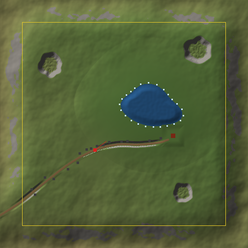

# Build plan: a small, realistic open world in Unreal Engine 5

From a blank project to walking around a finished-looking 500 × 500 m valley: rolling hills, a calm lake, a dirt road, a cabin, a fence line, roadside boulders, forest and meadow placed by PCG, distant mountains, and a fixed late-afternoon sun with Lumen, Nanite and virtual shadow maps. The player is the First Person template character, spawning on the road and looking down at the lake.



*The generated layout, 1 pixel = 1 m. Lake top right of centre, road from the bottom-left corner to the cabin on the lake's south-east shore, spawn on the road with its view line pointing at the water. The yellow square is the invisible boundary; the raised rim outside it hides the landscape edge.*

## Before you start

### What this plan assumes

Your request left the engine version, skill level and GPU as placeholders, so the plan is written to cover all three cases:

| Topic | Assumption | If yours differs |
|---|---|---|
| Engine | **UE 5.6, 5.7 or 5.8.** Every step uses features present in 5.6 that still exist in 5.8; differences are marked 🔁. | Installing fresh? Pick **5.8**: PCG is on by default and Medium GI gives you Lumen Lite, a much cheaper fallback for weaker GPUs. |
| Skill | Beginner to intermediate: you can move around the viewport, select actors and edit the Details panel. No C++. | Experienced users can skim the click-by-click parts; the scripts and numbers are the same. |
| PC | Windows 10/11, DirectX 12 GPU with Shader Model 6, **8 GB VRAM (RTX 3060 / RX 6600 class)**, 32 GB RAM, 100 GB free on an SSD (engine plus project). | Weaker GPU: every ⚡ flag names the setting to lower first. Stronger GPU: Phase 9B raises quality. |
| Assets | Free only: Fab (filter **Price: Free**), Epic's free samples, Engine content. Megascans stopped being free in general on 31 Dec 2024; about 1,500 remain free. | Paid assets drop straight into the same `ow_config.py` slots. |
| Goal | A tech demo you can walk around: no enemies, objectives or menus. Target 60 fps at 1080p–1440p with TSR. | |

Total time: roughly **10–16 hours** spread over the nine phases, most of it in asset downloads (1), materials (3), vegetation (6) and polish (9).

### How to read the flags

> ⚡ **Performance:** this step costs frame time or memory. **Lower first:** names the single setting to turn down if you are GPU-bound.

> 🔁 **Version:** something differs between 5.6, 5.7 and 5.8.

> ❓ **Not verified:** a label, default or behaviour that could not be confirmed for every version. The step tells you how to check it yourself.

### How the scripts work

The folder `ue5-open-world/` holds everything. In Phase 1 you copy it into your project as `<Project>/OpenWorldTools/`:

```
OpenWorldTools/
  BUILD_PLAN.md            this plan
  docs/layout_preview.png  the map above
  tools/generate_heightmap.py   terrain, weightmaps, layout (plain Python, no packages)
  scripts/ow_config.py     every shared setting: names, paths, layout, asset slots
  scripts/ow_common.py     helpers the other scripts import (never run it directly)
  scripts/p1_..p9_*.py     one or two scripts per phase
```

- **Run a script** with **Tools → Execute Python Script…** and pick the file, or type `py "C:/…/OpenWorldTools/scripts/<file>.py"` in the Output Log command box (Cmd mode). Step 1.5 walks through it once.
- **Edit `ow_config.py`, never the scripts**, except for the `TUNABLES` block at the top of a script (values with units, explained in the matching step).
- **Re-running is safe.** Each script tags what it spawns and deletes its own previous actors first. Most scene changes are one Ctrl+Z step.
- **Positions come from the layout.** `generate_heightmap.py` writes `OW_Layout.json` next to the terrain files; every Unreal-side script reads it and converts layout metres to world space from wherever your landscape actually sits.
- Scripts print to the Output Log with an `[OW]` prefix. Read the last lines after each run: they say what was created and what, if anything, to do by hand.

### What was checked, and what was not

- **Python:** every `unreal.*` class, method, property and enum used by the scripts was checked against the UE 5.6 Python API and against the 5.6.1 PCG and Water plugin source. Each script was then run end to end against a simulated editor (a landscape built from the generated heightmap, actor spawning, ground traces), including PCG pin labels taken from the engine source. 5.7 and 5.8 are assumed to match 5.6 unless a 🔁 flag says otherwise. The PCG authoring calls were also confirmed in 5.8.2 source.
- **Not run inside a real editor.** Expect the odd label that moved. Where a script cannot do something, it logs the exact manual step instead of failing.
- **Menus and values** come from Epic's documentation, engine source, template config files and community reports. Anything that could not be confirmed carries ❓.

### Phase overview

| Phase | You get | Time | Scripts |
|---|---|---|---|
| 1. Project setup | project, plugins, settings, level, assets | 1.5–3 h | `p1_check_project.py`, `p1_configure_assets.py` |
| 2. Landscape | 504 m terrain with lake basin, road, rim | 30–60 min | `tools/generate_heightmap.py`, `p2_verify_landscape.py` |
| 3. Materials | auto-blending grass/dirt/rock landscape material | 1–2 h | `p3_landscape_material.py` |
| 4. Lighting & sky | late-afternoon sun, sky, clouds, fog, exposure | 30–45 min | `p4_lighting.py` |
| 5. Water | calm lake | 30–45 min | `p5_water.py` |
| 6. Vegetation (PCG) | trees, bushes, grass, flowers, scatter, reeds | 1.5–3 h | `p6_pcg_vegetation.py` |
| 7. Props & road | cabin, fence, boulders, distant mountains | 45–90 min | `p7_props.py` |
| 8. Player | spawn, sprint, walls, ground check | 45–60 min | `p8_player_setup.py`, `p8_ground_check.py` |
| 9. Polish & performance | 9A performance pass, then 9B "it looks real now" | 2–4 h | `p9_quality.py` |

Work through the phases in order: later scripts depend on earlier results (the lake needs the landscape, vegetation avoids the lake and props, the ground check needs everything placed). The "it looks real now" polish is deliberately last, in Phase 9B.

## Phase 1 – Project setup

Goal: a First Person Blueprint project called `OpenWorldDemo` with the Water and PCG plugins on, rendering settings checked (Lumen, Virtual Shadow Maps, TSR, extended auto-exposure range), the build-plan scripts installed and tested, an empty non-World-Partition level `/Game/OpenWorld/Maps/L_OpenWorld`, and free Fab assets downloaded, listed in `ow_config.ASSETS` and configured (Nanite, collision, texture size). Phase 1 is done when `scripts/p1_check_project.py` prints no FIX lines.

Estimated time: about 2.5 hours of hands-on work, plus downloads (engine about 40–60 GB, assets 2–15 GB, optional Electric Dreams sample 44 GB) and 15–60 minutes of first-time shader compiling (estimate; depends on CPU).

### 1.1 Install the engine

1. Update the GPU driver first: NVIDIA App (or GeForce Experience) → **Drivers**, or the AMD Software: Adrenalin Edition. The project renders with DirectX 12 and Shader Model 6, which every RTX 20xx/30xx/40xx and RX 6000+ card supports.
2. Open the **Epic Games Launcher → Unreal Engine → Library**. Next to **Engine Versions**, click **+**, pick the newest 5.x in the version dropdown (5.8 at the time of writing), then **Install**.
3. In the install dialog, choose a folder on an SSD and open **Options**:
   - `Templates and Feature Packs` = **on** (the First Person template comes from here).
   - `Starter Content` = **off** (not used).
   - `Editor symbols for debugging` = **off** (very large, only needed for C++ crash debugging).
   - Target platforms (Android, iOS, Linux …) = **off** unless you need them.
4. Plan the disk: engine about 40–60 GB, project 5–15 GB (Medium-tier assets), derived-data cache several GB outside the project, plus 44 GB if you also install the Electric Dreams sample (1.7). Keep at least 150 GB free on the SSD.
5. You do not need Visual Studio (Blueprint project) or a separate Python install: the editor embeds Python (3.11.8 in 5.6).

Which version: use the newest you have, as long as it is 5.6, 5.7 or 5.8. If you are starting from nothing, install 5.8: PCG is enabled by default, and its Medium Global Illumination scalability keeps a lighter Lumen ("Lumen Lite") for weaker GPUs. Stay on one version for the whole plan; upgrading a project mid-build keeps old settings (for example Substrate stays off) and can break a step.

> 🔁 **Version:** 5.8 enables the PCG plugin by default and makes Medium GI scalability use Lumen Lite (Beta). 5.7 and 5.8 turn Substrate materials on in new projects; 5.6 leaves it off. Embedded Python is 3.11.8 in 5.6; 5.7 and 5.8 are believed to be 3.11.x.

> ❓ **Not verified:** the engine install size (40–60 GB is an estimate; the Launcher shows the exact figure in the install dialog) and the Python version in 5.7/5.8 (`p1_check_project.py` prints it in 1.5).

### 1.2 Create the project

1. In the Launcher click **Launch** on the installed version. The **Unreal Project Browser** opens.
2. Choose **Games → First Person**. In the **Variant** dropdown pick **None** (the plain template).
   - Do not pick **Arena Shooter** (AI enemies, weapons, HUD) or **Survival Horror** (dark map, flashlight, stamina UI). Phase 8 adds a simple sprint by hand.
3. **Project Defaults**:
   - **Blueprint** (not C++).
   - `Target Platform` = **Desktop**.
   - `Quality Preset` = **Maximum**.
   - `Starter Content` = **off**.
   - `Project Location` = a folder on the SSD; `Project Name` = **OpenWorldDemo** (no spaces).
4. Click **Create**. The first opening compiles shaders (bottom-right counter); wait until it finishes before judging performance.

There is no ray tracing checkbox: since 5.5 new projects have `Support Hardware Ray Tracing` on by default. Whether Lumen uses it is decided in 1.4. The template sets `Default GameMode` to `BP_FirstPersonGameMode` (Phase 8 relies on this).

> ⚡ **Performance:** `Quality Preset` = Maximum enables Lumen global illumination and reflections, Virtual Shadow Maps and hardware ray tracing support: the right look, and the most expensive defaults. **Lower first:** `sg.GlobalIlluminationQuality` → **2** (High) through the scalability menu (1.9), not by switching to the Scalable preset.

> 🔁 **Version:** Variants (Arena Shooter, Survival Horror) exist from 5.6. The template's default map is `Lvl_FirstPerson` and its game mode `BP_FirstPersonGameMode` (seen in 5.6 and 5.7 project files; 5.8 assumed the same). The ray tracing checkbox disappeared in 5.5, so older tutorials that say "tick Raytracing" are out of date.

> ❓ **Not verified:** the exact label of the plain variant ("None") and whether the Blueprint First Person template shows the Variant dropdown in every version. If there is no dropdown, the plain template is what you get. Template asset names are checked by search in Phase 8, not assumed here.

### 1.3 Enable the plugins and restart

**Edit → Plugins**, type each name in the search box, tick the box, accept the "experimental" warning with **Yes** where it appears, and click **Restart Now** once at the end.

| Plugin (exact name) | 5.6 / 5.7 | 5.8 | Why |
|---|---|---|---|
| `Procedural Content Generation Framework (PCG)` | tick it | already on: check it | vegetation (Phase 6) |
| `Water` (Experimental) | tick it | tick it | lake (Phase 5) |
| `Python Editor Script Plugin` | make sure it is ticked | same | runs every script |
| `Editor Scripting Utilities` | make sure it is ticked | same | the scripts use its `EditorAssetLibrary`; PCG depends on it |
| `Fab` | on by default: check it | same | asset downloads (1.7) |

Leave these **off**: `Water Extras` (sample content only), `Procedural Content Generation Framework (PCG) Water Interop` (Phase 6 reads the lake spline with a plain Get Spline Data node), PCG Geometry Script Interop, PCG Biome Core / Biome Sample, Procedural Vegetation Editor (5.7+), and the MegaLights, Nanite Foliage and Mesh Terrain features. Each is experimental or unnecessary here and adds failure modes.

After the restart, the editor may compile shaders again.

> 🔁 **Version:** PCG is Beta in 5.6, Production in 5.7, and enabled by default in 5.8. Water is Experimental in all three versions. Procedural Vegetation Editor exists only from 5.7.

> ❓ **Not verified:** whether `Python Editor Script Plugin`, `Editor Scripting Utilities` and `Water` start ticked in a new project. `p1_check_project.py` (1.5) reports each one as PASS or FIX, so you do not need to know in advance.

### 1.4 Check the rendering project settings

Open **Edit → Project Settings → Engine → Rendering**. A new 5.6–5.8 Games project already has the right values; this step is a check. Use the search box at the top of Project Settings when a section header differs from the table.

| Section → setting | Value | New-project default | Console variable / ini key |
|---|---|---|---|
| Global Illumination → `Dynamic Global Illumination Method` | **Lumen** | Lumen | `r.DynamicGlobalIlluminationMethod` = 1 |
| Reflections → `Reflection Method` | **Lumen** | Lumen | `r.ReflectionMethod` = 1 |
| Lumen → `Use Hardware Ray Tracing when available` | **on** for RTX 20xx+ / RX 6000+; **off** for older GPUs | on | `r.Lumen.HardwareRayTracing` |
| Lumen → `Software Ray Tracing Mode` | leave as created | Detail or Global, by template | `r.Lumen.TraceMeshSDFs` |
| Software Ray Tracing → `Generate Mesh Distance Fields` | **on** (restart) | on | `r.GenerateMeshDistanceFields` |
| Hardware Ray Tracing → `Support Hardware Ray Tracing` | **on** (restart) | on | `r.RayTracing` |
| Direct Lighting → `Shadow Map Method` | **Virtual Shadow Maps** | Virtual Shadow Maps | `r.Shadow.Virtual.Enable` = 1 |
| Misc Lighting → `Allow Static Lighting` | **off** (restart) | off | `r.AllowStaticLighting` |
| Default Settings → `Anti-Aliasing Method` | **Temporal Super-Resolution (TSR)** | TSR | `r.AntiAliasingMethod` = 4 |
| Default Settings → `Auto Exposure` | **on** | on | `r.DefaultFeature.AutoExposure` |
| Default Settings → `Extend default luminance range in Auto Exposure settings` | **on** | on | `r.DefaultFeature.AutoExposure.ExtendDefaultLuminanceRange` |
| Nanite → `Nanite` | **on** (restart) | on | `r.Nanite.ProjectEnabled` |
| Optimizations → `Support Sky Atmosphere` | **on** (restart) | on | `r.SupportSkyAtmosphere` |
| Optimizations → `Support Sky Atmosphere Affecting Height Fog` | **on** (restart) | on | `r.SupportSkyAtmosphereAffectsHeightFog` |
| Substrate → `Substrate materials` (5.6 label: `Substrate materials (Beta)`) | **leave as created** | 5.6 off, 5.7/5.8 on | `r.Substrate` |
| MegaLights, `Nanite Foliage (Experimental)` (5.7+) | **off** | off | — |

Why three of them matter later:
- `Extend default luminance range…` makes the Post Process exposure fields EV100. Phase 4's 120,000 lux sun renders pure white without it.
- `Support Sky Atmosphere Affecting Height Fog`: Phase 4 sets the fog colours to black and lets the atmosphere colour the fog; with this off the fog turns dark grey.
- `Allow Static Lighting` off means every light is Movable, which Lumen needs.

Hardware ray tracing: switch it with `Use Hardware Ray Tracing when available`, which takes effect immediately. Do not untick `Support Hardware Ray Tracing`: that needs a restart and a full shader recompile. Never toggle `Substrate materials` mid-project for the same reason.

Equivalent `Config/DefaultEngine.ini` lines, for checking or restoring. **Close the editor before editing the file**; the editor rewrites it when settings change. Keep any other lines the template wrote.

```ini
[/Script/Engine.RendererSettings]
; Written by new 5.6-5.8 Games templates:
r.AllowStaticLighting=False
r.GenerateMeshDistanceFields=True
r.DynamicGlobalIlluminationMethod=1
r.ReflectionMethod=1
r.RayTracing=True
r.Shadow.Virtual.Enable=1
r.DefaultFeature.AutoExposure.ExtendDefaultLuminanceRange=True
; 5.7 / 5.8 projects only (Substrate on). A 5.6 project has neither line: do not add them.
r.Substrate=True
r.Substrate.ProjectGBufferFormat=0
; Engine defaults, normally absent. Add a line only to override a wrong value.
r.AntiAliasingMethod=4
r.Nanite.ProjectEnabled=True
r.DefaultFeature.AutoExposure=True
r.SupportSkyAtmosphere=True
r.SupportSkyAtmosphereAffectsHeightFog=True
; Use False on a GPU without hardware ray tracing:
r.Lumen.HardwareRayTracing=True
```

> ⚡ **Performance:** Lumen GI and reflections cost several milliseconds per frame on a mid-range GPU, the biggest single cost in this plan; Virtual Shadow Maps get expensive with wind-animated foliage; hardware ray tracing adds scene-update cost above about 100,000 instances. **Lower first:** `sg.GlobalIlluminationQuality` → **2** (High). Then `r.Lumen.HardwareRayTracing` → **0** (software ray tracing fallback).

> 🔁 **Version:** 5.6 projects have no Substrate lines; 5.7/5.8 projects have `r.Substrate=True`. Lumen's software `Detail Tracing` mode is deprecated from 5.6 (still selectable); some 5.8 Blueprint templates write `r.Lumen.TraceMeshSDFs=0` (Global Tracing). The Lumen Lite mode in 5.8 has no checkbox: it is the Medium Global Illumination scalability level (1.9).

> ❓ **Not verified:** section headers, labels and defaults were read from the 5.6.1 engine source (`RendererSettings.h`; `r.Lumen.HardwareRayTracing`, `r.SupportSkyAtmosphere` and `r.SupportSkyAtmosphereAffectsHeightFog` all default to 1), not from a running 5.7/5.8 editor. If a header differs, type the setting label into the Project Settings search box. `p1_check_project.py` (1.5) reads every console variable in this table and flags wrong values.

### 1.5 Install the scripts and run the project check

1. Copy the repository folder `games/ue5-open-world` into the project folder, next to `OpenWorldDemo.uproject`, and rename the copy `OpenWorldTools`. You get:
   - `OpenWorldDemo/OpenWorldTools/scripts/` — `ow_config.py`, `ow_common.py` and the `pN_*.py` scripts
   - `OpenWorldDemo/OpenWorldTools/tools/generate_heightmap.py`
   Do not put it inside `Content`; the editor does not need it there.
2. **How to run a script** (every phase uses this):
   - **Tools → Execute Python Script…**, then pick the `.py` file. **Tools → Recent Python Scripts** re-runs one.
   - Or open **Window → Output Log**, set the dropdown left of the command box to **Cmd**, and type the full path with forward slashes and quotes, e.g.
     `py "C:/Users/<you>/Documents/Unreal Projects/OpenWorldDemo/OpenWorldTools/scripts/p1_check_project.py"`
     then press Enter. The Up arrow recalls the last command.
   - Output goes to the Output Log. Script lines start with `[OW]`; warnings are yellow. Type `[OW]` into the Output Log search box to see only them.
   - Later phases just say "Run `scripts/pN_x.py` (see 1.5)".
3. **Editing settings:** open `OpenWorldTools/scripts/ow_config.py` in any text editor, save, and run the next script. No restart is needed: every script reloads `ow_config.py`.
4. Run `scripts/p1_check_project.py`. It changes nothing except creating the empty Content Browser folders `/Game/OpenWorld/Maps`, `/Materials`, `/Landscape/Layers`, `/PCG`, `/Blueprints` and `/Water`. It prints one table:

   | Status | Meaning |
   |---|---|
   | PASS | correct |
   | FIX | wrong; the line under it (`->`) gives the exact menu path |
   | WARN | check by hand (could not be read, or not critical) |
   | INFO | nothing to do now |

   At this point expect PASS for the engine, plugins and rendering rows, INFO for the level (1.6 is next) and INFO "empty" for every `ASSETS` slot. Fix every FIX line, restart if the fix says so, and run it again. The script is safe to run any number of times; run it again after 1.6, 1.7 and 1.9.

If most rendering rows read `= 0 (or not found)`, your engine returned the console variables only as numbers: check those settings by hand against the table in 1.4.

> ❓ **Not verified:** the menu location **Tools → Execute Python Script…** (Epic's own page still says **File**; look under **Tools** first, then **File**), the **Tools → Recent Python Scripts** entry, and whether `get_console_variable_string_value` returns text for number console variables in every version (the script falls back to the number getters and says so).

### 1.6 Create the level L_OpenWorld

1. **File → New Level…** (Ctrl+N) → **Basic** → **Create**. Basic is a non-World-Partition level with a floor, sun, sky and fog, so the viewport is lit while you sculpt.
2. In the **Outliner**, select `Floor` and press **Delete**. The landscape (Phase 2) replaces it, and the floor would intersect it.
3. Keep the other actors (directional light, Sky Atmosphere, Sky Light, Exponential Height Fog, Volumetric Cloud). Phase 4's script finds and configures them instead of spawning duplicates. If there is a Player Start, leave it: Phase 8 replaces it.
4. **File → Save Current Level As…**, open `Content/OpenWorld/Maps` (created in 1.5), `Name` = **L_OpenWorld**, **Save**. The asset path is `/Game/OpenWorld/Maps/L_OpenWorld`.
5. **Edit → Project Settings → Project → Maps & Modes**:
   - Default Maps → `Editor Startup Map` = **L_OpenWorld**, `Game Default Map` = **L_OpenWorld**.
   - Default Modes → `Default GameMode`: leave **BP_FirstPersonGameMode** (set by the template).
6. Run `scripts/p1_check_project.py` again (see 1.5). The Level rows must read PASS: open level, World Partition off, no Floor, both default maps.

Why not World Partition: at 504 m it only adds landscape streaming proxies, editor regions to load, and runtime streaming that would unload the mountain ring at 420–650 m. Do not use **Open World** or **Empty Open World**, and do not convert the template's map; if a check says World Partition is on, create the level again with **File → New Level → Basic**.

> ⚡ **Performance:** the Basic level's Sky Atmosphere, Volumetric Cloud and Exponential Height Fog render every frame (Phase 4 tunes them). **Lower first:** `sg.EffectsQuality` → **2** (High).

> 🔁 **Version:** same steps in 5.6, 5.7 and 5.8. Forum reports describe a heightmap-import bug in World Partition levels in 5.7.0–5.8.0 (one tile repeated 16 × 16), another reason for the Basic level.

> ❓ **Not verified:** the exact actor list and labels of the Basic template (the light may be labelled `Light Source` or `DirectionalLight`; a Player Start may or may not be included). Phases 4 and 8 work either way. `p1_check_project.py` lists the counts it found.

### 1.7 Download free assets from Fab

Since 1 January 2025 most Megascans are paid; Fab keeps a free selection of 1,500+ Megascans, and every Megascans plant called "Megaplants" is free. **Always set the Fab filter `Price` = Free**, and treat every asset named below as replaceable by any similar free one. Free Fab content comes under the Fab Standard License (personal and commercial use, no redistribution of the files). Epic samples such as Electric Dreams and legacy Quixel claims come under the Epic Content License (use in Unreal Engine projects only).

**How to add an asset**
1. Open Fab inside the editor: **Window → Fab** (in some versions **Window → Get Content → Fab**, or the **Fab** button in the Content Browser toolbar). Sign in with your Epic account.
2. Filters: `Price` = **Free**; for Megascans also the seller **Quixel**; format **Unreal Engine** where offered.
3. Open the listing, confirm it shows **Free**, pick the quality, click **Add to Project**:
   - **Medium** (2K textures) for almost everything.
   - **Low** (1K) is enough for small scatter (pebbles, twigs).
   - **High** (4K) only for the cabin, and only if it looks soft up close.
   - Never **Raw** (8K).
4. Packs in Unreal format (the Megascans Trees packs) may only offer **Add to My Library** on fab.com. Then: **Epic Games Launcher → Unreal Engine → Fab Library** → the pack → **Add to Project** → OpenWorldDemo.

**Where they land** (Content Browser shows `Content/…`, references read `/Game/…`):
- Megascans 3D: `/Game/Fab/Megascans/3D/<Name>_<id>/Medium/<id>_tier_2/StaticMeshes/<id>_tier_2` (newer) or `/Game/Fab/Megascans/3D/<Name>_<id>/Medium/…` (older layout).
- Megascans plants: `/Game/Fab/Megascans/Plants/<Name>_<id>/<Tier>/<id>_tier_N/StaticMeshes/SM_<id>_VarA` (variants VarA, VarB …).
- Megascans surfaces: `/Game/Fab/Megascans/Surfaces/<Name>_<id>/Medium/<id>_tier_2/Textures/T_<id>_2K_B`, `_N`, `_ORM`.
- Unreal-format packs: `/Game/<PackName>/…`, e.g. `/Game/EuropeanHornbeam/Geometry/SimpleWind/SM_EuropeanHornbeam_Forest_01`.
- Shared Fab materials, installed once: `/Game/Fab/Materials/…` (e.g. `M_MS_Base`).

**Shopping list** (one row per `ow_config.ASSETS` slot, plus four surfaces for Phase 3). "Free?" says what research could confirm. Empty slots are fine: placeholders or skipped layers keep every script working.

| Slot (count) | First choice | Fab search (with `Price` = Free) and what to pick | Free? | Fallback |
|---|---|---|---|---|
| `trees` (3–6) | **European Hornbeam** (Megascans Trees pack): use the **SimpleWind** meshes `SM_EuropeanHornbeam_Forest_01…10` and `_Field_01…04` from `Geometry/SimpleWind/`, not the `_PP` Pivot Painter copies | `European Hornbeam`, `European Black Alder`, `European Beech`, `Norway Maple` (Megascans Trees packs, 15–27 trees each); 2–3 Forest + 1–2 Field meshes | listings showed Free in search results; confirm the price | Electric Dreams has the same Hornbeam set; else the cone placeholder |
| `bushes` (2–4) | Hornbeam `SM_EuropeanHornbeam_Sapling_*` / `_Seedling_*` from the same pack | `Common Hazel` (pack), `bush`, `shrub`, `fern` | Hazel: listed Free | Electric Dreams `Elderberry`, `Fern`; else the sphere placeholder |
| `grass` (2–5) | a Megascans 3D **plant** grass clump, 2–3 variants | `wild grass`, `meadow grass`, `grass` (seller Quixel; pick plants, not surfaces) | not confirmed for any named grass | Electric Dreams `KikuyuGrass`, `CloverVarieties`; else leave empty (Phase 6 skips grass) |
| `flowers` (0–4) | small wildflower plants | `wildflower`, `daisy`, `dandelion`, `clover` | not confirmed | Electric Dreams `WhiteWindflower`, `YellowArchangel`, `Periwinkle`; else empty |
| `scatter` (2–6) | pebbles, twigs, dead leaves (Low tier) | `pebbles`, `small stones`, `twigs`, `branch`, `pine cone`, `forest debris` | not confirmed | Electric Dreams `DeadLeaves`, `SmallStonesPack`, `DryBranches`; else empty |
| `shore_scatter` (1–4) | reeds | `reed`, `cattail`, `bulrush`, `common reed` | no free static reed confirmed | shore pebbles / beach rocks (Electric Dreams `NordicBeachRock`); else empty |
| `boulders` (3–6) | 1–3 m mossy rock scans | `boulder`, `mossy rock`, `granite rock` (seller Quixel, 3D) | not confirmed | Electric Dreams `MossyForestBoulder`, `MossyRocks`, `ForestRockFormation`; else the sphere placeholder |
| `cabin` (1) | any free realistic cabin | `wooden cabin`, `log cabin`, `forest hut`, `wooden shed` (format Unreal Engine, or FBX/glTF) | none confirmed | leave `""`: a cube placeholder stands on the cabin pad |
| `fence` (1) | one wooden fence segment, modelled along +X | `wooden fence`, `log fence`, `rail fence` | none confirmed | leave `""`: cube placeholders |
| `mountains` (3–6) | the largest cliff / rock-formation scans | `cliff`, `rock formation`, `gigantic terrain`, `massive cliff` (seller Quixel, 3D) | not confirmed | Electric Dreams `HugeSandstoneCliff`, `ForestRockFormation`, `IcelandicQuarryRock`; else cones, or Phase 7's backdrop landscape (needs no assets) |
| surface: grass (Phase 3) | Megascans surface, Medium | `wild grass`, `mossy grass` (category Surfaces) | not confirmed | Electric Dreams `MossyGrass` |
| surface: forest/dirt ground | Megascans surface | `forest floor`, `soil ground`, `dirt ground` | not confirmed | Electric Dreams `DriedGrassOnDampSoil`, `NordicMoss` |
| surface: rock | Megascans surface | `rocky steppe`, `rock`, `cliff` (Surfaces) | not confirmed | Electric Dreams `MossyRockyGround` |
| surface: gravel / dirt road | Megascans surface | `gravel`, `arid gravel`, `dirt road` | not confirmed | any dirt surface, tinted darker in Phase 3 |

Surfaces ship three textures per set: `T_<id>_2K_B` (albedo), `_N` (normal) and `_ORM` (R = ambient occlusion, G = roughness, B = metallic). Electric Dreams surfaces use `_BC`, `_N` and `_AoRDp` (B = displacement) instead. Phase 3.1 asks for these texture paths; you do not put them in `ASSETS`.

There is no verified free conifer that works on 5.6. Conifers (Norway Spruce, Baltic Pine and others) exist as free **Megaplants**, but those need 5.7+, the experimental Procedural Vegetation Editor plugin and Nanite Foliage, and they import as skeletal meshes that PCG's Static Mesh Spawner cannot use. This plan does not use them; `p1_check_project.py` flags a skeletal mesh in a vegetation slot.

**Fallback that covers most slots: the Electric Dreams sample** (free Epic sample on Fab, `Electric Dreams Environment`, about 44 GB). It cannot be added to an existing project:
1. Add it to your library, then **Epic Games Launcher → Unreal Engine → Fab Library → Electric Dreams Environment → Create Project** (it appears only when a compatible engine is installed).
2. Open that project, right-click each folder you want in the Content Browser (e.g. `Content/Megascans/3D_Assets/MossyForestBoulder`) → **Migrate…** → choose `OpenWorldDemo/Content`. Paths stay the same, e.g. `/Game/Megascans/3D_Plants/EuropeanHornbeam/Geometry/SimpleWind/…`.
3. Migrate only what you use: the cliffs carry 8K textures and take 0.3–1.9 GB each on disk. Its rocks arrive without collision; 1.8 adds it.

**Put the paths into `ow_config.ASSETS`**
1. In the Content Browser, open the asset's folder and filter to meshes (**Filters → Static Mesh**). For Megascans open `…/StaticMeshes/` (newer layout) or the tier folder.
2. Right-click the mesh → **Copy Reference**. The clipboard holds e.g. `/Script/Engine.StaticMesh'/Game/Fab/Megascans/3D/Mossy_Rock_abc123/Medium/abc123_tier_2/StaticMeshes/abc123_tier_2.abc123_tier_2'`.
3. In `ow_config.py`, paste **only the part between the single quotes** into the right slot. Lists take several meshes; `cabin` and `fence` take one string:

```python
ASSETS = {
    "trees": [
        "/Game/EuropeanHornbeam/Geometry/SimpleWind/SM_EuropeanHornbeam_Forest_01",
        "/Game/EuropeanHornbeam/Geometry/SimpleWind/SM_EuropeanHornbeam_Forest_04",
        "/Game/EuropeanHornbeam/Geometry/SimpleWind/SM_EuropeanHornbeam_Field_02",
    ],
    "bushes": ["/Game/EuropeanHornbeam/Geometry/SimpleWind/SM_EuropeanHornbeam_Sapling_03"],
    "grass": [],          # empty = Phase 6 skips grass
    "flowers": [],
    "scatter": [],
    "shore_scatter": [],
    "boulders": ["/Game/Fab/Megascans/3D/Mossy_Rock_abc123/Medium/abc123_tier_2/StaticMeshes/abc123_tier_2"],
    "cabin": "",          # empty = cube placeholder
    "fence": "",
    "mountains": [],
}
```
(The Hornbeam names are the real names in that pack; `abc123` stands for the random Megascans id.)

4. Save and run `scripts/p1_check_project.py` (see 1.5). Every filled entry must read PASS. "pasted with the class prefix" means you kept the `/Script/Engine.StaticMesh'…'` wrapper; "not found" means a typo or a deleted asset.

> ⚡ **Performance:** texture memory grows about 4× per quality step. One Megascans 3D asset at Medium (2K) needs about 11 MB of GPU memory fully loaded, at High (4K) about 43 MB. The whole asset set is about 0.5 GB at 2K but about 2 GB at 4K, which triggers "texture streaming pool over budget" on an 8 GB GPU next to Lumen and Virtual Shadow Maps. **Lower first:** download **Medium**, and keep `TEXTURE_MAX_SIZE` = **2048** in `p1_configure_assets.py` (1.8).

> 🔁 **Version:** Megaplants need 5.7+ (not used here). A 5.8 build of Electric Dreams has been seen in use; 5.6/5.7 builds are likely but were not confirmed. One 5.8 user reported Electric Dreams' foliage master material failing when packaging a build; the editor is unaffected.

> ❓ **Not verified:** which named Megascans are free today (only the 1,500+ count and Megaplants are confirmed; the Megascans Trees packs showed "Free" in search results); the Fab window's menu location, filter labels, quality names and the **Add to Project** / **Add to My Library** labels; the exact Fab listing titles (search the species names); whether Fab imports come with Nanite and collision (1.8 sets both either way). If a listing is not free, pick the next result or use the fallback column.

### 1.8 Configure the downloaded meshes

Run `scripts/p1_configure_assets.py` (see 1.5) after `ASSETS` is filled. It changes only assets under `/Game` (never Engine content) and saves them. Enabling Nanite on large scans rebuilds them: expect several minutes, a progress bar (with **Cancel**) and high editor memory use. Set `DRY_RUN = True` in its TUNABLES to see the plan without changing anything.

What it does per slot (defaults in its TUNABLES block):

| Slot | Nanite | Collision | Why |
|---|---|---|---|
| `trees` | on + Preserve Area | keeps existing simple collision; if none, adds a capsule on the trunk: radius 2 % of tree height (12–45 cm), height 60 % of the tree. Trees shorter than 4 m get none | you bump into trunks but walk under branches; Megascans tree packs usually ship a trunk capsule already |
| `bushes` | on + Preserve Area | removes simple collision | walk-through; PCG places hundreds |
| `grass`, `flowers`, `shore_scatter` | only if every material is opaque (+ Preserve Area); else as imported | removes simple collision | masked Nanite foliage is the costly Nanite path; thousands of instances |
| `scatter` | only if every material is opaque; else as imported | removes simple collision | pebbles and twigs should not trip the player |
| `boulders` | on | `Collision Complexity` = **Use Complex Collision As Simple** | the player stands on the real rock surface, not a hull; fine for about 16 placed rocks |
| `cabin` | on | **Use Complex Collision As Simple** | walls and porch collide exactly. A Blueprint cabin is skipped: set its meshes by hand |
| `fence` | on | keeps existing simple collision; if none, adds a box | one solid barrier per segment |
| `mountains` | on | unchanged | they stand outside the invisible walls; scanned cliffs need Nanite at 18–34× scale |

A mesh used in two slots gets the stronger collision of the two. The script also:
- sets `Used with Instanced Static Meshes` on the base materials of PCG meshes and `Used with Nanite` on the base materials of Nanite meshes (shaders then recompile in the background);
- sets `Maximum Texture Size` = **2048** (px) on any texture of these meshes that is larger (legacy tree packs ship 4K–8K atlases);
- prints each mesh's size, triangle count and before → after values, and appends them to `Saved/OpenWorld/p1_configure_assets_log.txt`;
- measures the fence mesh. If it says `Set FENCE_SEGMENT_LENGTH_M = 3.10`, copy that value into `ow_config.py` (use the post-to-post distance if the mesh has a post at both ends). If it says the fence is longer along Y, pick another mesh or reimport it rotated 90°.

TUNABLES you may change: `DRY_RUN`, `ONLY_SLOTS` (e.g. `["boulders"]`), `NANITE` and `COLLISION` per slot, the `TRUNK_*` sizes, `TEXTURE_MAX_SIZE` (0 = leave textures alone) and `TEXTURE_MAX_SIZE_PER_SLOT` (e.g. `{"trees": 4096}` if leaves look blurry). The script is safe to re-run: finished meshes report "no change". Run it again whenever you add assets.

Check one tree by hand: double-click it, then in the Static Mesh Editor toolbar **Show → Simple Collision**: a thin capsule should sit on the trunk. If the tree leans and the capsule misses, **Collision → Remove Collision**, **Collision → Add Capsule Simplified Collision**, and move and scale the capsule onto the trunk in the viewport.

Manual equivalent per mesh (also the undo; the script has no Ctrl+Z because the assets are saved):
- Details → Nanite Settings → `Enable Nanite Support` = on, `Preserve Area` = on (5.8: `Shape Preservation` = **Preserve Area**) → **Apply Changes**.
- **Collision** menu → **Add Capsule / Box Simplified Collision** or **Remove Collision**; Details → Collision → `Collision Complexity` = **Use Complex Collision As Simple** or **Project Default**.
- Material: Details → Usage → `Used with Instanced Static Meshes` / `Used with Nanite`. Texture: Details → `Maximum Texture Size` (0 = no limit).

> ⚡ **Performance:** Nanite on masked foliage (tree and bush leaves) uses programmable rasterisation, the most expensive Nanite path; complex-as-simple collision costs memory per unique mesh (fine for a few boulders and one cabin, never use it for PCG-scattered meshes). **Lower first:** `r.Nanite.MaxPixelsPerEdge` → **2** (coarser Nanite detail).

> 🔁 **Version:** 5.6 calls the foliage option `Preserve Area` (`preserve_area`). 5.8 replaces it with `Shape Preservation` = Preserve Area / Voxelize (`shape_preservation`); the script detects which one exists. 5.7 was not checked.

> ❓ **Not verified:** that the trunk capsule edit (made through the mesh's Body Setup from Python) is kept after saving in every version — check one tree with **Show → Simple Collision**; the script removes the capsule again and tells you the manual step if its size did not stick. Also unverified: that complex collision of a Nanite mesh uses its fallback mesh (if feet float on a boulder, raise its Nanite `Fallback Triangle Percent`), and 5.7's Nanite field names. Every Python name was checked against the 5.6 API only.

### 1.9 Set the editor scalability for working

1. In the level viewport toolbar, open **Performance and Scalability** (speedometer icon) → **Viewport Scalability** → **Epic**. Older location: **Settings → Engine Scalability Settings** (top right of the level editor).
2. Keep **Epic** for Phases 2–5 (an almost empty world). From Phase 6 (vegetation), drop to **High** if the viewport stays below 30 fps.
3. Never judge lighting below **High** Global Illumination: on 5.6/5.7, Medium turns Lumen GI off (only distance-field ambient occlusion), so everything looks flat and dark. On 5.8, Medium gives Lumen Lite, which is fine for working but not for judging the final look.
4. Show the frame rate: type `stat fps` (or `stat unit` for a game/draw/GPU split) in the Output Log command box (Cmd) or the console (` key). Type the same command again to hide it.
5. Run `scripts/p1_check_project.py` again (see 1.5): the scalability rows show the current level of each group, and a WARN appears if Lumen GI is off.

FPS targets: the editor viewport should stay at 30 fps or more while you work. The finished demo targets 60 fps at 1080p (or 1440p with TSR upscaling) on an RTX 3060/3070, measured in Standalone in Phase 9.

> ⚡ **Performance:** Epic Global Illumination and Reflections cost roughly twice as much as High. **Lower first:** `sg.GlobalIlluminationQuality` → **2** (High); then `sg.ShadowQuality` → **2** (note: Medium shadows also turn volumetric fog off).

> 🔁 **Version:** 5.6 introduced the new viewport toolbar with the **Performance and Scalability** menu; older guides point to **Settings → Engine Scalability Settings**. 5.8's Medium GI = Lumen Lite (Beta); 5.6/5.7 Medium GI = no Lumen GI.

> ❓ **Not verified:** the exact labels of the 5.6+ scalability menu, whether it changes the editor-wide `sg.*` values or only the viewport (the check script reads the `sg.*` console variables), and whether a separate Landscape group appears in it.

## Phase 2 – Landscape

Goal: turn the layout in `ow_config.py` into terrain. You generate a 505 × 505 heightmap (504 m × 504 m at 1 m per vertex) with the lake basin, road, cabin pad and a raised rim already carved in. Then you import it as one Landscape actor centred on the world origin, confirm with a script that it sits exactly where every later script expects it, and set the actor's collision, LOD and Nanite options. The landscape stays untextured (grey grid) until Phase 3.

Estimated time: 30 min, plus 15–60 min if you do the optional sculpting in 2.5.

### 2.1 Generate the terrain files

1. Run `tools/generate_heightmap.py` (see 1.5). It is in the `tools` folder, not `scripts`: pick `<Project>/OpenWorldTools/tools/generate_heightmap.py` in **Tools → Execute Python Script…**, or type `py "C:/…/OpenWorldTools/tools/generate_heightmap.py"` in the Output Log (Cmd mode).
2. Wait for the last line, about 30–60 s (33 s in a test run). The editor does not respond until the script finishes, and there is no progress bar. Output Log:
   ```
   [OW] sculpting 505x505 terrain...
   [OW] cutting the road (399 m)...
   [OW] height range 4.3 m .. 71.0 m (water 10.0 m)
   [OW] wrote files to C:/…/OpenWorldDemo/Saved/OpenWorld
   ```
   Alternative without the editor (Windows Python 3.9+ from python.org, no extra packages): in a Command Prompt run
   `cd /d "<Project>\OpenWorldTools\tools"` then `py generate_heightmap.py "<Project>/Saved/OpenWorld"`.
   Always pass that folder. Without it the files go to `OpenWorldTools/output`, and the Unreal scripts will not find them unless you set `OUTPUT_DIR` in `ow_config.py` to that folder.
3. Check that `<Project>/Saved/OpenWorld/` now holds these files:

   | File | What it is | Used in |
   |---|---|---|
   | `OW_Height_505.png` | 16-bit grayscale heightmap | 2.2 |
   | `OW_Height_505.r16` | the same heights as 16-bit RAW (little-endian), fallback if the PNG is refused | 2.2 |
   | `OW_Weight_Auto_505.png`, `OW_Weight_Road_505.png` | 8-bit paint-layer weightmaps (they add up to 255 at every pixel) | 3.5 |
   | `OW_Backdrop_Height_505.png` | coarse mountain landscape (Option B) | 7.3 |
   | `OW_Preview.png` | colour map of the layout | now |
   | `OW_Layout.json` | positions and heights of the lake, road, cabin, spawn, fence, boulders, mountains, probes | every later script |

4. Open `OW_Preview.png` in any image viewer. 1 pixel = 1 m. +X points right and +Y points down, and the top-left pixel is the corner at X −252 m, Y −252 m. In the editor, if you look down on the landscape with the red (X) gizmo arrow pointing right, the green (Y) arrow points down the screen (Unreal is left-handed), so the view matches the preview.

   | You see | It is |
   |---|---|
   | green shaded relief, lighter = higher | meadow and hills |
   | grey patches | slopes steeper than 33°: the rim around the edge and three rock knolls (rock surface in Phase 3) |
   | blue | the lake, everything below the 10 m water level |
   | white dots around the lake | the 24 Water Body spline points (Phase 5), 2 m outside the shore |
   | brown band | the 4.2 m dirt road, from the left edge to the cabin |
   | dark red square at the road's end | the cabin pad (20 m × 20 m, flattened) |
   | red square with a red line | player spawn. The 30 m line is the view direction, toward the lake |
   | white dots along the road | fence segments, on the side away from the lake |
   | dark grey squares | the 16 roadside boulders |
   | thin yellow square | invisible boundary walls, 45 m inside the edge. Everything outside is the raised rim that hides the landscape edge |

   Check: the lake is up and right of the centre (layout X +55 m, Y −35 m), the road enters bottom-left, the spawn line points at the lake, and no boulder sits on the road.
5. To change the layout, edit `OpenWorldTools/scripts/ow_config.py` (section "World layout"). All values are in metres in layout coordinates (origin = landscape centre). Useful values:

   | Value | Default | Effect |
   |---|---|---|
   | `LAKE_CENTER_M`, `LAKE_RADII_M`, `LAKE_ROTATION_DEG` | (55, −35), (60, 40), 15 | lake position, size, rotation |
   | `WATER_LEVEL_M`, `LAKE_MAX_DEPTH_M` | 10.0, 5.5 | water surface height above the landscape Z; depth |
   | `ROAD_CONTROL_POINTS_M` | 9 points | road path; the last point should end in the cabin clearing |
   | `CABIN_CENTER_M`, `CABIN_PAD_HALF_M` | (100, 24), 10 | cabin pad |
   | `PLAYER_SPAWN_ROAD_FRACTION` | 0.62 | spawn position along the road (0 = start, 1 = end) |
   | `BASE_HEIGHT_M`, `HILL_AMPLITUDE_M`, `HILL_WAVELENGTH_M` | 22, 12, 170 | meadow height, hill height (±), hill size |
   | `EDGE_BERM_HEIGHT_M`, `EDGE_BERM_WIDTH_M` | 30, 75 | rim that hides the edge |
   | `PLAYABLE_INSET_M` | 45 | invisible walls this far inside the edge |
   | `SEED` | 1337 | different hills and boulder placement |

   The three rock knolls are the `ROCK_KNOLLS` list near the top of `tools/generate_heightmap.py`. Do not change the "Landscape geometry" block (`LANDSCAPE_RESOLUTION`, `LANDSCAPE_SCALE_*`, `LANDSCAPE_SECTION_QUADS`, …) unless you also change the matching fields in 2.2.
6. After any change, do all of the following in order: regenerate (this step) → check the preview → delete the Landscape actor and import again (2.2) → run 2.3 → re-run every later script you have already run (they read `OW_Layout.json`). Re-importing discards all sculpting and painting on the landscape. If Phase 3 is done, assign the material and re-import the weightmaps again (the Layer Info assets are reused).

> ❓ **Not verified:** re-importing into the existing actor with **Landscape Mode → Manage → Import**. This would keep the actor's material and settings, but its fields were not checked for 5.6–5.8. Deleting the actor and repeating 2.2 always works.

### 2.2 Import the heightmap as a landscape

1. Open `L_OpenWorld` (1.6). Make sure its `Floor` mesh is deleted and that there is no Landscape actor in the Outliner.
2. In the main toolbar, **Selection Mode → Landscape** (Shift+2). The Landscape panel opens on the **Manage** tab with the **New** tool active.
3. Click **Import from File**.
4. Fill in the fields from top to bottom:

   | Field | Value |
   |---|---|
   | `Heightmap File` | **`<Project>/Saved/OpenWorld/OW_Height_505.png`** (click **…** to browse). If the PNG is refused, pick `OW_Height_505.r16` instead |
   | `Flip Y Axis` | **off** |
   | `Heightmap Resolution` (read-only) | must read **505 x 505** |
   | `Material` | **leave empty**. Phase 3 builds and assigns `MI_OW_Landscape`, and the Layers list stays empty until then |
   | `Location` | **0, 0, 0** (cm; the default). The landscape is centred on this point |
   | `Rotation` | **0, 0, 0** (degrees) |
   | `Scale` | **100, 100, 100**. X/Y 100 = 1 m per quad; Z 100 = the height range the file was encoded for |
   | `Section Size` | **63x63 Quads** |
   | `Sections Per Component` | **2x2 Sections** |
   | `Number of Components` | **4**, **4** |
   | `Overall Resolution` | must read **505 x 505**, `Total Components` **16**. If it changed after you picked the file, re-enter the three values above (or click **Fit To Data** at the bottom, then check again) |
   | `Enable Edit Layers` (5.6 only) | **on** |

   Why Edit Layers: they are mandatory in 5.7/5.8, so keeping them on in 5.6 gives the same workflow on all three versions. They let you sculpt touch-ups on a separate layer that you can hide or delete (2.5). The Water plugin's landscape brush only works with them: Phase 5 turns the lake's landscape carving off because the basin is already in the heightmap, but with edit layers on you can switch it on later without converting the landscape. They cost editor memory only, nothing in the game.
   If you see a **World Partition Grid Size** field, you are in a World Partition level: stop and redo 1.6 with **File → New Level → Basic**.
5. Click **Import** at the bottom of the panel. After a few seconds an actor named `Landscape` appears in the Outliner. It shows a grey grid material and is about 504 m across, with a hollow for the lake on the +X/−Y side of the centre.
6. **File → Save Current Level** (Ctrl+S).
7. Go back to normal selection: **Selection Mode → Select** (Shift+1).

> 🔁 **Version:** 5.6 has the `Enable Edit Layers` checkbox (New panel and landscape Details). In 5.7 and 5.8 it was removed and edit layers are always on. The Landscape-mode labels above were checked against 5.6 documentation, and 5.7/5.8 may word some fields differently. Forum reports say heightmap import into a World Partition level duplicates one tile 16 × 16 in 5.7.0–5.8.0, which is one more reason for the Basic level.

> ❓ **Not verified:** the field labels, the default `Location` (0, 0, 0), the **Fit To Data** button and the centring were read from the 5.6.1 Landscape editor source, not seen in a running 5.7/5.8 editor. After the import the actor's Details show Location **−25200, −25200, 0**: the actor's pivot is the corner, and the editor offsets it by half the size from the `Location` you typed. Step 2.3 checks the real relationship.

> ⚡ **Performance:** 16 components, 255,025 vertices, about 2 MB of height and collision data (estimate). The GPU cost is low, and the Phase 3 material will cost more than the geometry. **Lower first:** `Other LODs` (`lod_distribution_setting`) → **2** (see 2.4).

### 2.3 Verify placement, orientation and height scale

1. Open **Window → Output Log**.
2. Run `scripts/p2_verify_landscape.py` (see 1.5). It is read-only: it changes nothing and saves nothing, so you can run it as often as you like.
3. Read the result. It traces the ground at the six probes in `OW_Layout.json` (`lake_centre`, `cabin_pad`, `player_spawn` and three `rock_knoll`) and compares each traced height with the height the generator wrote. A probe passes within **10 cm** (`HEIGHT_TOLERANCE_CM` in the script's TUNABLES). Example of a good result (Output Log lines start with `LogPython: [OW]`):
   ```
   RESULT PROBE               X m      Y m   expected Z     traced Z      diff
   PASS   lake_centre        55.0    -35.0          446          446      +0.1
   PASS   cabin_pad         100.0     24.0         1266         1266      -0.4
   PASS   player_spawn      -58.9     52.8         2980         2980      -0.2
   PASS   rock_knoll       -150.0   -120.0         4272         4273      +0.7
   ...
   PASS   Scale                      100.00, 100.00, 100.00
   PASS   Rotation                   roll 0.00, pitch 0.00, yaw 0.00
   PASS   Extent                     504.0 m x 504.0 m (want 504 m)
   PASS   Components                 16 components, 126 quads each
   PASS   Script frame               bounds centre matches ow_common's landscape frame (0 cm apart)
   PASS   Placement                  centred on X=0, Y=0; actor at (-25200, -25200, 0) cm
   ...
   RESULT: PASS (0 warnings) - the landscape matches OW_Layout.json. Continue with 2.4.
   ```
4. If the result is **FAIL**, apply the `FIX:` lines in the order they are printed, then run the script again. When heights do not match, the script re-samples the probes as if the terrain were mirrored in Y, mirrored in X, rotated 90°/180°, had X and Y swapped, had another Z scale or offset, or were shifted. It then names the explanation that fits:

   | Row | What a FAIL / WARN means | Fix |
   |---|---|---|
   | `Diagnosis: mirrored in Y (Flip Y Axis)` | `Flip Y Axis` was ticked | delete the Landscape, redo 2.2 with `Flip Y Axis` off |
   | `Diagnosis: mirrored in X / rotated / X and Y swapped` | the heightmap file itself is wrong (the panel can only flip Y) | regenerate (2.1) without editing the PNG, then redo 2.2 |
   | `Diagnosis: heights are N x …` / `offset by …` | the file was generated for another `LANDSCAPE_SCALE_Z`, or edited | regenerate (2.1), redo 2.2 with `Scale` Z = **100** |
   | `Diagnosis: no hypothesis fits` | you imported an old or different file, or changed `ow_config.py` without re-importing | regenerate (2.1) and redo 2.2 |
   | `Diagnosis: heights changed locally` (WARN) | one or two probes differ after sculpting (2.5) | undo the sculpt there. Knoll-only differences can be ignored |
   | `Scale`, `Rotation` | typed wrong in 2.2 | **Details → Transform**: `Scale` = **100, 100, 100**, `Rotation` = **0, 0, 0** |
   | `Extent`, `Components` | wrong Section Size / Sections / Components | redo 2.2 with 63x63, 2x2, 4 × 4 |
   | `Placement` (WARN) | not centred on X 0 / Y 0, or Z ≠ 0. Scripts still work | **Details → Transform**: `Location` = the values printed |
   | `Layout vs config` (WARN) | `ow_config.py` changed after the files were generated | regenerate (2.1) and redo 2.2 |
   | `Level type` | World Partition level | redo 1.6 with **File → New Level → Basic**, then 2.2 |
   | `Template floor` (WARN) | the Basic level's `Floor` is still there | delete it, Ctrl+S |
   | `Script frame` | the actor's location is not the landscape's corner in your engine version, so every later script would be off | apply the `ow_common.py` workaround printed in the FIX line |

Do not start Phase 3 until the result reads `RESULT: PASS`. Run the script again after 2.4, after sculpting (2.5) and after every re-import. It also reports the 2.4 settings (Nanite, collision mip levels, material, edit layers) as INFO/PASS rows.

### 2.4 Set the landscape actor's properties

Select the landscape: click `Landscape` in the Outliner. Every field below can be found by typing its name in the search box at the top of the Details panel.

1. **Label:** press F2 in the Outliner and rename it `OW_Landscape`. Scripts find the landscape by class and size, not by name. Do not give it the tag `OW_Managed`: scripts delete actors with that tag when they re-run.
2. **Collision** (**Details → Collision**): `Collision Mip Level` = **0**, `Simple Collision Mip Level` = **0** (both are the defaults). 0 = full 1 m resolution, which the player's footing and every ground trace in later scripts rely on.

   > ⚡ **Performance:** full-resolution collision for 255,025 samples is about 1 MB (estimate) with negligible CPU cost. **Lower first:** nothing here – keep `Collision Mip Level` → **0** (raising it makes props and the player float or sink).

3. **LOD** (**Details → LOD Distribution**): keep the defaults `LOD 0 Screen Size` = **0.5**, `LOD 0` = **1.25**, `Other LODs` = **3** and `Blend Range` = **0.1**. Leave **Details → LOD →** `Max LOD Level` = **−1**.

   > ⚡ **Performance:** the defaults keep full detail near the camera, and at 504 m the whole landscape is cheap. Without Nanite, LOD transitions invalidate cached Virtual Shadow Map pages on the terrain. **Lower first:** `Other LODs` (`lod_distribution_setting`) → **2**, then `LOD 0 Screen Size` (`lod0_screen_size`) → **0.75**.

4. **Nanite** (**Details → Nanite**): leave `Enable Nanite` = **off** for now. Optional, after Phase 3 painting is finished (Phase 9 is a good time):
   1. Tick `Enable Nanite`, then click **Build Data** in the same section. **Rebuild Data** forces a full rebuild.
   2. Look at the road edges and the lake shore up close. If the painted layers look shrunk toward one corner of each component, or the material turns black or grey, untick `Enable Nanite` and leave it off.
   3. After every later sculpt or paint session, click **Rebuild Data** again (saving the level also rebuilds it). Until then, a viewport message reports out-of-date Nanite data and the non-Nanite mesh is drawn.
   4. To compare, type `Landscape.RenderNanite 0` (and `1` to restore) in the console.

   > ⚡ **Performance:** Nanite keeps both Nanite and regular landscape data in memory (about 2× landscape memory, a few MB here), and a rebuild takes seconds at 16 components. In exchange, Virtual Shadow Maps cache the terrain's shadows better. **Lower first:** `Enable Nanite` → **off** (test first with `Landscape.RenderNanite 0`).

   > 🔁 **Version:** 5.8.0 has forum reports of painted weightmap layers collapsing toward each component's corner, wrong weightmap projection (UE-386481), and Landscape Layer Blend materials turning black or grey with Nanite on. Unticking `Enable Nanite` fixes them, and a rebuild does not. 5.7.4 renders the same scene correctly. 5.6 has forum reports of Nanite landscapes disappearing in the editor; turning Nanite off fixed it.

   > ❓ **Not verified:** whether the 5.8.1–5.8.3 hotfixes fix the 5.8.0 Nanite paint bugs (test with step 2 above), and the exact wording of the main-menu entry **Build → Build Landscape** as an alternative to **Build Data**.

5. **Material:** leave `Landscape Material` empty. Phase 3 assigns `MI_OW_Landscape`.
6. **Edit layers (5.6 only):** in the Details panel, `Enable Edit Layers` must be ticked. Do not toggle it here: if it is off, delete the landscape and redo 2.2.
7. Ctrl+S, then run `scripts/p2_verify_landscape.py` again (see 1.5). The Nanite, collision, material and edit-layer rows should read PASS or INFO.

> ❓ **Not verified:** the Details labels, sections and defaults above were read from the 5.6.1 engine source (`LandscapeProxy.h`), not a 5.7/5.8 screenshot. Use the Details search box with `LOD`, `Collision Mip` or `Nanite` if a section is named differently.

### 2.5 Touch up the terrain by hand (optional)

The generated terrain is complete, so skip this step unless you want local changes. Make layout changes (lake, road, cabin, spawn, hills) in `ow_config.py` and regenerate (2.1) instead of sculpting them.

1. **Selection Mode → Landscape** (Shift+2), then open the **Sculpt** tab.
2. In the **Edit Layers** list at the top of the Sculpt tab, right-click → create a new layer, name it `OW_Sculpt` and select it. Click the lock icon on the imported base layer so you cannot sculpt on it by accident. All your changes then live on `OW_Sculpt`: toggle its eye icon to compare, or delete it to undo everything.
3. Stay out of these areas, because later phases place things from the heights the generator wrote:
   - the road corridor: 7 m either side of the road centre (2.1 m half width + 5 m shoulder);
   - the lake basin and shore, out to 10 m beyond the white spline dots in `OW_Preview.png`;
   - the cabin pad: a 48 m × 48 m square around layout (100, 24) (pad plus its 14 m blend);
   - 10 m around the player spawn;
   - the rim berm: do not lower it, because it hides the landscape edge.
4. Use these tools and starting values (Ctrl+Z undoes a stroke):

   | Tool | Use it for | `Tool Strength` | `Brush Size` | `Brush Falloff` | Other |
   |---|---|---|---|---|---|
   | **Smooth** | creases on the rim and knoll edges | 0.3 | 3000 (cm) | 0.5 | — |
   | **Sculpt** | small bumps and hollows in open meadow | 0.1–0.2 | 2000 (cm) | 0.6 | drag raises, Shift+drag lowers |
   | **Flatten** | a small flat spot, such as a viewpoint | 0.3 | 800 (cm) | 0.3 | `Flatten Mode` = **Both** |
   | **Hydro** (Hydro Erosion) | gullies on the rim berm only | 0.3 | 2000–4000 (cm) | 0.5 | leave `Rain Amount`, `Sediment Cap.`, `Iterations` at their defaults |

   Do not use **Retopologize** (it moves vertices sideways, so layout positions drift), **Visibility** (it cuts holes that need a hole material and drop the player through), **Noise** across the playable area, or **Ramp** (the road already has its grade). Landscape Splines are not needed: the road is already in the heightmap and the Road weightmap.
5. Run `scripts/p2_verify_landscape.py` again (see 1.5). If `lake_centre`, `cabin_pad` or `player_spawn` now fails, remove your sculpting there. A failing `rock_knoll` probe can be ignored. If Nanite is on, click **Rebuild Data** (2.4).
6. Remember that re-importing overwrites sculpting: deleting the landscape and importing again (for example after changing `ow_config.py`) discards `OW_Sculpt` and all painting. Finish layout iterations first and sculpt last.

Distant mountains are not sculpted on this landscape. The rim only hides the edge; Phase 7 adds a mountain ring 420–650 m from the centre, either as scaled rock meshes or as a second, coarse landscape from `OW_Backdrop_Height_505.png`.

> 🔁 **Version:** the sculpt tool names and settings come from the 5.x documentation and were not re-checked on 5.7/5.8. Edit layers behave the same on all three versions (always on in 5.7/5.8).

> ❓ **Not verified:** where exactly the **Edit Layers** list sits in the Sculpt tab, the right-click menu labels for creating, collapsing or deleting an edit layer, and whether Hydro's settings carry the labels listed above in 5.7/5.8. Hover a field to read its tooltip if the label differs.

> ⚡ **Performance:** sculpting does not change the vertex count, so the game cost is unchanged. Each edit layer keeps its own height data in the editor (about 1 MB here, estimate) and is merged after every stroke, with no cost in the packaged game. **Lower first:** `OW_Sculpt` edit layer → **collapsed** into the base layer when you are finished (right-click the layer), or delete it.

## Phase 3 – Materials

Goal: give the grey landscape a realistic ground. A script builds one landscape material, `M_OW_Landscape`, and its instance, `MI_OW_Landscape`. The material paints itself: grass on flat ground, dirt on slopes over 22°, rock on slopes over 33° and on the rim crest, and dark wet mud along the lake shore. Repetition is broken up by large soft colour patches and by bigger tiles in the distance. You then create the five paint layers (`Auto`, `Grass`, `Dirt`, `Rock`, `Road`), import the generated Auto and Road weightmaps so the road shows up, tune the look live in the material instance, and paint your own patches of Grass, Dirt or Rock on top. You can do the whole phase without any downloaded textures: the script falls back to flat colours, and you re-run it once the textures are in.

Estimated time: 1–2 h, plus 2–10 min of shader compiling after each script run (estimate; depends on CPU).

### 3.1 Find your four surface textures and paste their paths into the script

1. You need four Megascans **surfaces** (not 3D assets) from 1.7, Medium (2K) quality. Suggested matches (these surfaces exist; whether each one is free today is not verified, so filter Fab by **Price: Free** and take the closest free match):

   | Script slot | Look for | Used for |
   |---|---|---|
   | `Grass` | Wild Grass, Mossy Grass, Uncut Grass | flat meadow |
   | `Dirt` | Forest Floor, Soil Ground, Dirt Ground | slopes 22–33°, and darkened for the lake shore |
   | `Rock` | Rocky Steppe, or any rock / cliff surface | slopes over 33° and the rim crest |
   | `Road` | Arid Gravel, Rocky Sand, a dirt-road gravel | the road (Road weightmap) |

   Alternatives: skip downloading and keep flat colours (everything in this phase still works), or migrate `MossyGrass` and `MossyRockyGround` from Epic's free Electric Dreams sample (1.7). If you have no Road surface, leave `Road` empty: the script reuses the Dirt textures for the road with a darker tint (`ROAD_USES_DIRT_IF_EMPTY` = **True**).
2. In the Content Browser, open each surface's folder. Fab imports land under **Content → Fab → Megascans → Surfaces → `<Name>_<id>` → Medium**, sometimes one level deeper in `<id>_tier_2/Textures`. Each set has three textures:

   | Texture | Fab name | Older Megascans name | Script key |
   |---|---|---|---|
   | Base colour | `T_<id>_2K_B` | `_D`, `_Albedo`, `_BC` | `BaseColor` |
   | Normal | `T_<id>_2K_N` | `_N` | `Normal` |
   | Packed mask | `T_<id>_2K_ORM` (R = AO, G = Roughness, B = Metallic) | `_ORDp` / `_AoRDp` (B = Displacement) | `ORM` |

   Use only the textures. The `MI_<id>` material that came with the set is a mesh material and cannot be a landscape layer.
3. Open `<Project>/OpenWorldTools/scripts/p3_landscape_material.py` in a text editor (Notepad works). At the top, in `TUNABLES`, find `TEXTURES`. For each texture, right-click it in the Content Browser → **Copy Reference**, and paste it between the quotes:

   ```python
   "Grass": {"BaseColor": "/Game/Fab/Megascans/Surfaces/Wild_Grass_sfknaeoa/Medium/T_sfknaeoa_2K_B",
             "Normal": "/Game/Fab/Megascans/Surfaces/Wild_Grass_sfknaeoa/Medium/T_sfknaeoa_2K_N",
             "ORM": "/Game/Fab/Megascans/Surfaces/Wild_Grass_sfknaeoa/Medium/T_sfknaeoa_2K_ORM"},
   ```

   The whole copied text (`/Script/Engine.Texture2D'/Game/...'`) also works. `Normal` and `ORM` may stay empty; `BaseColor` empty means flat colour for that surface.
4. Set `TILE_M` to each scan's real size from its Fab page (most ground scans are 2 m × 2 m). Defaults: Grass **2.0**, Dirt **2.0**, Rock **4.0**, Road **2.0** (m per repeat). Rock is bigger because steep slopes stretch the texture.
5. Check each texture's settings (double-click it, **Details**): Base colour `sRGB` = **on**. Normal `Compression Settings` = **Normalmap**, `sRGB` = **off**. ORM `sRGB` = **off** (`Compression Settings` = **Masks** is ideal). The script picks each sampler type from these settings and warns about a wrong sRGB tick, so you do not have to set sampler types by hand.

> ⚡ **Performance:** 2K textures cost about 11 MB of GPU memory per surface (base colour 2.7 + normal 5.3 + ORM 2.7 MB), about 43 MB for four. 4K costs 4× that (estimate). **Lower first:** download Medium (2K), or on an existing 4K texture set `Maximum Texture Size` (`max_texture_size`) → **2048**.

> ❓ **Not verified:** the Fab texture suffixes (`_B` / `_ORM` vs `_D` / `_ORDp`), what the packed map's blue channel holds (the script ignores it), whether Fab normal maps need a green flip (Megascans use the Unreal convention), and whether Fab turns on `Virtual Texture Streaming` (the script handles both). Check: names in the Content Browser; a normal map that looks lit from below needs `Flip Green Channel` on the texture.

### 3.2 Run p3_landscape_material.py

1. If `M_OW_Landscape` is open in a Material Editor tab, close it (an open tab can later overwrite what the script builds).
2. Run `scripts/p3_landscape_material.py` (see 1.5). It:
   - creates `/Game/OpenWorld/Materials/M_OW_Landscape` and rebuilds its node graph from scratch on every run;
   - creates `/Game/OpenWorld/Materials/MI_OW_Landscape` (parent `M_OW_Landscape`) once, and keeps any value you change in it;
   - writes the TUNABLES into the material as parameter defaults, and sets one value in the instance: `WaterLevelZ_cm` = landscape actor Z + water level × 100 = **1000** (cm) for a landscape at Z 0 (read from `OW_Layout.json`);
   - sets the landscape's `Landscape Material` = **MI_OW_Landscape** (undo step "OW: assign landscape material"), then saves both assets and the level (`SAVE_LEVEL` = **True**).
3. Wait until the **Compiling Shaders** counter at the bottom right of the editor disappears.
4. Read the Output Log. Every line starts with `[OW]`:

   | Line | What you want |
   |---|---|
   | `engine 5.x.x, Substrate off / ON` | information (see the flag below) |
   | `Landscape Layer Blend input pins: ['Layer Auto', 'Layer Grass', 'Layer Dirt', 'Layer Rock', 'Layer Road']` | five names |
   | `surface Grass: textures from Grass (BaseColor, Normal, ORM)` | one line per surface; `flat colour` if you left it empty |
   | `built … nodes; … connections OK, 0 failed` | **0 failed** |
   | `material stats …` | instruction and sample counts (see Performance) |
   | `no Layer Info yet for: Auto, Grass, Dirt, Rock, Road` | expected now; fixed in 3.4 |
   | `RESULT: … ready, assigned to the landscape; 0 problem(s).` | **0 problem(s)** |

   If anything failed, the log ends with a list of steps to do by hand. Each line names the node by the label shown above it in the graph, and names the exact pin. A wrong texture path only drops that texture: fix the path and run again.
5. The landscape now looks black or flat. That is expected: no paint weights exist until 3.5. Double-click `M_OW_Landscape` to see the graph. The preview sphere shows the Auto layer. Do not edit the graph by hand, because the next run deletes it. Change `TUNABLES` and re-run, or change values in `MI_OW_Landscape` (3.6).

Other switches at the top of the script: `REBUILD_MATERIAL` (**False** = keep the graph, only re-assign and re-check), `ASSIGN_TO_LANDSCAPE`, `RESET_INSTANCE_OVERRIDES` (**True** = clear everything you changed in the instance), `USE_FAR_TILING`, `USE_MACRO_NOISE`, `NOISE_LEVELS`, `USE_AO`.

> ⚡ **Performance:** with four textured surfaces, every landscape pixel samples 12 textures (near + far base colour, normal and ORM for Grass, Dirt and Rock), plus 4 where the road is painted. That is roughly 250–400 pixel-shader instructions (estimate; the log prints the material editor's figure, which counts all layers at once). All samples use `Sampler Source` = **Shared: Wrap**, so they take no sampler slots. Flat-colour mode is much cheaper. **Lower first:** `USE_FAR_TILING` → **False** (−3 samples, −4 on the road), then `NOISE_LEVELS` → **1**, then `USE_AO` → **False** (one Layer Blend less). Re-run the script after each change.

> 🔁 **Version:** Substrate is off in new 5.6 projects and on in new 5.7/5.8 projects (the log says which). The script uses the classic Base Color / Normal / Roughness / Ambient Occlusion pins in both cases. It never uses `Use Material Attributes`, because Python cannot reach that pin in 5.6 and 5.8 has a forum report of Layer Blend + Material Attributes giving blown-out specular.

> ❓ **Not verified:** that the classic pins render correctly with Substrate on in 5.7/5.8. The UE 5.6.1 source converts classic pins to Substrate when the material loads, and community reports say it works. Check after 3.5: the ground must show grass and dirt colours. If it is black or flat grey on 5.7/5.8, save all, restart the editor and look again. If it is still wrong, open `M_OW_Landscape`, add a **Make Material Attributes** node, wire the four `Layer Blend …` nodes into its Base Color, Normal, Roughness and Ambient Occlusion pins, add a **Substrate Convert Material Attributes** node after it, and wire that into the result node's **Front Material** pin.

> ❓ **Not verified:** pin names on 5.7/5.8. They were checked in the UE 5.6.1 source (`Layer <Name>` on the Layer Blend, `UVs` on texture samples, `A`/`B`/`Alpha`, `Min`/`Max`/`Value`). The script reads the real pin names from the engine before each connection and prints the manual wiring if one fails.

### 3.3 Understand the automatic material

The material has five paint layers. `Auto` holds the automatic mix described below. `Grass`, `Dirt`, `Rock` and `Road` are the plain surfaces, so painting them replaces the automatic look (3.7). There is one **Landscape Layer Blend** node per output (Base Color, Normal, Roughness, Ambient Occlusion). Each lists the five layers with `Blend Type` = **LB Weight Blend**, and `Preview Weight` = **1** for Auto and **0** for the others. Normal and AO blends are only built when a texture supplies them.

The Auto layer is built in this order:

1. **Texture coordinates:** **Landscape Layer Coords** with `Mapping Scale` = **1** gives 1 UV unit per metre at landscape scale 100. Each surface divides it by `<Surface>_TileM`, so tiling is set in metres.
2. **Slope:** **Vertex Normal WS** → its Z component = cos(slope). The vertex normal is used because the pixel normal cannot drive a mask that also feeds the Normal output. Each degree parameter goes through a **Cosine** node (`Period` = **360**, so the input is in degrees). Dirt mask = 1 − SmoothStep(cos `DirtSlopeFull_deg`, cos `DirtSlopeStart_deg`, normal Z): 0 below 22°, 1 above 30°. The rock mask works the same way with the Rock parameters.

   | Slope | 15° | 22° | 25° | 30° | 33° | 35° | 40° | 42° | 45° |
   |---|---|---|---|---|---|---|---|---|---|
   | normal Z | 0.966 | 0.927 | 0.906 | 0.866 | 0.839 | 0.819 | 0.766 | 0.743 | 0.707 |

3. **Height above the lake:** **Absolute World Position** Z − `WaterLevelZ_cm`, × 0.01 = metres above the water. This works wherever the landscape sits, because the script derives `WaterLevelZ_cm` from the landscape actor's Z. Rock is also mixed in above `HighRockStart_m` (30 m above the water: the rim crest, the highest knoll and a few hilltops near the walls, about 2 % of the playable area), reaching `HighRockAmount` at `HighRockFull_m`.
4. **Shoreline:** full wet mud up to `ShoreFull_m` above the water, back to normal ground by `ShoreEnd_m`. The edge wobbles by `ShoreJitter_m` using the noise below. The shore reuses the Dirt surface × `ShoreDarken`, with roughness × `ShoreRoughnessMul`. Everything below the water line is mud (the lake bed). On this terrain the band is 6–12 m wide and stays below the cabin pad (+2.66 m).
5. **Macro variation:** a **Noise** node (`noise_function` = `NOISEFUNCTION_VALUE_ALU`, 2 levels, output 0–1, Position pin left empty, which means world position) makes 25 m light and dark patches. Base colour × (1 ± `MacroContrast`/2). The patch size is the script's `MACRO_SIZE_M`.
6. **Distance tiling:** a second base-colour sample with UVs × `FarTilingScale` (4× bigger tiles), faded in by **Pixel Depth** from `FarFadeStart_m` over `FarFadeLength_m`. Base colour only. Both samples share one texture parameter, so you set the texture once.
7. **Order:** Grass → Dirt (slope) → Rock (slope or height) → Shore (height). A `DebugMasks` switch overlays the masks for tuning.

Parameters in `MI_OW_Landscape` (groups as shown in the instance editor):

| Group | Parameter | Default | Unit | Effect |
|---|---|---|---|---|
| 01 Water level | `WaterLevelZ_cm` | 1000 (script-set) | cm, world Z | lake surface datum; do not edit by hand |
| 02 Slope | `DirtSlopeStart_deg` / `DirtSlopeFull_deg` | 22 / 30 | ° | where grass turns to dirt |
| 02 Slope | `RockSlopeStart_deg` / `RockSlopeFull_deg` | 33 / 42 | ° | where dirt turns to rock |
| 03 Shore | `ShoreFull_m` / `ShoreEnd_m` | 0.40 / 1.10 | m above water | wet band |
| 03 Shore | `ShoreJitter_m` | 0.30 | m | wobble of the band edge |
| 03 Shore | `ShoreDarken` / `ShoreRoughnessMul` | 0.55 / 0.60 | × | wet look |
| 04 High rock | `HighRockStart_m` / `HighRockFull_m` / `HighRockAmount` | 30 / 45 / 0.5 | m above water / 0–1 | rocky rim crest |
| 05 Tiling | `Grass_TileM`, `Dirt_TileM`, `Rock_TileM`, `Road_TileM` | 2 / 2 / 4 / 2 | m per repeat | texture size (textured surfaces only) |
| 05 Tiling | `FarTilingScale`, `FarFadeStart_m`, `FarFadeLength_m` | 0.25 / 10 / 40 | × / m / m | distance tiling |
| 06 Variation | `MacroContrast` | 0.24 | 0–1 | patch strength |
| 10–13 per surface | `<S>_BaseColor`, `<S>_Normal`, `<S>_ORM` | your textures | texture | swap textures (same compression and VT setting only) |
| 10–13 per surface | `<S>_Tint` (textured) or `<S>_Colour` (flat) | 1,1,1 (Road 0.80, 0.78, 0.75) or flat colour | linear RGB | colour correction |
| 10–13 per surface | `<S>_Roughness` | 0.85 / 0.90 / 0.75 / 0.90 | 0–1 | only when there is no ORM texture |
| 13 Road | `Road_RoughnessMul` | 0.85 | × | slightly wet, compacted track |
| 99 Debug | `DebugMasks` | 0 | 0/1 | 1 = red dirt, green rock, blue shore |

> ❓ **Not verified:** that two texture-parameter nodes with the same name (the near and far base-colour samples) always appear as one slot in the instance. If you see `Grass_BaseColor` twice, set both to the same texture.

### 3.4 Create the paint-layer infos

Python cannot create Layer Info assets (their layer name is read-only), so you click "+" five times.

1. Press **Shift+2** (or **Selection Mode dropdown → Landscape**) and open the **Paint** tab. Under **Target Layers** you should see `Auto`, `Grass`, `Dirt`, `Rock`, `Road`. If the list is empty, select the landscape and check **Details → Landscape → Landscape Material** = **MI_OW_Landscape**, then use the Target Layers button that creates layers from the assigned material.
2. Click the **+** to the right of `Auto`:
   - 5.6: a menu appears. Choose **Weight-Blended Layer (normal)**.
   - 5.7/5.8: no menu appears.
3. In the save dialog, open **Content → OpenWorld → Landscape → Layers** (`/Game/OpenWorld/Landscape/Layers`; right-click → **New Folder** if it is missing), keep the suggested name and click **Save**.
4. Repeat for `Grass`, `Dirt`, `Rock` and `Road`.
5. 5.7/5.8 only: double-click each new Layer Info asset and set `Blend Method` = **Weight Blending (Legacy)**, then save. Or skip this: the next script run does it for every Layer Info still set to No Weight Blending (`FIX_LAYER_INFO_BLENDING` = **True**).
6. Run `scripts/p3_landscape_material.py` (see 1.5) again. The log must show `Layer Info Auto : OK …` for all five layers and `all 5 paint layers have a Layer Info`.

Weight blending is what makes manual paint replace the automatic look. Without it, painting Grass leaves Auto at full strength and the shader shows a 50/50 mix of both.

> 🔁 **Version:** 5.6 asks for the layer type when you click "+" and stores it as `no_weight_blend`; changing it later means deleting and re-creating the asset (the script only reports it). 5.7/5.8 skip the menu, create **No Weight Blending** infos by default, and let you change `Blend Method` at any time (No Weight Blending / Weight Blending (Legacy) / Advanced Weight Blending).

> ❓ **Not verified:** that the Python value `FINAL_WEIGHT_BLENDING` is the UI's "Weight Blending (Legacy)" (the log prints both names, so compare them with the Details panel), the exact label of the Target Layers "create from material" button, the default save folder of the "+" dialog, and the 5.7/5.8 project setting that changes the default blend method (**Edit → Project Settings → Engine → Landscape**).

### 3.5 Import the Auto and Road weightmaps

The terrain generator wrote two 505 × 505 weightmaps that add up to 255 at every pixel: `Auto` everywhere except the road, `Road` along the flattened track.

1. Stay in **Landscape → Paint**. Right-click `Auto` in **Target Layers** → **Import from file**, and pick `<Project>/Saved/OpenWorld/OW_Weight_Auto_505.png`.
2. Right-click `Road` → **Import from file** → `OW_Weight_Road_505.png`.
3. Import nothing for Grass, Dirt and Rock, and do not use **Fill Layer** afterwards: it would overwrite both imports.
4. Wait for shader compiling. The whole landscape now shows the automatic mix, with a 4.2 m gravel track.
5. Run `scripts/p3_landscape_material.py` (see 1.5) again. Expect `weight Auto at lake centre = 1.00 OK` and `weight Road at middle of the road = 1.00 OK`.

Fallback (if **Import from file** is missing or fails): right-click `Auto` → **Fill Layer**. Then select `Road` and paint along the flattened track, using `OW_Preview.png` as a map: `Brush Size` = **450** (cm), `Tool Strength` = **1.0**, `Brush Falloff` = **0.3**. Because the infos are weight-blended, painting Road removes Auto under the brush.

Re-importing the heightmap (2.1/2.2) discards all paint. After a re-import, assign the material again (re-run the script) and repeat this step. The Layer Info assets are reused.

> ⚡ **Performance:** Auto + Road use one RGBA weightmap texture per component. Only the components the road crosses compile the two-layer shader with the 4 extra road samples. **Lower first:** `USE_FAR_TILING` → **False** in the script (road samples 4 → 3).

> ❓ **Not verified:** the exact right-click labels **Import from file** and **Fill Layer** in 5.7/5.8. If they are missing, **Landscape → Manage → Import** can also import layer files into an existing landscape (its fields were not checked).

### 3.6 Tune the material instance

1. Double-click `MI_OW_Landscape` and put its window next to the viewport. Tick a parameter's checkbox to override it; untick it to go back to the script default. Changes show at once, with no recompile.
2. Set `DebugMasks` = **1**. Red is dirt slope, green is rock, blue is shore. Fly over the hills, the three rock knolls, the rim and the lake shore, then set it back to **0**.
3. Adjust, in this order:

   | What you see | Change | Range |
   |---|---|---|
   | too much dirt on gentle hills | raise `DirtSlopeStart_deg` and `DirtSlopeFull_deg` by the same amount | 18–30 / 25–38 |
   | knolls not rocky enough | lower `RockSlopeStart_deg` / `RockSlopeFull_deg` | 28–38 / 36–48 |
   | wet band too wide or too narrow | `ShoreEnd_m` (keep at most **2.0**, below the cabin pad at +2.66 m), `ShoreFull_m` | 0.6–2.0 / 0.1–0.8 |
   | shore edge looks ruled | raise `ShoreJitter_m` | 0.2–0.6 |
   | rim crest too grey | lower `HighRockAmount` or raise `HighRockStart_m` | 0–1 / 25–40 |
   | tiling visible near the player | `<S>_TileM` = the scan's real size; check that a 2 m texture repeats about twice across the 4.2 m road | 1–4 |
   | tiling visible in the distance | lower `FarTilingScale`, or lower `FarFadeStart_m` | 0.15–0.35 / 5–20 |
   | meadow too uniform / too blotchy | `MacroContrast` | 0.1–0.35 |
   | colour off between surfaces | `<S>_Tint` (textured) or `<S>_Colour` (flat) | 0.7–1.2 per channel |

   The shoreline sits at the water surface plus the band, in world Z: `WaterLevelZ_cm` + `ShoreFull_m` × 100 = **1040** cm (full mud) up to `WaterLevelZ_cm` + `ShoreEnd_m` × 100 = **1110** cm (normal ground), for a landscape at Z 0.
4. Leave `WaterLevelZ_cm` alone. If you move the landscape or change `WATER_LEVEL_M` in `ow_config.py`, re-run the script and it recomputes the value.
5. Your instance values survive re-runs. To make them the defaults, copy them into `TUNABLES` and set `RESET_INSTANCE_OVERRIDES` = **True** for one run. After adding textures, untick any `<S>_Tint` you changed while testing.

> ⚡ **Performance:** changing parameter values costs nothing extra; `MacroContrast` = 0 hides the noise but still computes it. **Lower first:** `USE_FAR_TILING` → **False** in the script (re-run), which removes one texture sample per surface.

### 3.7 Paint your own Grass, Dirt and Rock patches

1. **Landscape → Paint**, select `Grass`, `Dirt` or `Rock` in **Target Layers** and left-drag on the terrain. Painting `Auto` brings back the automatic look; Ctrl+Z undoes a stroke.
2. Starting values:

   | Purpose | Layer | `Brush Size` (cm) | `Tool Strength` | `Brush Falloff` |
   |---|---|---|---|---|
   | soft worn patches in the meadow | Dirt | 800 | 0.3 | 0.7 |
   | trampled ground at the cabin, fence ends, lake access | Dirt | 400 | 0.5 | 0.5 |
   | remove automatic dirt from a slope you want green | Grass | 1000 | 0.4 | 0.6 |
   | rock outcrop accents on the knolls | Rock | 600 | 0.6 | 0.4 |

3. Paint at most one manual layer per area on top of Auto (and Road). Leave the road and the lake bed alone: they come from the weightmaps and the height mask.
4. Keep **Details → Nanite → Enable Nanite** off while painting (2.4): 5.8.0 has forum reports of painted layers rendering shrunk, black or grey on Nanite landscapes.

> ⚡ **Performance:** every new combination of layers on a component compiles a new shader (a one-time "Compiling Shaders" pause) and adds that surface's texture samples there. A fifth painted layer on one component needs a second weightmap texture. **Lower first:** on the landscape actor set `Max Painted Layers Per Component` (`max_painted_layers_per_component`) → **3**.

> 🔁 **Version:** 5.7 changed weight-blended painting so that layers are painted more independently (UE-354778), and added an "exclusive" weight-blend paint mode that a forum post says is active by default, or applies while **Ctrl** is held. If on 5.7/5.8 a painted surface only half-replaces Auto, hold **Ctrl** while painting. 5.6 always paints exclusively.

> ❓ **Not verified:** the 5.7/5.8 exclusive-paint label and default. Check: paint Grass at full strength on a dirt slope; the dirt must disappear completely.

### 3.8 Optional polish: Runtime Virtual Texturing

Skip this unless profiling shows the landscape material is your bottleneck (`stat gpu`, or the viewport's **Shader Complexity** view, Alt+8). Runtime Virtual Texturing (RVT) renders the finished landscape colour, normal and roughness into a cached texture once, so each frame samples about 3 textures instead of 12–16. The setup: **Edit → Project Settings → Engine → Rendering → Virtual Textures → Enable virtual texture support** (restart). Then **Add → Texture → Runtime Virtual Texture**, a **Runtime Virtual Texture Volume** fitted to the landscape, the landscape's `Draw in Virtual Textures` set to that asset, and a **Runtime Virtual Texture Output** / **Sample** pair in the material, which the script does not build. For a 16-component landscape with four surfaces, the gain rarely justifies the setup.

> ⚡ **Performance:** RVT trades texture samples for page rendering when the camera moves, plus VT memory, and it blurs up close unless the RVT is large. **Lower first:** a smaller RVT `Size` (`tile_count`), or remove the RVT.

> ❓ **Not verified:** the default of `r.VirtualTextures` in new 5.6–5.8 projects, and the RVT UI labels on 5.7/5.8.

## Phase 4 – Lighting & sky

Turn the Basic level's default lighting into one physically coherent late-afternoon setup. It has a sun 15° above the horizon and 60° to the left of the spawn view, with Sky Atmosphere haze sized for a 500 m world. A real-time Sky Light supplies the ambient light, and there are low cumulus clouds and a light height fog with volumetric light shafts. One unbound Post Process Volume holds the exposure range, which matches the sun's brightness. One script does everything (4.1). Steps 4.2–4.7 list every value it sets, so you can check, tune or set each one by hand.

**Estimated time:** 30–45 min (5 min for the script, the rest for checking and tuning).

### 4.1 Run p4_lighting.py

1. Check the two project settings from 1.4; the values in this phase are wrong without them. Open **Edit → Project Settings → Engine → Rendering** and type each name into the search box:
   - `Extend default luminance range in Auto Exposure settings` = **on**. With it off, the exposure fields are in cd/m² instead of EV100, and the 120,000 lux sun renders pure white.
   - `Support Sky Atmosphere Affecting Height Fog` = **on**. With it off, the black fog colours from 4.6 make the fog dark grey. Changing it asks for a restart.
2. Open `L_OpenWorld`. Run `scripts/p4_lighting.py` (see 1.5).
3. The script does the following, as one undo step named "OW: Lighting":
   - It finds the Directional Light, Sky Atmosphere, Sky Light, Exponential Height Fog and Volumetric Cloud that **File → New Level → Basic** created, and configures them. It spawns only the ones that are missing, so nothing is duplicated.
   - It renames them `OW_Sun`, `OW_SkyAtmosphere`, `OW_SkyLight`, `OW_HeightFog` and `OW_VolumetricCloud`, tags them `OW_Lighting` only (never `OW_Managed`, so no script deletes them), and moves them to the Outliner folder **OpenWorld/Lighting**.
   - It spawns one unbound Post Process Volume, `OW_PostProcess` (tags `OW_Managed` and `OW_Lighting`). On every run it deletes the previous one first.
   - It creates the material instance `/Game/OpenWorld/Materials/MI_OW_Clouds` and assigns it to the clouds (see 4.5).
   - It reads the sun direction from `OW_Layout.json` (`player_start.yaw_deg`) and the fog height from the landscape (the water level).
4. Read the Output Log:
   - The script ends with a summary table, one row per actor, showing `reused` or `spawned` and the key values.
   - The line `sun through the atmosphere: …` should report a transmittance of about **0.6**, about **73,000 lux** facing the sun and about **19,000 lux** on flat ground.
   - `N DirectionalLight actors in the level` and similar warnings mean the level has extras, for example from an earlier manual setup. Delete the ones the warning names; a second sun or a second fog still affects the image.
   - `could not set … do this by hand: …` gives the exact Details-panel path for any setting the engine refused.
5. Undo with **Ctrl+Z** (one step; the `MI_OW_Clouds` asset stays, delete it in the Content Browser if wanted). The script overwrites the values on every run. If you tune values and plan to re-run, put them in the `TUNABLES` block at the top of the script, not in the Details panel.
6. If the script cannot run, set 4.2–4.7 by hand. Add any missing actor with the Quick Add button (the cube with "+" in the main toolbar): **Lights → Directional Light** or **Sky Light**; **Visual Effects → Sky Atmosphere**, **Exponential Height Fog**, **Volumetric Cloud** or **Post Process Volume**.

Do not save yet; 4.8 saves.

> ⚡ **Performance:** On an 8 GB RTX 3060/3070 at 1440p, this step adds roughly 1.5–4 ms in total (estimate): volumetric fog, volumetric clouds, longer Lumen distances, plus Virtual Shadow Maps from a movable sun. **Lower first:** `sg.GlobalIlluminationQuality` → **2** (the per-feature knobs are in 4.2–4.7).

> ❓ **Not verified:** Every Python name was checked against the UE 5.6 API only; 5.7 and 5.8 are assumed unchanged. If a name changed, the script logs `could not set … do this by hand` instead of stopping. Also unverified: that the Basic template contains exactly these five actors in every version (the script works either way), the section names inside **Project Settings → Rendering** (use the search box), and the Quick Add category labels.

### 4.2 Check the sun (`OW_Sun`)

Select `OW_Sun` in the Outliner and check its Details panel:

- **Transform** → `Rotation` = **X 0, Y −15, Z 82.4** (degrees). X is Roll, Y is Pitch, Z is Yaw.
  - Pitch −15 puts the sun 15° above the horizon. Shadows are 3.7× object height, so a 15 m tree casts a 56 m shadow.
  - Yaw = spawn view yaw (−37.6°) − 60° + 180°. The sun sits **60° to the left of the spawn view**, a front-left side light that stays outside the default 90° field of view. Long shadows run across the frame toward the camera.
  - Along the road to the cabin (yaw ≈ −5°) the sun is about 93° to the left, a pure side light, so the player never walks into glare.
  - The cabin front faces yaw −127°, about 30° off the sun, so it is sunlit when you arrive. The sun's glint on the lake falls outside the spawn view.
- **Transform** → `Mobility` = **Movable**. The project has Allow Static Lighting off, and Lumen and Virtual Shadow Maps need a dynamic light.
- **Light** → `Intensity` = **120000** (lux). Type the number in; the slider stops lower.
- **Light** → `Light Color` = **white** (255, 255, 255).
- **Light** → `Source Angle` = **0.5357** (degrees; the real sun's angular diameter). Larger values give softer shadows and a bigger sun disk.
- **Light** → `Use Temperature` = **off**. The atmosphere already tints a 15° sun to about RGB (0.79, 0.59, 0.36). Adding 5000–5500 K on top makes the scene too orange.
- **Light** → `Cast Shadows` = **on**.
- **Atmosphere and Cloud** → `Atmosphere Sun Light` = **on**, `Atmosphere Sun Light Index` = **0**.
- **Atmosphere and Cloud** → `Cast Cloud Shadows` = **on**, `Cast Shadows on Clouds` = **on**, `Cast Shadows on Atmosphere` = **on**.

**Why 120,000 lux.** With Atmosphere Sun Light on, Intensity is the sunlight above the atmosphere (the real value is about 128,000 lux). At 15° the atmosphere passes about 73,000 lux facing the sun and about 19,000 lux direct on flat ground; the Output Log line from 4.1 confirms it. The exposure range in 4.7 is set for exactly this light. If you raise the elevation to 20°, the sun gives about 82,000 lux facing it; at 12° it gives about 66,000 lux. The exposure range covers both.

**Tuning:**

- Elevation: `SUN_ELEVATION_DEG`, useful range 12–20°. Below about 10° the sun turns orange-red and dims to 55% or less. Above 20° the look moves to mid-afternoon.
- Direction: `SUN_AZIMUTH_OFFSET_DEG` = −90 gives a pure side light at the spawn point. Avoid 0, which puts the sun straight into the camera. The mirror choice (+60) backlights the cabin and puts the sun in your face along the road.
- Other script tunables: `SUN_INTENSITY_LUX`, `SUN_SOURCE_ANGLE_DEG`, `SUN_USE_TEMPERATURE`, and `SUN_CAST_*` for the three shadow flags.

> ⚡ **Performance:** Virtual Shadow Maps for one movable sun cost about 1–3 ms (estimate), mostly from foliage with World Position Offset (wind) invalidating cached shadow pages. Cloud shadows add a little. **Lower first:** `r.Shadow.Virtual.ResolutionLodBiasDirectional` → **current value + 1.0** (each +1 halves shadow resolution; type the name alone in the console to print the current value).

> ❓ **Not verified:**
> - The defaults of a newly placed Directional Light (believed 10 lux and Stationary).
> - The Intensity slider range.
> - The category name "Atmosphere and Cloud".
> - The defaults of the three cloud and atmosphere shadow flags.
> - The lux figures, which are my calculation using the default atmosphere coefficients from memory. The script's Output Log line shows the real transmittance.

### 4.3 Check the Sky Atmosphere (`OW_SkyAtmosphere`)

- **Planet** → `Transform Mode` = **Planet Top at Absolute World Origin**. The planet's ground is world Z 0, and all terrain is above it because the landscape actor sits at Z 0 and the lake bottom is 4.5 m above that. If you moved the landscape below Z 0, the script switches to **Planet Top at Component Transform** and moves this actor to the landscape's Z. Keep any later terrain (such as the backdrop) above the planet ground too.
- **Planet** → `Ground Radius` = **6360** km and **Atmosphere** → `Atmosphere Height` = **60** km. Keep both.
- Rayleigh and Mie values: keep the defaults. These give the blue sky and the warm low sun. The default `Mie Scattering Scale` is believed to be 0.003996; **0.006** (`MIE_SCATTERING_SCALE`) gives a hazier afternoon sky with a bigger glow around the sun.
- **Art Direction** → `Aerial Perspective View Distance Scale` = **5.0** (range 3–8; `AERIAL_PERSPECTIVE_DISTANCE_SCALE`). At real scale, 500 m of air adds only about 2% blue haze, so the far shore and the mountain ring would not read as distant. A scale of 5 makes 500 m haze like 2.5 km. It is cheaper and more coherent than thick height fog.
- **Art Direction** → `Height Fog Contribution` = **1.0**.
- `Sky Luminance Factor` and `Sky and Aerial Perspective Luminance Factor` = **white** (keep). Any other value breaks the match between sky brightness and exposure.

> ⚡ **Performance:** About 0.1–0.3 ms (look-up-table based; estimate). Aerial Perspective View Distance Scale costs nothing. **Lower first:** `Trace Sample Count Scale` → **0.5** (only if `stat gpu` shows the sky above 0.3 ms).

> ❓ **Not verified:** The default coefficient values (6360 / 60 / Rayleigh 0.0331 / Mie 0.003996, anisotropy 0.8) are from memory. Note the label/Python mismatches: `Ground Radius` is `bottom_radius` in Python, and the aerial perspective property is spelled `aerial_pespective_view_distance_scale` (engine typo).

### 4.4 Check the Sky Light (`OW_SkyLight`)

- **Transform** → `Mobility` = **Movable**. `Real Time Capture` is greyed out otherwise.
- **Light** → `Source Type` = **SLS Captured Scene**.
- **Light** → `Real Time Capture` = **on**. The sky (atmosphere and clouds) is re-captured continuously, so ambient light always matches the sun and the clouds.
- **Light** → `Intensity Scale` = **1.0**. The capture is already physically scaled to the 120,000 lux sun.
- **Light** → `Lower Hemisphere Is Solid Color` = **on**, `Lower Hemisphere Color` = **black**. Lumen computes the real ground bounce, so a coloured lower hemisphere would count it twice.
- **Light** → `Cast Shadows` = **on**. Lumen shadows the sky light, so forest floors and the space under the cabin roof darken correctly.
- `Cloud Ambient Occlusion` = **on** (clouds darken the ambient light).

Script tunables: `SKY_LIGHT_INTENSITY`, `SKY_LIGHT_REAL_TIME_CAPTURE`, `SKY_LIGHT_CLOUD_AO`.

> ⚡ **Performance:** Real-time capture is small and spread over several frames (estimate under 0.2 ms). **Lower first:** `Real Time Capture` → **off**. Then click **Recapture** in the Sky Light's Details after every sun or cloud change (or set `SKY_LIGHT_REAL_TIME_CAPTURE = False` and re-run; the script recaptures once).

> ❓ **Not verified:** The labels "Intensity Scale" and "Lower Hemisphere Is Solid Color" (the Python name is `lower_hemisphere_is_black`), and that Real Time Capture is greyed out unless Movable.

### 4.5 Set up the clouds (`OW_VolumetricCloud`)

- **Layer** → `Layer Bottom Altitude` = **1.5** (km), `Layer Height` = **3.0** (km). These match fair-weather cumulus: bases at 1–2 km, puffy rather than towering. The defaults are believed to be 5 km and 10 km.
- **Cloud Tracing** → `Tracing Max Distance` = **50** (km, keep). `View Sample Count Scale` = **1.0**. `Reflection View Sample Count Scale` = **0.5**: it only affects the clouds inside the Sky Light capture, where lower quality is invisible.
- **Cloud Material** → `Material` = **MI_OW_Clouds** (`/Game/OpenWorld/Materials`). The script creates it as a child of the engine's `m_SimpleVolumetricCloud_Inst` (**Engine Content → EngineSky → VolumetricClouds**), so the clouds look the same as before. Never edit the engine asset itself.
- **Coverage:** the Output Log lists `MI_OW_Clouds scalar parameters: …`.
  - If one of them controls coverage or density, double-click **MI_OW_Clouds** in the Content Browser, tick that parameter and adjust it while you watch the viewport.
  - To make the change survive re-runs, enter it in the script as `CLOUD_MI_SCALARS = {"<name from the log>": <value>}`.
  - If no listed parameter relates to coverage, leave the clouds as they are: the shapes then come from the material's textures.
- Different cloud shapes (optional): search Fab for "volumetric clouds" with **Price: Free**. Alternative: keep the engine material. Set `CLOUD_CREATE_MATERIAL_INSTANCE = False` if you assign your own material.

Script tunables: `CLOUD_LAYER_BOTTOM_KM`, `CLOUD_LAYER_HEIGHT_KM`, `CLOUD_TRACING_MAX_DISTANCE_KM`, `CLOUD_VIEW_SAMPLE_COUNT_SCALE`, `CLOUD_REFLECTION_SAMPLE_COUNT_SCALE`.

> ⚡ **Performance:** Volumetric clouds cost about 0.5–2 ms (estimate), most when you look at the horizon. **Lower first:** `View Sample Count Scale` → **0.5**. Then `Tracing Max Distance` → **30** km (watch for clipped clouds at the horizon). `r.VolumetricCloud 0` removes clouds entirely.

> ❓ **Not verified:**
> - The default values (5 km, 10 km, 350 km, 50 km).
> - The category names "Layer", "Cloud Tracing" and "Cloud Material".
> - The full object path `/Engine/EngineSky/VolumetricClouds/m_SimpleVolumetricCloud_Inst`. The folder and name are official; the path is assembled from them. If it is wrong, the script warns and leaves the cloud material alone.
> - The parameter names inside the cloud material. The script prints them instead of guessing.

### 4.6 Set the height fog (`OW_HeightFog`)

- **Transform** → `Location` Z = **water level**: the landscape's Z + 1000 cm, so **1000** cm for a landscape at Z 0. Fog density is measured at the actor's height, so the lake hollow gets slightly denser haze.
- `Fog Density` = **0.01**, half the template's 0.02.
- `Fog Height Falloff` = **0.1**. This is gentler than the default 0.2, so the haze reaches the hilltops and the distant backdrop.
- `Second Fog Data` → `Fog Density` = **0** (off).
- `Fog Inscattering Color` = **black** and **Directional Inscattering** → `Directional Inscattering Color` = **black**. This is Epic's Sky Atmosphere workflow: the fog's colour then comes only from the atmosphere, scaled by Height Fog Contribution in 4.3, so the fog matches the sky exactly. It needs `Support Sky Atmosphere Affecting Height Fog` (4.1). Dark grey fog means that setting is off.
- `Fog Max Opacity` = **1.0**. Use 0.9 if the horizon sky looks washed out.
- `Start Distance` = **0** (cm).
- **Volumetric Fog** section:
  - `Volumetric Fog` = **on**.
  - `Scattering Distribution` = **0.4**: a soft glow and light shafts toward the front-left sun. Use 0.2 for shafts seen from the side.
  - `Albedo` = **white** (keep).
  - `Extinction Scale` = **1.0**.
  - `View Distance` = **6000** (cm).
- Volumetric fog replaces the height fog within its View Distance and ignores Start Distance and Fog Max Opacity.

**Tuning:** if the mountains at 500 m look milky, lower `Fog Density` first (to 0.006), then Aerial Perspective View Distance Scale (4.3). Script tunables: `FOG_*` and `VOLUMETRIC_FOG_*`.

> ⚡ **Performance:** Volumetric fog costs about 0.5–1.5 ms (estimate). **Lower first:** `r.VolumetricFog.GridPixelSize` → **16** (the High-scalability value; Epic uses 8). Then `r.VolumetricFog.GridSizeZ` → **64**, or untick `Volumetric Fog`.

> ❓ **Not verified:**
> - The label "Fog Inscattering Color" (the Python name is `fog_inscattering_luminance`).
> - The default Scattering Distribution (0.2) and View Distance (6000 cm).
> - How Fog Density converts to real haze. My estimate, from memory, is that 0.01 hides about 35% of the view over 500 m at player height.
> - Which scalability level turns volumetric fog off (believed: the Shadows group at Medium or lower). If the shafts vanish after lowering scalability, check `r.VolumetricFog` in the console.

### 4.7 Check the Post Process Volume (`OW_PostProcess`)

Every post process setting has a checkbox to its left, and a value only takes effect when that box is ticked. The script ticks them. Type a label into the Details search box to find it.

- **Post Process Volume Settings**: `Infinite Extent (Unbound)` = **on**, `Priority` = **1**, `Blend Weight` = **1.0**, `Enabled` = **on**.
- **Lens → Exposure**:
  - `Metering Mode` = **Auto Exposure Histogram**.
  - `Exposure Compensation` = **1.0**.
  - `Min EV100` = **11.0**, `Max EV100` = **15.0**.
  - `Speed Up` = **3.0**, `Speed Down` = **1.0** (f-stops/s). The slower down-adaptation feels natural when you walk out of the forest.
  - Leave `Low Percent`/`High Percent` (10/90) and `Histogram Min EV100`/`Histogram Max EV100` as they are. The histogram range is believed to be −10/20; it must include 10–16.

**Why EV100 11–15.** These are the scene brightness levels under the 15° sun (EV100 = log2(luminance × 8)):

| View | Light | EV100 |
|---|---|---|
| Sunlit meadow | about 28,000 lux on the ground (sun + sky), albedo 0.15 → about 1,300 cd/m² | **≈ 13.4** |
| Forest shade | sky light only, partly blocked | **≈ 10–11** |
| Sky, view toward the sun | — | **≈ 15** |

The 11–15 range brackets all three. Forest shade ends up slightly darker than mid-grey, which reads as shade.

- Do not mix unit systems: with this sun, a Max EV100 of 3 renders white.
- For fixed exposure (to compare screenshots), set Min = Max = **13.0**. Eye adaptation turns off when Min = Max.
- **Lens → Local Exposure**: `Method` = **Bilateral**, `Highlight Contrast` = **0.8**, `Shadow Contrast` = **0.9**. The project defaults are 0.8/0.8; 0.9 keeps the forest shade from looking flat. If clouds turn black against the sky, lower `Highlight Contrast` to **0.5**.
- **Film** (tone curve): leave the defaults (`Slope` 0.88, `Toe` 0.55, `Shoulder` 0.26, `Black Clip` 0, `White Clip` 0.04). The script does not override them. This filmic baseline is what Megascans albedos are judged against.
- **Color Grading → Global**: `Saturation` = **1.05**, `Contrast` = **1.03** (all four channels). Leave **White Balance** `Temp` at 6500; the atmosphere supplies the warmth.
- **Lens effects:**
  - **Lens → Bloom**: `Method` = **Standard**, `Intensity` = **0.5**.
  - **Lens Flares** `Intensity` = **0**.
  - **Image Effects** `Vignette Intensity` = **0.25**.
  - **Chromatic Aberration** `Intensity` = **0**.
  - **Film Grain** `Film Grain Intensity` = **0**.
- **Motion Blur**: `Amount` = **0.2**, `Max` = **2.0** (% of screen width). Strong camera blur in first person smears the image and causes nausea.
- **Global Illumination → Lumen**: `Lumen Scene View Distance` = **40000** (cm) and `Max Trace Distance` = **40000** (cm), so sky occlusion reaches the far shore and the forest. Both defaults are believed to be 20000. Leave the quality values at 1.
- Optional screenshot preset (not in the script): `Final Gather Quality` 2–4, `Lumen Scene Detail` 2, **Reflections** `Quality` 2. Set them back to 1 for play.

Script tunables: `EXPOSURE_*`, `LOCAL_EXPOSURE_*`, `COLOR_*`, `BLOOM_INTENSITY`, `VIGNETTE_INTENSITY`, `MOTION_BLUR_*`, `LUMEN_*`, `PPV_PRIORITY`.

> ⚡ **Performance:** Lumen GI and reflections cost about 3–6 ms at Epic scalability on a mid-range GPU (estimate), and the longer Lumen distances add to that. Bloom, local exposure and motion blur together cost under 0.3 ms. **Lower first:** `sg.GlobalIlluminationQuality` → **2** (High). Next `sg.ReflectionQuality` → 2, then set `Lumen Scene View Distance` and `Max Trace Distance` back to **20000**.

> 🔁 **Version:**
> - Medium GI scalability (`sg.GlobalIlluminationQuality 1`): on 5.8 it gives Lumen Lite (Beta), about 2× faster than High; on 5.6/5.7 it turns Lumen GI off (distance-field AO only).
> - 5.7+: High scalability computes Lumen GI at half resolution.
> - 5.6/5.7: bug UE-218856 can clamp Min/Max EV100 values typed into Details oddly, so re-check the fields after typing. The fix targets 5.8.
> - MegaLights (experimental in 5.6, beta in 5.7, production in 5.8): keep it off; one sun does not need it.

> ❓ **Not verified:**
> - The labels "Metering Mode", "Min EV100"/"Max EV100" (believed to show only when the luminance range is extended), the Local Exposure labels, and the category holding Motion Blur.
> - The defaults: Exposure Compensation 1.0, histogram −10/20, bloom 0.675, vignette 0.4, motion blur 0.5/5, Lumen distances 20000.
> - The EV100 figures, which are calculations. Check them in 4.8.

### 4.8 Check exposure and frame cost, then save

1. In the viewport, make sure the view mode is **Lit** and exposure is set to **Game Settings** (in the view-mode menu). Otherwise the viewport ignores the Post Process Volume.
2. Press **Play** and stand at the spawn point. Expect long shadows, a warm sun from the front-left, blue haze over the far shore and the mountains, and a sky that is not clipped to white.
3. **Show → Visualize → HDR (Eye Adaptation)** shows the live EV100. A sunlit meadow should read about 13–14. A value stuck at 11 or 15 means the view is outside the range: re-check 4.1 and 4.7.
4. In the console, type `stat unit` and `stat gpu`. Note the GPU time (ms) as your baseline before vegetation; 60 fps is 16.7 ms.
5. Press **Ctrl+S**.

| Symptom | Fix |
|---|---|
| Everything white or far too bright | `Extend default luminance range…` is off (4.1), or a second unbound Post Process Volume exists, or viewport exposure is not Game Settings |
| Two sun disks or doubled shadows | Delete the extra Directional Light the script warned about |
| Fog dark grey | `Support Sky Atmosphere Affecting Height Fog` is off (4.1) |
| Black clouds against the sky | Local Exposure `Highlight Contrast` → 0.5 |
| Cabin interior pitch black | `Min EV100` → 8 |

> ❓ **Not verified:** Where the exposure "Game Settings" option sits in the 5.6+ viewport toolbar, and the label **Show → Visualize → HDR (Eye Adaptation)**. If you cannot find them, search the viewport menus for "Exposure" and "HDR".

## Phase 5 – Water

Goal: fill the lake basin that Phase 2 carved with calm, dark, clear freshwater that meets the bank all the way round, without the Water plugin re-sculpting your terrain. A script places one Water Body Lake on the shoreline points from `OW_Layout.json` and fits the Water Zone around it. You then pick the wave setting, tune the water colour and decide what the player does at the lake: wade (the default) or swim (optional).
Estimated time: 30 min. Add 15 min if you have to place the lake by hand, and 10 min for the optional swim volume.

### 5.1 Check the Water plugin and learn the two water actors

1. **Edit → Plugins**, search `Water`. **Water** must be ticked; the browser marks it **Experimental**. If it is not ticked, tick it, accept the warning and click **Restart Now** (see 1.3). You do not need **Water Extras** or **WaterAdvanced**.
2. Check that the collision profile exists. The first time the editor starts with Water enabled, the **Message Log** (page **Load Errors**) shows *"Collision Profile settings do not include an entry for the Water Body Collision profile, which is required for water collision to function."* followed by the link **Add entry to DefaultEngine.ini?**. Click the link. To check it worked: **Edit → Project Settings → Engine → Collision → Preset** lists `WaterBodyCollision`. Without that profile the lake has no overlap, so the underwater look never switches on.
3. The two actors you will work with:
   - **Water Body Lake**: a flat water surface inside a closed spline. The **actor's Z location is the water height**: the plugin forces every spline point to it. On its own it does nothing to the player: there is no swimming and no blocking (see 5.6).
   - **Water Zone**: renders the water mesh and a "water info" texture of water height and ground height inside its **Zone Extent**. The shoreline fade, depth colour and foam come from that texture. A lake outside every zone is invisible.
4. Know what the plugin adds by itself. When the first water body appears in a level that has a landscape, the editor spawns a **Water Zone** sized to the landscape. Because a new lake starts with **Affects Landscape** on, the editor also spawns a `<LandscapeName>_WaterBrushManager` actor and adds an edit layer named **Water** to the landscape. The script turns Affects Landscape off straight away, and then the brush manager and the empty Water layer change nothing. Leave both. If you ever disable the Water plugin, delete the WaterBrushManager actor first, otherwise the level fails to package.

> 🔁 **Version:** Water is Experimental in 5.6 (5.6.1 source); its status in 5.7/5.8 (Experimental or Beta) is not verified, but the plugin name is expected to stay **Water**. Every Water menu, property, Python name and asset path in this phase was checked against the UE 5.6.1 engine source only.

> ❓ **Not verified:** Water-plugin labels and defaults in 5.7/5.8, the exact text of the Experimental warning dialog, and whether the Message Log opens by itself at startup. If it does not, open it from **Window → Message Log** (look under **Tools** if it is not in Window). Also unverified: that deleting the WaterBrushManager and the Water edit layer is safe, so the plan leaves them in place.

### 5.2 Run `scripts/p5_water.py` to build the lake

Before you run it: `L_OpenWorld` is open, the landscape from Phase 2 is in the level at Location 0,0,0, and `OW_Layout.json` is in `<Project>/Saved/OpenWorld` (step 2.1).

1. Run `scripts/p5_water.py` (see 1.5). It takes a few seconds. It does the following:
   - Prints the water surface height (`WATER SURFACE: world Z = 1000.0 cm` with the default layout) and a table of the 24 shoreline points. Keep the Output Log open.
   - Creates `/Game/OpenWorld/Water/MI_OW_Lake`, a child of the plugin material `Water_Material_Lake`, and prints all of its parameters (used in 5.4). Your edits survive re-runs, because an existing MI_OW_Lake is reused.
   - Spawns **OW_Lake** (tags `OW_Managed` and `OW_Water`, Outliner folder `OpenWorld/Water`) with its actor Z at the water surface. It replaces the default 3-point spline with the 24 layout points (closed loop, Curve points). The points sit 2 m outside the shoreline, so the water meets the bank.
   - Sets `Channel Depth` = **600** (cm) and then `Affects Landscape` = **off**. The basin is already in the heightmap; with carving on, the plugin would dig a 5 m channel with a 20 m ramp into a new edit layer and spoil the shoreline and the Road/Auto weightmaps. Channel Depth still matters with carving off, because it is the depth of the lake's overlap box (the underwater look stops below it). Set it first: the field is greyed out once Affects Landscape is off.
   - Sets `Waves Source` = **None** (5.3), sets every lake material explicitly, and turns `Generate Overlap Events` = **on** (5.6).
   - Reuses the auto-spawned Water Zone (or spawns one), renames it **OW_WaterZone** (tags `OW_Managed` and `OW_WaterZone`), and fits it around the lake (5.5).
   - Prints the transform for the optional swim volume (5.6) and refreshes the water texture. It does **not** save the level.
2. Read the end of the log. `p5_water done` with no `do this by hand` warnings means everything was applied. Each warning names the exact field to set in the Details panel; do those by hand.
3. Check the lake in the viewport:
   - The water reaches the bank all round, with no dry strip of lakebed and no water sheet lying over grass.
   - The shore looks exactly as it did before the script ran. A 5 m trench along the shore means Affects Landscape is still on: select **OW_Lake → Details → Terrain** and untick **Affects Landscape**.
   - If the surface is invisible, type `r.Water.WaterInfo.ForceUpdateWaterInfoNextFrames 3` in the console. If it stays invisible, check that **OW_Lake → Details → Rendering → Water Info Material** = `DrawWaterInfo`.
4. Press **Ctrl+S**.

Re-running is safe: it deletes OW_Lake and creates it again. Any change you made by hand in OW_Lake's Details panel is lost, so put lasting changes in the script's `TUNABLES`. Re-run the script whenever you regenerate the terrain with a different lake (Phase 2).

For Phase 6: PCG finds the lake by the tag `OW_Water`; its spline (a normal spline component) runs 2 m outside the shoreline. The lake is deliberately **not** tagged `OW_PCGExclude`: that exclusion uses actor bounds, and the lake's rectangular bounding box (at least 129 × 90 m) would also clear the shore vegetation.

> ⚡ **Performance:** the water surface uses Single Layer Water shading: reflections and refraction on every water pixel, so the cost grows with how much of the screen is lake. This is usually the biggest water cost with Lumen. **Lower first:** `r.Water.SingleLayer.Reflection.DownsampleFactor` → **2** (add `r.Water.SingleLayer.Reflection.Denoising 1` if the reflections look noisy).

> ❓ **Not verified:** the script has not been run in a real editor. Its Water calls were checked against the UE 5.6.1 headers, and every plugin call is guarded so that a failure prints a `do this by hand` line instead of stopping the script. Also unverified: whether spawning from Python applies the Place Actors defaults (Epic's source says yes, a community report says no). The script therefore sets every material itself.

**If the script could not build the lake (manual fallback)**

The plugin calls the script uses come from 5.6.1 source. If a later version renamed one, the log says which step failed. The log always prints the numbers below, using your actual landscape position. Set `SPAWN_POINT_MARKERS = True` in the TUNABLES and re-run to get a 2 m sphere on every point (folder `OpenWorld/Water/Markers`). Markers are also placed automatically when the spline step fails.

1. **Window → Place Actors**, type `Water Body Lake` in the search box (it is listed under **All Classes**, not in a Water category), and drag it into the viewport. Delete any OW_Lake that is left over.
2. **Details → Transform**: `Location` = **5500, −3500, 1000** (cm). These are the `LAKE CENTRE` and `WATER SURFACE` values from the log, for a landscape at 0,0,0. `Rotation` = **0, 0, 0**, `Scale` = **1, 1, 1**.
3. **Details → Terrain → Curve Settings**: `Channel Depth` = **600**, then untick `Affects Landscape`. **Details → Wave**: `Waves Source` = **None**. **Details → Rendering**: `Water Material` = **MI_OW_Lake** (if the script created it). **Details → Collision**: `Generate Overlap Events` = **on**.
4. Make 24 spline points. Select the lake and click one of its 3 white spline points. Right-click a spline segment → **Add Spline Point Here**, and repeat until there are 24. (**Alt**+drag on a selected point also duplicates it.)
5. Place each point. Click it, then in **Details → Selected Points**, type its `Location` from the table: X and Y in the Relative columns, Z = **0**. The Location field is Relative to the lake by default; its dropdown switches it to **World**, which takes the World columns. Or drag each point onto its marker sphere in the Top view. The water mesh redraws when you release the mouse (**Project Settings → Plugins → Water Editor → Update Water Mesh During Interactive Changes** is off by default). Points must go round the lake in order.
6. Delete the markers (select the `Markers` folder's actors → **Delete**) and press **Ctrl+S**.

Shoreline points for the default layout (landscape at 0,0,0; world cm = layout m × 100; Relative = world − lake centre 5500, −3500):

| # | World X | World Y | Rel. X | Rel. Y | | # | World X | World Y | Rel. X | Rel. Y |
|---|---|---|---|---|---|---|---|---|---|---|
| 0 | 12075 | −1738 | 6575 | 1762 | | 12 | −403 | −5082 | −5903 | −1582 |
| 1 | 11467 | −656 | 5967 | 2844 | | 13 | 489 | −5895 | −5011 | −2395 |
| 2 | 10228 | 26 | 4728 | 3526 | | 14 | 1392 | −6574 | −4108 | −3074 |
| 3 | 8811 | 384 | 3311 | 3884 | | 15 | 2241 | −7325 | −3259 | −3825 |
| 4 | 7407 | 584 | 1907 | 4084 | | 16 | 3361 | −8062 | −2139 | −4562 |
| 5 | 5960 | 642 | 460 | 4142 | | 17 | 4950 | −8384 | −550 | −4884 |
| 6 | 4440 | 458 | −1060 | 3958 | | 18 | 6703 | −7990 | 1203 | −4490 |
| 7 | 2935 | −15 | −2565 | 3485 | | 19 | 8103 | −7036 | 2603 | −3536 |
| 8 | 1533 | −731 | −3967 | 2769 | | 20 | 9027 | −5971 | 3527 | −2471 |
| 9 | 295 | −1658 | −5205 | 1842 | | 21 | 9839 | −5049 | 4339 | −1549 |
| 10 | −599 | −2785 | −6099 | 715 | | 22 | 10837 | −4134 | 5337 | −634 |
| 11 | −864 | −4002 | −6364 | −502 | | 23 | 11774 | −3006 | 6274 | 494 |

On `OW_Preview.png` these are the 24 white dots round the blue lake. +X is to the right and +Y is down the image; in the viewport, the red gizmo arrow is +X and the green one is +Y.

If you placed the lake by hand, do 5.5 by hand as well (the plugin's auto zone covers the whole landscape, which works but gives a blurrier shoreline). Rename the lake `OW_Lake` and add the tags `OW_Managed` and `OW_Water` (**Details → Actor → Tags**) so that PCG finds it.

> ❓ **Not verified:** the Place Actors search result name and the **Add Spline Point Here** label in 5.7/5.8 (both checked in 5.6.1 source only).

### 5.3 Keep the water calm

The script sets **OW_Lake → Details → Wave → Waves Source** = **None**. That is the recommended setting for a sheltered lake: the surface stays flat, and the material's normal maps still give small moving ripples. There is nothing else to do unless you want a slight swell.

Optional slight swell (about 5 cm high):

1. In the Content Browser go to `/Game/OpenWorld/Water`, right-click → **Water → Water Waves**, and name the asset `WW_OW_LakeSwell`. Never edit `/Water/Waves/GerstnerWaves_Lake` or anything else under `/Water`: that is engine plugin content, shared by every project on this engine install.
2. Open the asset: `Water Waves` = **Gerstner Water Waves**, `Gerstner Wave Generator` = **Gerstner Water Wave Generator Simple**, then set:
   - `Num Waves` = **6**
   - `Min Wavelength` = **150**, `Max Wavelength` = **800** (cm), `Wavelength Falloff` = **2**
   - `Min Amplitude` = **0.3**, `Max Amplitude` = **2.0** (cm), `Amplitude Falloff` = **2**
   - `Dominant Wind Angle` = **45** (°; any value works, there is no wind system), `Direction Angular Spread` = **60** (°)
   - `Small Wave Steepness` = **0.15**, `Large Wave Steepness` = **0.05**, `Steepness Falloff` = **1**
   Save the asset. Edit wave values here in the asset editor, not from Python: Python edits to the generator may not apply until the asset reloads.
3. In `p5_water.py`, set `WAVES_ASSET = "/Game/OpenWorld/Water/WW_OW_LakeSwell"` and re-run. The script assigns the asset through a Water Waves Asset Reference and sets `Wave Attenuation Water Depth` = **300** (cm). The default, 2048 cm, would fade the waves almost everywhere, because this lake is at most 5.5 m deep. By hand: **OW_Lake → Details → Wave → Waves Source** = **Water Waves Asset Reference**, its `Water Waves Asset` = `WW_OW_LakeSwell`, and `Wave Attenuation Water Depth` = **300**.

> ⚡ **Performance:** waves add Gerstner evaluation per water-mesh vertex on the GPU, plus CPU height queries; `Waves Source` = None costs nothing. **Lower first:** `Waves Source` → **None** (`WAVES_ASSET = ""`).

> ❓ **Not verified:** the swell values are reasoned from the generator's class defaults and have not been tested (the contents of the shipped `GerstnerWaves_Lake` asset could not be read). The script's Python path for assigning a waves asset has not been tested either; if it warns, set it by hand as described in step 3.

### 5.4 Tune the shoreline and water colour

The script assigned **MI_OW_Lake** to the lake and printed every parameter, with its default value, to the Output Log and to `<Project>/Saved/OpenWorld/OW_LakeMaterialParams.txt`. The shoreline itself (the depth fade and foam at the water's edge) comes from the Water Zone's texture. Its sharpness is set in 5.5, not here. The lake's `Shape Dilation` (default **4096** cm) extends the water about 20 m beyond the spline so that it reaches the bank. Leave it.

1. Double-click `/Game/OpenWorld/Water/MI_OW_Lake`. The parameters are expected in groups named **Water Shading** and **General Foam** (**River Flowmaps** only matters for rivers). Tick a parameter's checkbox to override it.
2. For calm, clear but dark freshwater, set each value relative to the default printed in the log:
   - **Absorption** (a vector; the name contains "Absorption"): R × **2.0**, G × **1.5**, B × **1.2**. Deep water turns dark teal and the shallows stay clear.
   - **Scattering** (a vector; the name contains "Scatter"): all channels × **0.4**. Clearer water with darker depths.
   - **Foam** (scalars whose names contain "Foam"): × **0.3**. Still water has almost no foam.
   - Refraction, roughness and specular: leave at their defaults.
3. Watch the lake in the viewport while you edit, and save the MI. To make the values repeatable, put them in the script instead, using the exact names from the log. Multipliers are applied to the parent's default, so re-runs do not compound: `LAKE_MI_MULTIPLY = {"<absorption name>": (2.0, 1.5, 1.2), "<scattering name>": 0.4}`. Absolute values go in `LAKE_MI_SCALARS` / `LAKE_MI_VECTORS`.
4. Do not override `WaterBodyIndex`, `WaterZoneIndex`, `WaterBodyZOffset`, `GlobalOceanHeight`, `MaxFlowVelocity` or the texture `WaterVelocityAndHeight`. The plugin sets them every frame.

> 🔁 **Version:** 5.7/5.8 projects have Substrate on and 5.6 projects do not. The water surface renders through the Single Layer Water output either way (Absorption and Scattering coefficients are in 1/cm); no water-specific Substrate difference was found.

> ❓ **Not verified:** the parameter names and units on `Water_Material_Lake`. Only the group names were seen, in a UE ~5.3 project. That is why the script prints the real list. If no name contains "Absorption" or "Scatter", look in the **Water Shading** group for the colour vectors and apply the same multipliers.

### 5.5 Fit the Water Zone to the lake

The script set **OW_WaterZone** as follows (`ZONE_FIT = "lake"`):

| Setting (OW_WaterZone → Details) | Value | Why |
|---|---|---|
| `Location` | **5605, −3871, 1000** (cm), the centre of the lake's points | the zone is centred on its location |
| Water → `Zone Extent` | **20000 × 20000** (cm) | the lake (129 × 90 m), plus about 20 m of Shape Dilation and 10 m of margin on each side, rounded up |
| Water → `Render Target Resolution` | **1024 × 1024** | ≈ 19.5 cm per texel: a 2.5× sharper shoreline than the auto zone (504 m at 1024² ≈ 49 cm per texel) |
| Terrain → `Auto Include Landscapes As Terrain` | **on** (default) | this is how the water reads the lakebed depth without carving |
| WaterMesh component → Rendering → `Tessellation Factor` | **4** (default 6) | flat water without waves gains nothing from denser tiles |
| WaterMesh component → Rendering → `Tile Size` | **2400** (cm, default) | unchanged |

To change a value by hand, select OW_WaterZone and set it in Details. For the last two rows, select the **WaterMesh** component in the component list first. Keep exactly **one** Water Zone in the level: two overlapping zones fight over the lake. Re-running the script reuses OW_WaterZone and never adds a second one. Setting `ZONE_FIT = "landscape"` in the script makes the zone cover the whole landscape (510 × 510 m). Set `ZONE_RESOLUTION = 2048` with it to keep the shoreline sharp.

After changing zone values, refresh with `r.Water.WaterInfo.ForceUpdateWaterInfoNextFrames 3` in the console, or click **OW_WaterZone → Details → Debug → Force Update Water Info Texture**.

> ⚡ **Performance:** the water info texture costs Render Target Resolution² × 8 bytes: 1024² = 8 MiB, 2048² = 32 MiB. It is re-rendered only when water, the zone or the landscape changes, not every frame. Water mesh vertices ≈ tiles × (2^Tessellation Factor)² at LOD 0. **Lower first:** `Render Target Resolution` → **512 × 512** for memory, or `r.Water.WaterMesh.TessFactorBias` → **−1** for vertices.

> 🔁 **Version:** tutorials for earlier UE5 versions mention **Extent in Tiles**. It is deprecated in 5.6.1 (Zone Extent ÷ Tile Size replaces it); ignore it.

> ❓ **Not verified:** that Tessellation Factor 4 looks the same as 6 on this lake (reasoned, not tested). If the water edge looks faceted from close up, set it back to **6**.

### 5.6 Decide what the player does at the lake

Default: **wade**, which needs no setup. A Water Body Lake is not a physics volume. Its collision only *overlaps* the player, so the First Person character walks into the water and along the lakebed. The bed drops to about 5.5 m within about 16 m of the shore. Most of it is under 28° and the steepest spots reach about 39° (measured on the generated heightmap), still under the default `Walkable Floor Angle` (44.77°), so the player can always walk back out. Once the camera goes below the surface, the underwater post process switches on. That needs `Generate Overlap Events` = on, which the script set, and the `WaterBodyCollision` profile from 5.1. There is no drowning, no floating and no splash.

Optional: **swim**. Place a Physics Volume by hand; volumes spawned from Python get no box shape.

1. **Window → Place Actors → Volumes → Physics Volume**, drag it into the viewport, and rename it `OW_SwimVolume` (folder `OpenWorld/Water`).
2. Copy the transform from the script's `OPTIONAL SWIM VOLUME` log line. For the default layout: `Location` = **5827, −3697, 600** (cm), `Rotation` Z = **15** (°, matching the lake's tilt in `ow_config.LAKE_ROTATION_DEG`).
3. **Details → Brush Settings**: `X` = **13484**, `Y` = **9146**, `Z` = **800** (cm). That puts the top exactly at the water surface (Z 1000) and the bottom 2.5 m below the deepest point. The box corners lie under dry land, which is always above the water level.
4. **Details → Character Movement**: tick `Water Volume`. Leave `Fluid Friction`, `Terminal Velocity` and `Priority` at their defaults.
5. Play (Alt+P). The character starts swimming once its capsule centre (about 1 m above the feet) is under the surface. Swim speed is the character's `Max Swim Speed` (**300** cm/s by default; Phase 8 covers movement tuning).

Limits of swimming with the First Person template: it has no swim-down input, and `Buoyancy` 1.0 keeps the character at the surface, so the camera bobs at the waterline and the underwater effect may flicker. If that bothers you, delete OW_SwimVolume and go back to wading.

Do **not** block the lake with invisible walls along the shore: they catch the camera and the shore vegetation, and the walking demo loses its best view.

> ⚡ **Performance:** the underwater post process costs GPU time only while the camera is under water. The Physics Volume costs nothing. **Lower first:** `r.Water.EnableUnderwaterPostProcess` → **0**.

> ❓ **Not verified:** how swimming feels with the First Person template (camera at the surface, effect flicker), and the menu path **Place Actors → Volumes** in 5.7/5.8. If Volumes is missing, type `Physics Volume` in the Place Actors search box.

## Phase 6 – Vegetation (PCG)

Cover the terrain with vegetation that follows simple, readable rules, using two PCG graphs. `PCG_OW_Vegetation` places trees in forest patches, bushes that thicken toward the lake, forest-floor scatter, and reeds and pebbles in a band along the shore. `PCG_OW_Grass` places grass everywhere (thinner under trees, denser near the water) and flowers in meadow patches. Plants avoid steep ground (no layer grows above 33°, where the Phase 3 material turns to rock; the shore layer uses its height band instead), the road, the lake, and every prop tagged `OW_PCGExclude` (Phase 7). Each graph runs in its own PCG Volume. The vegetation is generated in the editor and saved with the level, so it costs no runtime PCG work. One script builds both graphs and both volumes (6.3). Step 6.4 lists every node, setting and wire, so you can build or check the graphs by hand.

**Estimated time:** 45–60 min with the script (5 min to run, the rest to check and tune). 3–4 h to build the graphs by hand.

### 6.1 Check the prerequisites

1. **Plugin:** `Procedural Content Generation Framework (PCG)` is ticked in **Edit → Plugins** (1.3).
2. **Assets:** the vegetation slots in `ow_config.ASSETS` are filled (1.7) and configured by `p1_configure_assets.py` (1.8). Step 1.8 turns on Nanite for trees and bushes, gives trees a trunk capsule, removes collision from the small plants, and ticks `Used with Instanced Static Meshes`.

   | Slot | Branch it feeds | Count |
   |---|---|---|
   | `trees` | Trees | 3–6 meshes |
   | `bushes` | Bushes | 2–4 |
   | `scatter` | Ground Scatter (forest floor) | 2–6 (pebbles, twigs, cones, leaves) |
   | `shore_scatter` | Shore (reeds and/or pebbles) | 1–4 |
   | `grass` | Grass | 2–5 |
   | `flowers` | Flowers | 1–4 (optional) |

   The script skips the branch of an empty slot and says so; it uses no placeholder shapes here. Every entry must be a **Static Mesh**. Megaplants (5.7+) import as skeletal meshes, which the Static Mesh Spawner cannot use.
3. **Landscape:** the `Road` paint layer has a Layer Info and the imported Road weightmap (Phases 2–3). PCG only reads layers that have a Layer Info.
4. **Lake:** the actor `OW_Lake` carries the tag `OW_Water` (Phase 5). Its Z is the water surface. Without it, the script falls back to the lake box (6.6).
5. **Graph editor:** close every PCG graph editor tab.

### 6.2 Learn PCG in five minutes

- **PCG Volume:** a box in the level that holds a **PCG Component**. The component runs one **graph** over the area inside the box and stores the result (instanced static meshes) on the volume actor. Those instances are saved with the level.
- **Graph:** an asset of nodes and wires. Data flows left to right from output pins to input pins.
- **Points:** most nodes pass lists of points. Each point has a position and rotation (Get Landscape Data aligns the rotation's up axis with the ground normal), **bounds** (`Point Extents`, a small box around it), a **density** from 0 to 1, a **seed**, and **attributes**.
- **Attributes:** named numbers stored on each point.
  - Get Landscape Data adds one per paint layer, named after the layer: `Road`, `Auto`, `Grass` and so on, each 0–1.
  - This plan adds its own: `Forest`, `Patch`, `WaterDist` and the random rolls `TreeRoll`, `GrassRoll` and so on.
  - Built-in properties start with `$`: `$Position.Z` is the height in world cm, `$Density` the density.
- **Filters:** `Filter Attribute Elements` compares an attribute against a constant or against another attribute. Points that pass leave through **Inside Filter**, the rest through **Outside Filter**.
- **Density** is not a spawn chance. The Static Mesh Spawner spawns every point that reaches it, so all thinning must happen in filters before it.
- **Keep with a probability:** an `Attribute Noise` node writes a random number between `Noise Min` and `Noise Max` into an attribute, for example `TreeRoll`. A filter then keeps the points where `Forest` > `TreeRoll`. Where Forest ≥ Noise Max the point always stays, where Forest ≤ Noise Min it never does, and in between the chance rises linearly. The near-water rule works the same way with the distance in cm: keep where `WaterDist` < `WaterRoll`, with `WaterRoll` random from 0 to R. The keep chance is then 1 − d/R: 100 % at the shore, falling to the layer's floor at its distance and beyond.
- **Seeds:** every random choice uses the component `Seed` combined with the node's `Seed`. The same seeds give exactly the same result, so change a seed to get a new variation (6.6).
- **Generate:** select a volume, then click **Generate** in its PCG component details. **Ctrl-click** forces a full regeneration, and **Cleanup** removes the generated instances.

> 🔁 **Version:** PCG is Beta in 5.6 (enable it by hand), Production-Ready in 5.7, and enabled by default in 5.8. 5.7 adds a PCG Editor Mode in the level editor. This phase does not use it; the graph editor works the same in all three versions.

> ❓ **Not verified:** the exact labels of the node right-click entries for showing a node's points in the viewport ("Debug") and listing them ("Inspect"). Look for them in the node's right-click menu in the PCG graph editor.

### 6.3 Run p6_pcg_vegetation.py

1. Open `L_OpenWorld`. Close any PCG graph editor tab.
2. Run `scripts/p6_pcg_vegetation.py` (see 1.5).
3. What it does:
   - It creates (or empties and rebuilds) the graph assets `/Game/OpenWorld/PCG/PCG_OW_Vegetation` and `/Game/OpenWorld/PCG/PCG_OW_Grass` with the nodes in 6.4, and saves them.
   - It deletes the volumes it placed before (tag `OW_PCG`) and spawns `PCGV_OW_Vegetation` and `PCGV_OW_Grass`. Both cover the landscape (about 506 × 506 × 108 m), carry the tags `OW_Managed` + `OW_PCG` (+ `OW_PCG_Vegetation` / `OW_PCG_Grass`), and go in the Outliner folder **OpenWorld/PCG**. Their component settings are those in 6.5.
   - It starts generation on both. Generation is asynchronous: plants appear over the next 10–60 s, and the editor stays usable.
   - It writes `Saved/OpenWorld/OW_PCG_Graphs.txt`, which lists every node, setting and wire it built.
   - The editor may add a `PCGWorldActor` to the level (it holds PCG's landscape cache). Leave it.
4. Read the Output Log:
   - `water surface Z = … cm` gives the height that all lake rules use (from `OW_Lake`), and the next line prints the height thresholds.
   - `PCG_OW_Vegetation: 51 nodes, wires 57 OK, 0 not checkable, 0 FAILED` (49 nodes and 54 wires in box mode, fewer with empty slots) and `PCG_OW_Grass: 32 nodes, wires 32 OK, …`. A wire counts as "not checkable" when the editor would not list the node's pins; a wrong one then shows as a `LogPCG` error in the Output Log.
   - When generation has finished, `PCG generated N instances in total:` lists each layer against its budget (the ⚡ notes in 6.4). `OVER BUDGET` points you to the ⚡ knob of that layer.
   - `do this by hand: …` lines name the node, the setting and the value, or the wire, that the engine refused. They are repeated at the end and in `OW_PCG_Graphs.txt`.
5. Look at the result: forest patches with lone trees between them, bushes thickening toward the lake, reeds in a band at the water's edge, grass everywhere except the road, the lake and steep slopes, flower patches in the meadows.
6. Save: **File → Save All** (the graphs are already saved; this saves the level with the generated instances).
7. Undo: **Ctrl+Z** (one step, "OW: PCG vegetation") removes the new volumes. The graph assets stay; delete them in the Content Browser if wanted.

Re-running is safe and rebuilds both graphs from the `TUNABLES` at the top of the script. Hand edits inside the graphs are lost unless you set `BUILD_GRAPHS = False` (6.6).

> ⚡ **Performance:** this places about 23,000 instances in `PCGV_OW_Vegetation` and about 280,000 in `PCGV_OW_Grass`, starting values that were simulated on the heightmap, not measured. Generation takes 10–60 s in the editor and costs nothing at runtime. In the game, grass is the main cost (1–4 ms on an RTX 3060/3070, estimate). **Lower first:** in the `Grass: Spawn` node, `Instance Start Cull Distance` → **2500** and `Instance End Cull Distance` → **3500** (cm; keep Start below End so instances still fade).

> 🔁 **Version:** in **5.6** the PCG graph editor caches its view. If you opened `PCG_OW_Vegetation` or `PCG_OW_Grass` earlier in the session, reopening it after a re-run still shows the **old** nodes. **Restart the editor** to see the rebuilt graph. Generation always uses the real graph, so the plants are right either way. Do not edit a stale view. In 5.8 the script asks the editor to refresh an open view. In 5.7 that refresh is not verified, so restart if the view looks wrong.

> ❓ **Not verified:** the script has not been run in a real editor. Every PCG name comes from the UE 5.6.1 and 5.8.2 PCG source and every engine name from the 5.6 Python API, and every call is guarded: a refusal prints a `do this by hand` line and the script carries on. These Python details were derived from the source but not seen running:
> - the constant-threshold struct (`PCGMetadataTypesConstantStruct`, type Double);
> - the enum value `PCGDifferenceDensityFunction.BINARY`;
> - setting attribute fields with `import_text("PCGBegin(…)PCGEnd")`;
> - that a volume spawned from Python gets the 200 cm cube brush (the script measures it and prints manual placement values if not);
> - the property `generation_in_progress` used by the instance report. If the report never appears, count instances with `p8_ground_check.py` (8.6).

### 6.4 The graphs in detail

Use this step to build the graphs by hand, or to understand and check what the script built. `Saved/OpenWorld/OW_PCG_Graphs.txt` lists the same nodes, with the exact numbers for your level.

**How to build by hand:**

1. **Create the asset:** in the Content Browser, go to `/Game/OpenWorld/PCG`, right-click → **PCG → PCG Graph**, and name it `PCG_OW_Vegetation`. If a template picker appears, choose an empty graph. Double-click the asset to open it.
2. **Add a node:** right-click the canvas, type the palette name from the table (for example `Surface Sampler`), and click it. Its settings appear in the Details panel. Optionally rename it (F2) to the title in the table so it matches the script's graph.
3. **Wire:** drag from an output pin to an input pin. The tables write `V1.Out → Surface`, meaning node V1's `Out` pin into this node's `Surface` pin. Filters show their pins as **Inside Filter** / **Outside Filter**. The graph's own Input and Output nodes stay unconnected.
4. **Attribute fields** (`Target Attribute`, `Output Target`, `Value Target` …) are text boxes: type the name exactly, including `$` and capitals (`$Position.Z`, `Road`, `Forest`).
5. Set every node's settings before wiring it. Turning `Use Constant Threshold` on or off adds or removes the `Filter` pin.

**Heights:** the lake rules compare `$Position.Z` (world cm) with the water surface. With the landscape at Location Z = 0, as in Phase 2, the water is at **1000 cm**. If you moved the landscape or the lake, add the difference: the script log prints the numbers for your level.

| Rule | World Z (landscape at Z 0) |
|---|---|
| Trees above | 1100 (water + 100) |
| Bushes, scatter, grass above | 1030 (water + 30) |
| Flowers above | 1050 (water + 50) |
| Shore band | 960 … 1080 (water − 40 … + 80) |

#### Graph 1 – `PCG_OW_Vegetation`: shared nodes

| # | Node (palette name) — title | Settings to change (why) | Wires in |
|---|---|---|---|
| V1 | **Get Landscape Data** — `Landscape` | none. `Get Layer Weights` is on by default (it gives the `Road` attribute). Leave `Get Height Only` off: the normals are needed for the slope filter. | — |
| V2 | **Get Actor Data** — `Props To Avoid (OW_PCGExclude)` | `Actor Filter` = **All World Actors**, `Actor Selection` = **By Tag**, `Actor Selection Tag` = **OW_PCGExclude**, `Select Multiple` = **on** (off would return one prop only), `Mode` = **Get Single Point** (one box per prop: its bounds) | — |
| V3 | **Bounds Modifier** — `Props + Margin` | `Mode` = **Translate**, `Bounds Min` = **−150, −150, −300**, `Bounds Max` = **150, 150, 300** (grows each prop box by 1.5 m sideways and 3 m up and down, so uneven ground under it is covered) | V2.Out → In |
| V4 | **Surface Sampler** — `Road Points` | `Points Per Squared Meter` = **0.5**, `Point Extents` = **50, 50, 50**, `Seed` = **7** | V1.Out → Surface |
| V5 | **Filter Attribute Elements** — `Road Points: Road >= 0.5` | `Target Attribute` = **Road**, `Operator` = **>=**, `Use Constant Threshold` = **on**, `Type` = **Double**, value **0.5** | V4.Out → In |
| V6 | **Bounds Modifier** — `Road Clearance Boxes` | `Mode` = **Set**, `Bounds Min` = **−250, −250, −500**, `Bounds Max` = **250, 250, 500** (a 5 m box around each road point: keeps trees and bushes off the road edge) | V5.Inside Filter → In |
| V7 | **Get Spline Data** — `Lake Spline (OW_Water)` | `Actor Filter` = **All World Actors**, `Actor Selection` = **By Tag**, `Actor Selection Tag` = **OW_Water**, `Select Multiple` = **on**. The default Actor Filter (Self) finds nothing. | — |
| V8 | **Spline Sampler** — `Lake Shore Points` | `Dimension` = **On Spline**, `Mode` = **Distance**, `Distance Increment` = **200** (cm), `Unbounded` = **on** (about 160 points round the lake) | V7.Out → Spline |
| V9 | **Create Points** — `Distance Safety Point` | `Points To Create` → **+** one point, `Transform` → `Location` = **0, 0, −999000** (landscape centre, 10 km under the water: never in range); `Coordinate Space` = **World**. Why: when a Distance node finds no target data at all, it writes distance **0** ("at the water") on every point. This point keeps distances at their maximum if the lake spline gives no points. | — |

The Road weight is above 0 only within about 2.8 m of the road centre line. The road-point boxes (V4–V6) add clearance for trees and bushes. Small plants use the Road weight directly ("On Road" filters below).

#### Trees branch (expected about 3,000 trees)

| # | Node — title | Settings to change (why) | Wires in |
|---|---|---|---|
| T1 | **Surface Sampler** — `Trees: Sample` | `Points Per Squared Meter` = **0.06**, `Point Extents` = **100, 100, 100**, `Seed` = **11** (candidates; the 5.6 sampler allows at most 10000 / (2 × extents)² = 0.25 per m², and staying well below that limit keeps the pattern random) | V1.Out → Surface |
| T2 | **Normal To Density** — `Trees: Slope To Density` | none: `Normal` = 0, 0, 1, `Density Mode` = Set (density becomes cos(slope)) | T1.Out → In |
| T3 | **Density Filter** — `Trees: Max Slope 30 deg` | `Lower Bound` = **0.866** (cos 30°), `Upper Bound` = **1.0** | T2.Out → In |
| T4 | **Filter Attribute Elements** — `Trees: Above Water` | `Target Attribute` = **$Position.Z**, `Operator` = **>**, `Use Constant Threshold` = **on**, `Type` = **Double**, value **1100** (water + 1 m; see the height table) | T3.Out → In |
| T5 | **Difference** — `Trees: Remove Props And Road` | `Density Function` = **Binary** (any overlap removes the point) | T4.Inside Filter → Source; V3.Out → Differences; V6.Out → Differences |
| T6 | **Spatial Noise** — `Trees: Forest Mask` | `Mode` = Perlin2D (default), `Transform` → `Scale` = **1.5, 1.5, 1** (patches tens of metres wide; the noise lattice is 100 m / scale), `Contrast` = **4**, `Brightness` = **0**, `Value Target` = **Forest**, `Seed` = **1001** | T5.Out → In |
| T7 | **Attribute Noise** — `Trees: Roll` | `Output Target` = **TreeRoll**, `Mode` = **Set**, `Noise Min` = **0.15**, `Noise Max` = **0.65**, `Seed` = **111** | T6.Out → In |
| T8 | **Filter Attribute Elements** — `Trees: Keep In Forest` | `Target Attribute` = **Forest**, `Operator` = **>**, `Use Constant Threshold` = **off**, `Threshold Attribute` = **TreeRoll**. Leave the `Filter` pin unconnected: the threshold then comes from the same points. Result: always a tree where Forest ≥ 0.65, never where it is ≤ 0.15, and lone trees in between. | T7.Out → In |
| T9 | **Bounds Modifier** — `Trees: Spacing Boxes` | `Mode` = **Set**, `Bounds Min` = **−200, −200, −100**, `Bounds Max` = **200, 200, 100** (4 m boxes) | T8.Inside Filter → In |
| T10 | **Self Pruning** — `Trees: Spacing` | none: `Pruning Type` = Large To Small, `Randomized Pruning` = on. Overlapping boxes are thinned, so no two trunks are closer than about 4 m. | T9.Out → In |
| T11 | **Transform Points** — `Trees: Random Transform` | `Offset Min` = **0, 0, −20**, `Offset Max` = **0, 0, −10** (roots into the ground), `Rotation Max` = **0, 0, 360** (Z = yaw), `Absolute Rotation` = **on** (trees stand vertical instead of leaning with the slope), `Scale Min` = **0.8**, `Scale Max` = **1.25**, `Uniform Scale` = on | T10.Out → In |
| T12 | **Static Mesh Spawner** — `Trees: Spawn` | `Mesh Entries`: **+** one entry per `ASSETS["trees"]` mesh, `Weight` = 1, `Descriptor` settings as in 6.5 (trees row) | T11.Out → In |

> ⚡ **Performance:** about 3,000 Nanite trees with wind and shadows, 1–3 ms (estimate). Budget: ≤ 5,000 Nanite trees in the level, or ≤ 1,500 non-Nanite trees drawn per frame. **Lower first:** `Trees: Spacing Boxes` `Bounds Min`/`Max` → **±250, ±250** (5 m spacing, about −35 % trees).

#### Bushes branch (about 1,900 bushes, denser near the lake)

| # | Node — title | Settings to change (why) | Wires in |
|---|---|---|---|
| B1 | **Surface Sampler** — `Bushes: Sample` | `Points Per Squared Meter` = **0.03**, `Point Extents` = **50, 50, 50**, `Seed` = **22** | V1.Out → Surface |
| B2 | **Normal To Density** — `Bushes: Slope To Density` | none | B1.Out → In |
| B3 | **Density Filter** — `Bushes: Max Slope 33 deg` | `Lower Bound` = **0.839** (cos 33°: no bushes on rock), `Upper Bound` = **1.0** | B2.Out → In |
| B4 | **Filter Attribute Elements** — `Bushes: Above Water` | `Target Attribute` = **$Position.Z**, `Operator` = **>**, constant on, Double **1030** | B3.Out → In |
| B5 | **Difference** — `Bushes: Remove Props And Road` | `Density Function` = **Binary** | B4.Inside Filter → Source; V3.Out → Differences; V6.Out → Differences |
| B6 | **Distance** — `Bushes: Distance To Lake` | `Output To Attribute` = **on**, `Output Attribute` = **WaterDist**, `Set Density` = **off**, `Maximum Distance` = **4000** (cm), `Source Shape` = **Center**, `Target Shape` = **Center** | B5.Out → Source; V8.Out → Target; V9.Out → Target |
| B7 | **Attribute Noise** — `Bushes: Roll` | `Output Target` = **BushRoll**, `Mode` = **Set**, `Noise Min` = **0**, `Noise Max` = **5333** (= 4000 / (1 − 0.25)), `Seed` = **122** | B6.Out → In |
| B8 | **Filter Attribute Elements** — `Bushes: Keep Near Water` | `Target Attribute` = **WaterDist**, `Operator` = **<**, `Use Constant Threshold` = **off**, `Threshold Attribute` = **BushRoll** (keep 100 % at the shore, 25 % from 40 m on) | B7.Out → In |
| B9 | **Transform Points** — `Bushes: Random Transform` | `Offset Min` = **0, 0, −10**, `Offset Max` = **0, 0, −5**, `Rotation Max` = **0, 0, 360**, `Absolute Rotation` = **on**, `Scale Min` = **0.7**, `Scale Max` = **1.3** | B8.Inside Filter → In |
| B10 | **Static Mesh Spawner** — `Bushes: Spawn` | one entry per `ASSETS["bushes"]` mesh; `Descriptor` as in 6.5 (bushes row) | B9.Out → In |

> ⚡ **Performance:** about 1,900 bushes with shadows, under 0.5 ms (estimate). Budget ≤ 3,000. **Lower first:** `Bushes: Spawn` → `Instance Start Cull Distance` → **8000** and `Instance End Cull Distance` → **10000** (cm).

#### Ground Scatter branch (about 15,000 pieces, forest floor only)

| # | Node — title | Settings to change (why) | Wires in |
|---|---|---|---|
| S1 | **Surface Sampler** — `Scatter: Sample` | `Points Per Squared Meter` = **0.15**, `Point Extents` = **10, 10, 10**, `Seed` = **33** | V1.Out → Surface |
| S2 | **Normal To Density** — `Scatter: Slope To Density` | none | S1.Out → In |
| S3 | **Density Filter** — `Scatter: Max Slope 33 deg` | `Lower Bound` = **0.839**, `Upper Bound` = **1.0** | S2.Out → In |
| S4 | **Filter Attribute Elements** — `Scatter: Above Water` | `$Position.Z` **>** constant Double **1030** | S3.Out → In |
| S5 | **Filter Attribute Elements** — `Scatter: On Road` | `Target Attribute` = **Road**, `Operator` = **>=**, constant on, Double **0.2**. Its **Outside Filter** carries the off-road points. If the landscape has no `Road` layer, every point goes out of Outside Filter, so nothing is wiped by mistake. | S4.Inside Filter → In |
| S6 | **Difference** — `Scatter: Remove Props` | `Density Function` = **Binary** | S5.Outside Filter → Source; V3.Out → Differences |
| S7 | **Spatial Noise** — `Scatter: Forest Mask` | exactly as T6 (`Scale` 1.5, 1.5, 1; `Contrast` 4; `Brightness` 0; `Value Target` **Forest**; `Seed` **1001**). Same settings and seed give the same mask, so scatter lies under the trees. | S6.Out → In |
| S8 | **Attribute Noise** — `Scatter: Roll` | `Output Target` = **ScatterRoll**, `Mode` Set, `Noise Min` = **0.4**, `Noise Max` = **0.7**, `Seed` = **133** | S7.Out → In |
| S9 | **Filter Attribute Elements** — `Scatter: Keep In Forest` | `Target Attribute` = **Forest**, `Operator` = **>**, constant off, `Threshold Attribute` = **ScatterRoll** | S8.Out → In |
| S10 | **Transform Points** — `Scatter: Random Transform` | `Offset Min` = **0, 0, −3**, `Offset Max` = **0, 0, 0**, `Rotation Max` = **0, 0, 360**, `Absolute Rotation` = **off** (lies flat on the slope), `Scale Min` = **0.6**, `Scale Max` = **1.4** | S9.Inside Filter → In |
| S11 | **Static Mesh Spawner** — `Scatter: Spawn` | one entry per `ASSETS["scatter"]` mesh; `Descriptor` as in 6.5 (scatter row) | S10.Out → In |

> ⚡ **Performance:** about 15,000 small instances without shadows, culled at 25 m, under 0.3 ms (estimate). Budget ≤ 25,000. **Lower first:** `Scatter: Spawn` → `Instance Start Cull Distance` → **1000** and `Instance End Cull Distance` → **1500** (cm).

#### Shore branch (reeds and pebbles, about 2,800, in a 6 m band)

| # | Node — title | Settings to change (why) | Wires in |
|---|---|---|---|
| R1 | **Surface Sampler** — `Shore: Sample` | `Points Per Squared Meter` = **1.5**, `Point Extents` = **10, 10, 10**, `Seed` = **44** | V1.Out → Surface |
| R2 | **Filter Attribute Elements by Range** — `Shore: Water Band` | `Target Attribute` = **$Position.Z**; `Min Threshold` → `Use Constant Threshold` **on**, `Inclusive` **on**, Double **960**; `Max Threshold` → constant **on**, `Inclusive` **on**, Double **1080** (from 40 cm under water to 80 cm above it) | R1.Out → In |
| R3 | **Filter Attribute Elements** — `Shore: On Road` | `Road` **>=** constant Double **0.2** (use Outside Filter) | R2.Inside Filter → In |
| R4 | **Difference** — `Shore: Remove Props` | `Density Function` = **Binary** | R3.Outside Filter → Source; V3.Out → Differences |
| R5 | **Distance** — `Shore: Distance To Lake` | as B6 but `Maximum Distance` = **600** (cm) | R4.Out → Source; V8.Out → Target; V9.Out → Target |
| R6 | **Attribute Noise** — `Shore: Roll` | `Output Target` = **ShoreRoll**, `Mode` Set, `Noise Min` = **0**, `Noise Max` = **600**, `Seed` = **144** | R5.Out → In |
| R7 | **Filter Attribute Elements** — `Shore: Keep Near Water` | `Target Attribute` = **WaterDist**, `Operator` = **<**, constant off, `Threshold Attribute` = **ShoreRoll** (100 % at the spline, 0 % at 6 m) | R6.Out → In |
| R8 | **Transform Points** — `Shore: Random Transform` | `Offset Min` = **0, 0, −5**, `Offset Max` = **0, 0, 0**, `Rotation Max` = **0, 0, 360**, `Absolute Rotation` = **on**, `Scale Min` = **0.7**, `Scale Max` = **1.3** | R7.Inside Filter → In |
| R9 | **Static Mesh Spawner** — `Shore: Spawn` | one entry per `ASSETS["shore_scatter"]` mesh; `Descriptor` as in 6.5 (shore row) | R8.Out → In |

The lake spline runs about 2 m outside the waterline (Phase 5). The band therefore starts slightly in the water and fades out 6 m beyond the spline, about 8 m from the waterline.

> ⚡ **Performance:** about 2,800 instances without shadows, under 0.3 ms (estimate). Budget ≤ 5,000. **Lower first:** `Shore: Sample` → `Points Per Squared Meter` → **1.0**.

#### Graph 2 – `PCG_OW_Grass`: shared nodes

Create a second graph asset `PCG_OW_Grass` the same way. Its shared nodes copy the Vegetation graph's (select them there, Ctrl+C, then Ctrl+V here):

| # | Same as | Title |
|---|---|---|
| G1 | V1 | `Landscape` |
| G2 | V2 | `Props To Avoid (OW_PCGExclude)` |
| G3 | V3 (wire G2.Out → In) | `Props + Margin` |
| G4 | V7 | `Lake Spline (OW_Water)` |
| G5 | V8 (wire G4.Out → Spline) | `Lake Shore Points` |
| G6 | V9 | `Distance Safety Point` |

#### Grass branch (about 270,000 clumps)

| # | Node — title | Settings to change (why) | Wires in |
|---|---|---|---|
| Gr1 | **Surface Sampler** — `Grass: Sample` | `Points Per Squared Meter` = **3.0**, `Point Extents` = **10, 10, 10** (limit 25 per m²), `Seed` = **55** | G1.Out → Surface |
| Gr2 | **Normal To Density** — `Grass: Slope To Density` | none | Gr1.Out → In |
| Gr3 | **Density Filter** — `Grass: Max Slope 33 deg` | `Lower Bound` = **0.839**, `Upper Bound` = **1.0** | Gr2.Out → In |
| Gr4 | **Filter Attribute Elements** — `Grass: Above Water` | `$Position.Z` **>** constant Double **1030** | Gr3.Out → In |
| Gr5 | **Filter Attribute Elements** — `Grass: On Road` | `Road` **>=** constant Double **0.2** (use Outside Filter) | Gr4.Inside Filter → In |
| Gr6 | **Difference** — `Grass: Remove Props` | `Density Function` = **Binary** | Gr5.Outside Filter → Source; G3.Out → Differences |
| Gr7 | **Spatial Noise** — `Grass: Forest Mask` | exactly as T6 (**must** match, see 6.5 Seed) | Gr6.Out → In |
| Gr8 | **Attribute Noise** — `Grass: Forest Roll` | `Output Target` = **GrassRoll**, `Mode` Set, `Noise Min` = **0**, `Noise Max` = **1.429** (= 1 / (1 − 0.3)), `Seed` = **155** | Gr7.Out → In |
| Gr9 | **Filter Attribute Elements** — `Grass: Thin In Forest` | `Target Attribute` = **Forest**, `Operator` = **<**, constant off, `Threshold Attribute` = **GrassRoll** (100 % in open meadow, 30 % in deep forest) | Gr8.Out → In |
| Gr10 | **Distance** — `Grass: Distance To Lake` | as B6 but `Maximum Distance` = **3000** (cm) | Gr9.Inside Filter → Source; G5.Out → Target; G6.Out → Target |
| Gr11 | **Attribute Noise** — `Grass: Water Roll` | `Output Target` = **WaterRoll**, `Mode` Set, `Noise Min` = **0**, `Noise Max` = **7500** (= 3000 / (1 − 0.6)), `Seed` = **255** | Gr10.Out → In |
| Gr12 | **Filter Attribute Elements** — `Grass: Keep Near Water` | `Target Attribute` = **WaterDist**, `Operator` = **<**, constant off, `Threshold Attribute` = **WaterRoll** (100 % at the shore, 60 % from 30 m on) | Gr11.Out → In |
| Gr13 | **Transform Points** — `Grass: Random Transform` | `Rotation Max` = **0, 0, 360**, `Absolute Rotation` = **off** (clumps follow the slope), `Scale Min` = **0.7**, `Scale Max` = **1.3**, offsets 0 | Gr12.Inside Filter → In |
| Gr14 | **Static Mesh Spawner** — `Grass: Spawn` | one entry per `ASSETS["grass"]` mesh; `Descriptor` as in 6.5 (grass row) | Gr13.Out → In |

> ⚡ **Performance:** about 270,000 grass instances in the level. Near the spawn point about 7,000 lie inside the 50 m cull radius, and up to about 15,000 in an open meadow by the lake (budget ≤ 60,000 drawn, ≤ 500,000 in the level; the script's report uses the latter). Grass costs 1–4 ms (estimate), mostly overdraw. **Lower first:** `Grass: Spawn` → `Instance Start Cull Distance` → **2500** and `Instance End Cull Distance` → **3500** (cm). Then `Grass: Sample` → `Points Per Squared Meter` → **2.0** (−33 %).

#### Flowers branch (about 10,000, in meadow patches)

| # | Node — title | Settings to change (why) | Wires in |
|---|---|---|---|
| F1 | **Surface Sampler** — `Flowers: Sample` | `Points Per Squared Meter` = **0.25**, `Point Extents` = **10, 10, 10**, `Seed` = **66** | G1.Out → Surface |
| F2 | **Normal To Density** — `Flowers: Slope To Density` | none | F1.Out → In |
| F3 | **Density Filter** — `Flowers: Max Slope 30 deg` | `Lower Bound` = **0.866**, `Upper Bound` = **1.0** | F2.Out → In |
| F4 | **Filter Attribute Elements** — `Flowers: Above Water` | `$Position.Z` **>** constant Double **1050** | F3.Out → In |
| F5 | **Filter Attribute Elements** — `Flowers: On Road` | `Road` **>=** constant Double **0.2** (use Outside Filter) | F4.Inside Filter → In |
| F6 | **Difference** — `Flowers: Remove Props` | `Density Function` = **Binary** | F5.Outside Filter → Source; G3.Out → Differences |
| F7 | **Spatial Noise** — `Flowers: Forest Mask` | exactly as T6 | F6.Out → In |
| F8 | **Filter Attribute Elements** — `Flowers: Meadow Only` | `Target Attribute` = **Forest**, `Operator` = **<**, constant on, Double **0.4** | F7.Out → In |
| F9 | **Spatial Noise** — `Flowers: Patches` | `Transform` → `Scale` = **6, 6, 1** (patches of about 8–15 m), `Contrast` = **3**, `Brightness` = **0**, `Value Target` = **Patch**, `Seed` = **2002** | F8.Inside Filter → In |
| F10 | **Filter Attribute Elements** — `Flowers: In Patch` | `Target Attribute` = **Patch**, `Operator` = **>**, constant on, Double **0.6** | F9.Out → In |
| F11 | **Transform Points** — `Flowers: Random Transform` | `Rotation Max` = **0, 0, 360**, `Absolute Rotation` = **off**, `Scale Min` = **0.8**, `Scale Max` = **1.2** | F10.Inside Filter → In |
| F12 | **Static Mesh Spawner** — `Flowers: Spawn` | one entry per `ASSETS["flowers"]` mesh; `Descriptor` as in 6.5 (flowers row) | F11.Out → In |

> ⚡ **Performance:** about 10,000 flowers without shadows, under 0.3 ms (estimate). Budget ≤ 15,000. **Lower first:** `Flowers: Sample` → `Points Per Squared Meter` → **0.15**.

**Place the volumes by hand** (only if you did not run the script):

1. Use **Place Actors → Volumes → PCG Volume** (or drag one in from the Place Actors panel).
2. Name it `PCGV_OW_Vegetation`. Set `Location` = **0, 0, 3770** (cm) and `Scale` = **253, 253, 54**. The brush is a 200 cm cube, so this covers 506 × 506 × 108 m. Add the tags `OW_Managed` and `OW_PCG`, and move it to the Outliner folder `OpenWorld/PCG`.
3. Its PCG component: `Graph` = **PCG_OW_Vegetation**, and the settings in 6.5. Click **Generate**.
4. Repeat for `PCGV_OW_Grass` with `PCG_OW_Grass`.

> 🔁 **Version:** the node names, pins and settings above were read from the UE **5.6.1** source and match a 5.7 community script; 5.8 is assumed to be the same. Newer versions show extra settings; leave them at their defaults:
> - Filter Attribute Elements: `Generate Output Data Even If Empty` (5.7, 5.8).
> - Density Filter: `Normalize Output Density` (5.8).
> - Static Mesh Spawner: `Setup Culling Cells` (5.8, advanced).
> - Actor selector: `Include Isolated Actors` (5.8).
> - Get Actor Data: an extra mode, Get Point Data (5.8).
>
> The 5.6 Surface Sampler uses a new grid with default `Point Extents` 50 cm and an advanced `Use Legacy Grid Creation Method` toggle (leave it off).

> ❓ **Not verified:**
> - **Lake spline (main open point).** The 5.6.1 source shows that Get Spline Data turns any spline component into spline data, the lake's Water Spline Component included. Research R6b could not confirm it in a running editor. Check after generation: reeds must line the shore. Alternatively, Inspect `Lake Shore Points`, which should list about 160 points. If not, use the lake-box fallback (6.6).
> - **UI labels.** The exact row labels of the constant threshold (shown here as `Type` / Double value), the **PCG → PCG Graph** menu entry and its template picker, the F2 rename, and the Place Actors path of the PCG Volume.
> - **Numbers.** All densities and instance counts are starting values, simulated on the heightmap with the 5.6 sampling rules, not measured in the engine.

### 6.5 Set generation, culling, shadows and collision

**PCG component of each volume** (select the volume → Details → PCG component):

| Setting | `PCGV_OW_Vegetation` | `PCGV_OW_Grass` | Why |
|---|---|---|---|
| `Graph` | **PCG_OW_Vegetation** | **PCG_OW_Grass** | |
| `Seed` | **1337** | **1337** | Must be equal: the forest masks of both graphs agree only with the same component Seed and the same node Seed (1001). |
| `Generation Trigger` | **Generate On Demand** | **Generate On Demand** | You generate in the editor and the result is saved with the level. Nothing runs at load or at runtime, and the 5.6 landscape cache, which by default does not work outside the editor, is never needed. |
| `Is Partitioned` | **off** | **off** | 504 m is small. One component per volume is simpler, and partitioning only pays off for runtime generation. |
| `Regenerate PCG Volume In Editor` | **on** | **off** | Vegetation (about 23k instances) refreshes by itself when you change a node, which is handy while tuning. Grass (about 280k) would regenerate on every landscape brush stroke; click Generate yourself. |

The graph setting `Use Hierarchical Generation` stays **off** (default; it is only useful for partitioned or runtime graphs).

**Mesh descriptor per layer** (Static Mesh Spawner → `Mesh Entries` → each entry → `Descriptor`; distances in cm, 0 = never):

| Layer | `Instance Start Cull Distance` / `Instance End Cull Distance` | `World Position Offset Disable Distance` | `Cast Shadow` | `Visible In Ray Tracing` | Collision |
|---|---|---|---|---|---|
| Trees | **0 / 0** | **6000** | **on**, `Shadow Cache Invalidation Behavior` = **Rigid** | on | `Collision Presets` = **BlockAll** |
| Bushes | **12000 / 15000** | **4000** | **on** | on | default (NoCollision) |
| Scatter | **1500 / 2500** | `Evaluate World Position Offset` = **off** | **off** | **off** | default |
| Shore | **3500 / 5000** | **2500** | **off** | **off** | default |
| Grass | **3500 / 5000** | **2500** | **off** | **off** | default |
| Flowers | **3000 / 4500** | **2500** | **off** | **off** | default |

- **Culling:** instances disappear at `Instance End Cull Distance`. They fade from the Start distance only if the material supports per-instance fade; otherwise they pop at End. Trees use 0 because they must stay visible across the map (the far rim is up to about 600 m away). For non-Nanite trees, set **40000**.
- **Shadows:** the missing shadows of small plants are hard to notice, and turning them off saves most of the foliage shadow cost. Rigid stops wind on the trees from invalidating cached Virtual Shadow Map pages.
- **Collision:** PCG's default is **NoCollision**. Trees get **BlockAll**, which uses the trunk capsule from 1.8, so the player cannot walk through trunks. Everything else stays walk-through on purpose, and boulders are placed actors (Phase 7), not PCG.
- **Not used, and why:**
  - **Runtime generation** (Generate At Runtime): it needs the landscape cache set to serialize, it adds per-frame cost, and plants pop in.
  - **GPU execution** (`Execute on GPU`): Experimental in 5.6.
  - **PCG Water Interop and PCG Biome:** Experimental, and not needed.
- **Optional, for later: runtime grass.** Set the grass volume's `Generation Trigger` = Generate At Runtime and `Is Partitioned` = on. In the graph, tick `Use Hierarchical Generation` and add a `Set Grid Size` node (3200) before the spawner. Then set **PCGWorldActor → Landscape Cache Object → Serialization Mode = Serialize Only At Cook**. This trades a much smaller saved level for runtime cost; test it in a packaged build.

> ⚡ **Performance:** the whole vegetation costs roughly 2–6 ms on an RTX 3060/3070 at 1440p (estimate). Most of it is grass overdraw and tree shadows. Budget: about 300k instances in the level (≤ 1M), ≤ 60k grass drawn per frame, ≤ 5k Nanite trees. **Lower first:** grass `Instance Start Cull Distance` → **2500** and `Instance End Cull Distance` → **3500** (cm). Then trees `World Position Offset Disable Distance` → **3000**.

> 🔁 **Version:** 5.7 adds more shadow options to the descriptor (`Cast Far Shadow`, `Cast Inset Shadow`, `Self Shadow Only`, `Cast Cinematic Shadow`, `Cast Volumetric Translucent Shadow`) and `Nanite Pixel Programmable Distance`; leave them at their defaults. In 5.8 the graph's `Is Editor Only` became `Should Cook` (unused here).

> ❓ **Not verified:**
> - **Collision from the script.** When the script sets **BlockAll**, the full profile applies after the graph asset reloads, for example after an editor restart. The script also sets `Collision Enabled` = Query and Physics so that trunks block at once. Test by walking into a tree. If you pass through, restart the editor and Ctrl-click Generate on `PCGV_OW_Vegetation`.
> - **Automatic refresh.** Whether a Generate On Demand volume with `Regenerate PCG Volume In Editor` on really regenerates by itself after a node or landscape edit. If nothing changes, Ctrl-click Generate.
> - **Cost and distances.** The ms figures, budgets and cull distances are estimates. Measure with `stat gpu` in 9.1.

### 6.6 Iterate: seeds, densities, regenerating

**Two ways to change something:**

- **Script (recommended):** edit the `TUNABLES` block at the top of `p6_pcg_vegetation.py` and re-run it. It rebuilds both graphs and regenerates.
- **By hand:** change a node in the graph, then select the volume and **Ctrl-click Generate** (Force). Once you have edited a graph by hand, set `BUILD_GRAPHS = False` in the script, or a re-run overwrites your edits.

**Where each TUNABLE ends up:**

| TUNABLE | Node(s) and setting |
|---|---|
| `TREES["density"]`, `["extents_cm"]`, `["seed"]` (same pattern for each layer) | `<Layer>: Sample` → `Points Per Squared Meter`, `Point Extents`, `Seed` |
| `["max_slope_deg"]` | `<Layer>: Max Slope` → `Lower Bound` = cos(angle). Keep it ≤ Phase 3's `RockSlopeStart_deg` (33) so nothing grows on rock |
| `["above_water_cm"]`, `SHORE["band_cm"]` | `<Layer>: Above Water` constant, `Shore: Water Band` min/max (added to the water Z) |
| `TREES["forest_roll"]`, `SCATTER["forest_roll"]` | `Trees: Roll`, `Scatter: Roll` → `Noise Min` / `Noise Max` |
| `TREES["spacing_m"]` | `Trees: Spacing Boxes` → ± spacing/2 × 100 cm |
| `["near_water"]` = (distance m, floor) | `<Layer>: Distance To Lake` → `Maximum Distance` = distance × 100; Roll `Noise Max` = that / (1 − floor) |
| `GRASS["forest_keep"]` | `Grass: Forest Roll` → `Noise Max` = 1 / (1 − value) |
| `FLOWERS["meadow_max_forest"]`, `["patch"]` | `Flowers: Meadow Only` constant; `Flowers: Patches` scale/contrast/seed and `Flowers: In Patch` constant |
| `FOREST_NOISE` | all four Forest Mask nodes (T6, S7, Gr7, F7) |
| `["scale"]`, `["sink_cm"]`, `["upright"]` | `<Layer>: Random Transform` |
| `["start_cull_cm"]`, `["end_cull_cm"]`, `["wpo_disable_cm"]`, `["shadow"]`, `["collision"]`, `["ray_tracing"]`, `["wpo"]` | `<Layer>: Spawn` descriptor (6.5) |
| `EXCLUDE_MARGIN_CM`, `ROAD_CLEAR_HALF_CM`, `ROAD_POINT_MIN_WEIGHT`, `SMALL_PLANT_MAX_ROAD` | V3, V6, V5, the "On Road" filters |
| `PCG_SEED`, `REGENERATE_IN_EDITOR` | the volumes' PCG component (6.5) |

**Seeds:**

- A layer's `seed` (on its Sample node and its Roll nodes) reshuffles only that layer.
- `FOREST_NOISE["seed"]` moves the forest patches. Change it on all four Forest Mask nodes together, otherwise grass, flowers and scatter stop matching the trees.
- `PCG_SEED` (component `Seed`) changes everything. Keep it identical on both volumes.

**Densities:** change a layer's `density` first. Keep it below about a quarter of the limit 10000 / (2 × extents)² per m², or points line up in a visible grid. For trees, `spacing_m` controls the forest density more than `density` does.

**Regenerating:**

- **After Phase 7 adds the cabin, fence and boulders** (tag `OW_PCGExclude`): select `PCGV_OW_Vegetation` and **Ctrl-click Generate**, then do the same for `PCGV_OW_Grass`, then **File → Save All**. Re-running the script does the same (and rebuilds the graphs).
- **After sculpting or painting the landscape:** the vegetation volume should regenerate by itself (if not, Ctrl-click Generate); Ctrl-click Generate on the grass volume. If you moved the landscape or the lake, re-run the script: the height thresholds are absolute world Z values.
- **Odd or stale results:** type `pcg.FlushCache` in the console, then Ctrl-click Generate.
- **Remove plants:** **Cleanup** on a volume, or delete the volume.

**Fallbacks:**

- **The lake spline is not read** (no reeds, bushes not denser at the lake): set `NEAR_WATER_SOURCE = "box"` and re-run. The script deletes `Lake Spline` / `Lake Shore Points` and puts the lake's bounding box, computed from `OW_Layout.json`, into the Create Points node as `Lake Box (fallback)`. It also switches every `Distance To Lake` node's `Target Shape` to **Box Bounds**. By hand:
  1. Delete V7/V8 (G4/G5).
  2. In V9/G6, set the point's `Location`, `Rotation` Z and `Bounds Min/Max` to the values in the log line `lake box (fallback, 6.6): …`. With the landscape at 0, 0, 0 that is about centre 5564, −2899, 1000; yaw 47°; half size 5666 × 4699 × 1000 cm.
  3. Set each Distance node's `Target Shape` = **Box Bounds**.

  The box is rectangular, so its corners count as "at the water" up to about 15 m beyond the real shore. Simplest fallback of all: delete a layer's Distance → Roll → Keep trio and wire around it, which gives uniform density.
- **Backdrop landscape (7.3 Option B):** Get Landscape Data also samples the backdrop's hidden surface about 60 m below the terrain. The lake-height filters discard those points, so they only cost generation time. To skip them, set `LANDSCAPE_TAG = "OW_PCGLandscape"` and re-run: the script tags the main landscape and reads only it. By hand: add that tag to the main landscape, then in V1/G1 set `Actor Selection` = **By Tag** and `Actor Selection Tag` = **OW_PCGLandscape**.

**Troubleshooting:**

| Symptom | Cause | Fix |
|---|---|---|
| Nothing appears | volume not generated, or plugin off | Ctrl-click Generate; read LogPCG lines in the Output Log |
| Grass and scatter on the road; node warning "doesn't have target attribute … 'Road'" | `Road` layer has no Layer Info | give it one and re-import the Road weightmap (Phases 2–3), then regenerate |
| Plants under water or a bare band above it | water Z changed (lake or landscape moved) | re-run the script |
| Plants inside the cabin or fence | props added after generation | Ctrl-click Generate on both volumes |
| Graph editor shows old nodes (5.6) | cached view | restart the editor |
| Trees in rows | `density` too close to the sampler limit | lower `density` or `extents_cm` |
| Editor stutters while sculpting | vegetation volume regenerates on each stroke | untick `Regenerate PCG Volume In Editor` on it while sculpting |

> ⚡ **Performance:** each density change scales that layer's instance count linearly. Re-check the `PCG generated …` report and stay within the 6.5 budgets. **Lower first:** `GRASS["start_cull_cm"]` → **2500** and `GRASS["end_cull_cm"]` → **3500**.

> ❓ **Not verified:** that the button is labelled **Generate**, and Ctrl-click forces it, in 5.7/5.8 (verified in 5.6.1 source). That plain Generate always picks up newly tagged props without Ctrl: use Ctrl-click to be sure.

## Phase 7 – Props & road

Goal: furnish the world. The road is already carved and painted, so it only gets optional dressing. A script places the cabin on its pad facing the lake, a fence along the road, 16 roadside boulders and a ring of distant mountains, and drops every prop onto the terrain with line traces. Empty asset slots get grey Engine shapes, so you can run this phase before any download and swap the real assets in later. Option B swaps the mountain meshes for a second, coarse "backdrop" landscape. Last, both PCG volumes are regenerated so the vegetation clears the new props.

Estimated time: 30–45 min with placeholders or assets you already have. Add 15 min per blockout in 7.2, 10 min for Option B (7.3), and download time for Electric Dreams (about 44 GB).

### 7.1 Check the road, then dress it (optional)

The road needs no work. `tools/generate_heightmap.py` flattened a 4.2 m track (`ROAD_HALF_WIDTH_M` = 2.1), sank it 12 cm below its shoulders (`ROAD_SINK_M`), blended the shoulders over 5 m, and the Road paint layer came from `OW_Weight_Road_505.png` in 3.5.

1. Fly along the road from its start in the −X/+Y corner to the cabin clearing. The road texture should be continuous. Fill any gap by painting the `Road` layer (3.7).
2. Optional dressing, kept small on purpose. Wet road edges and more decals come in Phase 9.

**A. Tyre ruts or gravel patches (3–6 decals)**

1. Get a decal. Open **Window → Fab**, search `tire tracks decal`, `mud decal`, `gravel decal` or `dirt decal`, and filter **Price: Free**. Add it at Medium (2K) quality. The material lands at `/Game/Fab/Megascans/Decals/<Name>_<id>/Medium/MI_<id>`. Alternative: Electric Dreams ships the decals `ScatteredSticksAndTwigs` and `JungleDebris` (see 7.2 for how to migrate them).
2. **Window → Place Actors**, type `Decal` in the search box, and drag **Decal Actor** onto the road.
3. In its Details panel, set:
   - `Decal Material` = your `MI_<id>`
   - `Decal Size` = X **100**, Y **100**, Z **200** (cm). These are **half** sizes (the engine uses `Decal Size` as the box half extent), so this projects ±1 m deep onto a 2 m × 4 m patch: Y across the road, Z along it.
   - `Rotation` = X **0**, Y **−90**, Z = the road heading: about **−28** near the spawn, and **−10 to +2** along the lake (these are the `yaw_deg` values of the fence segments in `OW_Layout.json`). A new Decal Actor already has Y (pitch) −90, which makes it project downward; only Z needs typing.
   - `Fade Screen Size` = **0.01** (the default)
4. Right-click the decals → **Move To → Create New Folder** `OpenWorld/Props/Road`. Give them no `OW_` tags: no script manages them, so no re-run ever deletes them.

> ⚡ **Performance:** each decal is an extra pass over the pixels it covers. 3–6 decals cost well under 0.1 ms (estimate). **Lower first:** `Fade Screen Size` → **0.05** (decals fade out sooner with distance).

> 🔁 **Version:** Substrate is on by default in new 5.7/5.8 projects and off in 5.6. Fab decal materials are converted automatically, but they were made for the non-Substrate path.

> ❓ **Not verified:** no specific free road or puddle decal was confirmed on Fab, so search as above. Also unverified: how Megascans decal materials look under Substrate (if a decal shows as a flat grey patch, check the Output Log for material errors and try another decal). The half-size meaning of `Decal Size`, the pitch −90 of a new Decal Actor and the 0.01 fade default come from the 5.6.1 engine source.

**B. Pebbles along the edges (Foliage Mode)**

1. Pick a mesh: a small-stone mesh from your `ASSETS["scatter"]` list (1.7), or Electric Dreams `SmallStonesPack`. Fab search: `pebbles`, `small stones`, `gravel` + **Price: Free**.
2. Open **Selection Mode dropdown (top-left of the main toolbar) → Foliage** (Shift+3).
3. Drag the mesh from the Content Browser into the Foliage panel's mesh list. Tick its checkbox, then click it to edit its settings:

   | Setting | Value |
   |---|---|
   | `Density / 1Kuu` | **300** (about 3 per m²; 1Kuu = 10 m × 10 m) |
   | `Scaling` / `Scale X` | Uniform, **0.5 – 1.2** |
   | `Align to Normal` | on |
   | `Random Yaw` | on |
   | `Ground Slope Angle` | **0 – 35** |
   | `Z Offset` | **−2 – 0** (cm) |
   | `Cull Distance` | Min **1500**, Max **3000** (cm) |
   | `Collision Presets` | **NoCollision** |
   | `Cast Shadow` | off |

4. Brush: `Brush Size` = **250** (cm), `Paint Density` = **0.5**. Filters: `Landscape` on, `Static Meshes` off, so no pebbles land on the boulders.
5. Paint short strokes (5–20 m) along both edges, denser in bends and near the cabin. Shift+drag erases. Painted foliage lives in the level, not in PCG, so regenerating the PCG volumes (7.4) keeps it.

> ⚡ **Performance:** a few thousand tiny instances with no shadow and no collision cost about as much as one extra grass patch. **Lower first:** `Cull Distance` Max → **2000**.

> ❓ **Not verified:** the mesh settings in the table match the 5.6.1 engine source (`FoliageType.h`); the brush and filter labels (`Brush Size`, `Paint Density`, `Landscape`, `Static Meshes`) come from UE 4/5 documentation and were not checked in 5.6–5.8. Use the panel's search box if one is named differently.

**C. One puddle at the road's low point**

The road dips at layout position (−119, 86) m, where the road surface is 30.7 m. The road is about 1 m higher 20 m to either side. With the landscape imported at Location 0, 0, 0 (Phase 2), that is world **X −11912, Y 8625, Z ≈ 3070** cm.

1. In Fab, search `puddle decal`, `wet decal` or `water puddle` with **Price: Free**.
2. Place a Decal Actor there (steps A2–A3) with `Decal Size` = X **50**, Y **60**, Z **90** (half sizes: a 1.2 m × 1.8 m puddle) and `Rotation` = X 0, Y **−90**, Z **−35** (the road heading at that point).
3. If you find no free puddle decal, skip it. Phase 9 adds wet road edges.

### 7.2 Place the props: run `p7_props.py`

The script reads `OW_Layout.json` and places four groups:

- **Cabin:** centred on the flattened 20 × 20 m pad at (100, 24) m. Its +X side faces the lake (yaw −127.3°).
- **Fence:** 61 pieces along the side of the road away from the lake (+Y side), from about 25 m behind the spawn to about 23 m short of the cabin pad. Each piece spans one layout segment exactly and tilts so both posts stand on the ground.
- **Boulders:** 16 boulders 1.5–6 m from the road edge, with the layout's yaw and scale (0.7–1.6). Each is buried in proportion to its height, and pushed off the road if a big mesh would overlap it.
- **Mountains (Option A):** 22 large rock meshes scaled 18–34× on a ring 420–650 m from the centre, with their bases sunk to 25 m below the landscape base so they are hidden.

Every prop is dropped with traces that hit only the landscape. The script measures each mesh's bounding box and underside, so the pivot position does not matter.

1. **Choose the assets, or keep the placeholders.** Empty slots in `ow_config.ASSETS` give a grey cube cabin, thin grey fence panels, flattened spheres and grey cones. For each slot you fill: find the asset, right-click it → **Copy Reference**, paste the part in quotes into `ow_config.py` (1.7), then run `scripts/p1_configure_assets.py` (1.8) for Nanite and collision.

   | Slot | What to use | Must fit |
   |---|---|---|
   | `cabin` | No free realistic cabin is verified. Fab search: `wooden cabin`, `log cabin`, `forest hut`, `wooden shed`, **Price: Free**, format Unreal Engine (or FBX/glTF). Fallback: the blockout in step 2, or keep the placeholder. | Footprint within 20 × 20 m (the pad). Door on the mesh's +X side, otherwise set `CABIN_YAW_OFFSET_DEG`. |
   | `fence` | No free fence is verified. Fab search: `wooden fence`, `log fence`, `rail fence`, **Price: Free**. Fallback: the blockout in step 2. | One section modelled along +X (otherwise set `FENCE_MESH_AXIS`), with a post-to-post length equal to `FENCE_SEGMENT_LENGTH_M` (2.5 m). |
   | `boulders` (3–6) | Electric Dreams `MossyForestBoulder`, `MossyForestRock`, `MossyRocks`, `NordicBeachRock`. Or Fab: `boulder`, `mossy rock`, `granite rock`, **Price: Free**, seller Quixel. | 1–3 m across |
   | `mountains` (3–6) | Electric Dreams `HugeSandstoneCliff` (slabs 11–22 m), `ForestRockFormation`. Or the Megascans scans `Gigantic Sandstone Terrain`, `Gigantic Tundra Terrain`, `Massive Nordic Coastal Cliff` (these exist; free status unknown). Or Fab search `cliff`, `rock formation`, `gigantic terrain`, **Price: Free**. | **At least 8 m tall** (the Static Mesh Editor viewport shows `Approx Size`). Smaller meshes are scaled up by `MOUNTAIN_MIN_TOP_M`. |

   **Electric Dreams** (free sample, best source for rocks and cliffs):
   1. In the Epic Games Launcher, open **Fab Library → Electric Dreams Environment → Create Project** (about 44 GB). It is listed only when a compatible engine version is installed.
   2. Open that project. In the Content Browser, right-click a folder such as `/Game/Megascans/3D_Assets/MossyForestBoulder` → **Asset Actions → Migrate…** and choose `<YourProject>/Content`.
   3. Migrated rocks have **no collision**, so run `p1_configure_assets.py` (1.8) after pasting their references.
   4. Watch the size: the 8K cliffs are 0.3–1.9 GB each on disk.
   5. Licence: Epic Content License (Unreal Engine projects only), which is fine for this demo.

   > 🔁 **Version:** a 5.8 build of Electric Dreams is confirmed by community projects. The sample was made for 5.2, and builds for 5.6/5.7 were not checked. The Launcher offers only the builds that match the engine versions you have installed.

   > ❓ **Not verified:** that any specific cabin, fence or Megascans "Gigantic" scan is free today (only Fab's curated set of 1,500+ free Megascans is confirmed). Electric Dreams content is free inside the sample. Check the price on each Fab page before adding it.

2. **Blockout fallback (optional, about 15 min each).** Grey boxes in the right proportions read far better than a single cube, and the script handles Blueprints.

   **Cabin `BP_OW_Cabin`:**
   1. Content Browser → `/Game/OpenWorld/Blueprints` → right-click → **Blueprint Class → Actor**, name it `BP_OW_Cabin`, and open it.
   2. Add four components with **Components → + Add → Cube** (the Engine cube is 1 m, pivot at its centre) and set their Details → Transform as below. Rotation is X = Roll, Y = Pitch, Z = Yaw.

      | Component | Location (cm) | Rotation | Scale |
      |---|---|---|---|
      | `Body` | 0, 0, 130 | 0, 0, 0 | 4.5, 6.0, 2.6 |
      | `RoofFront` | 127.5, 0, 334 | 0, **−30**, 0 | 2.95, 6.6, 0.15 |
      | `RoofBack` | −127.5, 0, 334 | 0, **30**, 0 | 2.95, 6.6, 0.15 |
      | `Door` | 228, 0, 100 | 0, 0, 0 | 0.06, 1.0, 2.0 |

      The result is a 4.5 m × 6 m hut, 2.6 m to the eaves, with a 30° gable roof and the door on +X, the side the script turns toward the lake. If the roof forms a V, swap the two pitch signs.
   3. Optional: give each part a free wood surface as `Materials → Element 0` (Fab search `wood planks` or `weathered wood`, **Price: Free**).
   4. Click **Compile**, then **Save**. Set `ASSETS["cabin"] = "/Game/OpenWorld/Blueprints/BP_OW_Cabin"`.

   **Fence `BP_OW_Fence`:** same steps, with three cubes:

   | Component | Location (cm) | Scale |
   |---|---|---|
   | `Post` | 0, 0, 60 | 0.12, 0.12, 1.2 |
   | `RailTop` | 125, 0, 95 | 2.5, 0.06, 0.12 |
   | `RailLow` | 125, 0, 50 | 2.5, 0.06, 0.12 |

   This makes one 2.5 m section along +X with its post at the start. Set `ASSETS["fence"] = "/Game/OpenWorld/Blueprints/BP_OW_Fence"`. The last piece has no end post; add one by hand if you want it.

   > ❓ **Not verified:** the sign convention of the Details `Rotation` Y (pitch) was not checked in 5.6–5.8, hence the "if the roof forms a V" note. Modeling Mode (**Selection Mode → Modeling**) can build the same shapes as one Static Mesh, but its tool names change between versions, so this guide uses the Blueprint route.

3. **Check the TUNABLES** at the top of `scripts/p7_props.py`. The defaults suit the layout.

   | Tunable | Default | What it does |
   |---|---|---|
   | `CABIN`, `FENCE`, `BOULDERS`, `MOUNTAINS` | `"place"` | `"place"` = delete this script's old actors in that group and place new ones; `"keep"` = leave the group untouched; `"remove"` = delete and place nothing |
   | `CABIN_YAW_OFFSET_DEG` | 0 | Added to the lake-facing yaw. Use 90 / 180 / −90 if the door is not on +X. |
   | `CABIN_SCALE` / `CABIN_SINK_CM` | 1.0 / 10 | Uniform scale of a real cabin; how far its underside goes below the ground (cm) |
   | `FENCE_MESH_AXIS` | `"+X"` | Axis the fence mesh runs along: `+X`, `-X`, `+Y`, `-Y` |
   | `FENCE_STRETCH_TO_FIT` | True | Scale along that axis = segment length ÷ `FENCE_SEGMENT_LENGTH_M` (segments are 2.49–2.51 m, so the change is under 1 %) |
   | `FENCE_FOLLOW_SLOPE` / `FENCE_MAX_PITCH_DEG` | True / 20 | Tilt each piece so both posts stand on the ground; steeper slopes are clamped |
   | `FENCE_SINK_CM` | 15 | Post depth (cm) |
   | `BOULDER_SCALE_MULTIPLIER` | 1.0 | × the layout scale (0.7–1.6) |
   | `BOULDER_SINK_FRACTION` / `BOULDER_MIN_SINK_CM` | 0.15 / 10 | Bury depth = 15 % of the height, at least 10 cm |
   | `BOULDER_ROAD_CLEARANCE_M` | 0.3 | Minimum gap to the road edge; closer boulders are pushed away |
   | `MOUNTAIN_SCALE_MULTIPLIER` | 1.0 | × the layout scale (18–34) |
   | `MOUNTAIN_ALIGN` | `"bottom"` | `"bottom"`: the mesh's lowest point goes to `mountain_base_height_m` (−25 m); `"pivot"`: the pivot does |
   | `MOUNTAIN_MIN_TOP_M` | 180 | Height (m above the landscape base) that lower tops are scaled up to, spread to ×1.35 by `MOUNTAIN_HEIGHT_VARIATION`. A top of 80–180 m, depending on direction, clears the terrain rim by 2° from the spawn, road, cabin and lake shore (computed from the generated heightmap). 0 = off. |
   | `MOUNTAIN_CAST_SHADOW` / `MOUNTAIN_COLLISION` | True / False | Shadows on (self-shadowing gives the rock form); collision off (the mountains stand outside the invisible walls) |
   | `PLACEHOLDER_*` | — | Sizes of the grey placeholder shapes |
   | `SAVE_LEVEL` | True | Saves `L_OpenWorld` at the end |

4. **Run** `scripts/p7_props.py` (see 1.5) with Play stopped. It takes a few seconds. With empty slots, the Output Log ends like this:
   ```
   [OW] ASSETS['cabin'] is empty - using placeholder /Engine/BasicShapes/Cube
   ...
   [OW] Option B (7.3): import OW_Backdrop_Height_505.png with Location X=0 Y=0 Z=0 (cm), Scale 1000 / 1000 / 300
   [OW] p7_props done: cabin 1 (placeholder, yaw -127.3); fence 61/61 (placeholder); boulders 16/16 (16 placeholder, 0 pushed off the road); mountains 22/22 (22 placeholder, tops 181-238 m above the landscape base, 22 scaled up to reach MOUNTAIN_MIN_TOP_M)
   [OW] next: Ctrl-click Generate on BOTH PCG volumes (PCGV_OW_Vegetation, then PCGV_OW_Grass) so the vegetation clears the new props (7.4)
   [OW] level saved
   ```
   Read every `[OW]` warning, because each one names its fix. For example, `may poke through the terrain` means a mountain slope may show above the rim: fly there and look, and if it shows, lower `MOUNTAIN_SCALE_MULTIPLIER`. A fence-length warning means `FENCE_SEGMENT_LENGTH_M` or `FENCE_MESH_AXIS` does not match the mesh. A cabin footprint warning means the cabin is larger than the pad.
5. **Check:**
   - Outliner: `OpenWorld/Props` holds `OW_Cabin`, `OpenWorld/Props/Fence` holds `OW_Fence_01…61`, `OpenWorld/Props/Boulders` holds `OW_Boulder_01…16`, and `OpenWorld/Backdrop` holds `OW_Mountain_01…22`.
   - Select `OW_Cabin`, type `Tags` in the Details search box, and confirm it has `OW_Managed`, `OW_Prop`, `OW_GroundCheck`, `OW_PCGExclude` and `OW_Cabin`. Fence pieces carry `OW_Fence` and boulders `OW_Boulder` in place of `OW_Cabin`. Mountains carry `OW_Managed` and `OW_Mountain` only.
   - The cabin door faces the water, the fence runs unbroken along the road, and no boulder sits on the road.
   - Press Play at the spawn and turn around: mountain tops show above the rim in most directions. Placeholder cones look like grey spikes, which is expected.
   - Phase 8.6 (`p8_ground_check.py`) later confirms that every prop touches the ground.
   - Undo: one Ctrl+Z right after the run removes everything it did; press Ctrl+S afterwards, because the script already saved the level.

> ⚡ **Performance:** 1 cabin, 61 fence pieces and 16 boulders. With Nanite meshes (1.8) they are cheap. The Blueprint blockouts are about 190 small non-Nanite components (estimate: under 0.2 ms of draw calls). **Lower first:** select everything in `OpenWorld/Props/Fence` → **Details → Lighting →** `Cast Shadow` → **off**.

> ⚡ **Performance:** the 22 mountains are huge on screen. Nanite keeps their triangle cost bounded by pixels, so the real costs are texture memory and shadows. An 8K Megascans texture set is about 171 MB of GPU memory, a 2K set about 11 MB, so download the Medium (2K) tier. At the Phase 4 sun (15° high), the sun-side (−Y) part of the ring shades a few percent of the playable area near the rim (rough estimate). **Lower first:** `MOUNTAIN_CAST_SHADOW` → **False** and re-run, or select `OW_Mountain_*` → **Details → Lighting →** `Cast Shadow` → **off**. The rock then looks flat.

> 🔁 **Version:** the script uses the same Python calls on all versions, but they were verified against 5.6 only. If a call fails in 5.7/5.8, check **Help → Python API** for the renamed member.

> ❓ **Not verified:** the pivot and real size of Fab meshes, which is why the script measures bounds instead of trusting pivots. Also unverified: the cast-shadow area figure, which is a heightmap estimate, not a measurement in the engine.

### 7.3 Option B: a backdrop landscape for the mountains

A second, coarse landscape surrounds the main one: 505 × 505 vertices at 10 m per quad (5.04 km square). Its hills start at the main landscape's edge and rise to peaks of up to about 580 m, 1.5–2.5 km out. Inside the main landscape's footprint it sits at −60 m, at least 56 m below the main terrain everywhere (checked against both heightmaps), so it never shows through.

**A or B?**

| | Option A: rock meshes (7.2) | Option B: backdrop landscape |
|---|---|---|
| Needs | 1–6 large cliff or rock meshes, ≥ 8 m tall | Nothing to download: `OW_Backdrop_Height_505.png` and your landscape material |
| Look | Detailed rock, separate peaks with gaps between them; repetition shows with few meshes | A continuous horizon of hills and peaks; softer, detail comes from the Auto layer |
| Cost | 22 Nanite meshes, texture memory per mesh | One more landscape with 16 components, a few MB |
| Work | Done by the script | About 10 min by hand |

- **Choose B** if you have no big free cliff mesh, or you want a continuous horizon. From the spawn the backdrop rises above the rim in 69 of 72 directions (median 6.5° above it), and from the cabin in 68 of 72 (median 3.5°). Both figures were computed from the two heightmaps.
- **Choose A** for a rocky, detailed skyline.
- **Both work together.** The rocks stand in front of the backdrop hills, which bury their bases.
- **B only:** set `MOUNTAINS = "remove"` in `p7_props.py` and run it again (step 6).

1. **Work out the Location.** The 7.2 log printed it: `Option B (7.3): import … with Location X=… Y=… Z=…`. To compute it yourself, select the main Landscape and read **Details → Transform →** `Location`. It is normally −25200, −25200, 0, because the actor's pivot is its corner. The import Location is (X + 25200, Y + 25200, Z), normally **0, 0, 0**. Z must equal the main landscape's Z, because both heightmaps measure heights from their own actor Z.
2. **Selection Mode → Landscape** (Shift+2) → **Manage → New → Import from File**, then fill in:

   | Field | Value |
   |---|---|
   | `Heightmap File` | `<Project>/Saved/OpenWorld/OW_Backdrop_Height_505.png` |
   | `Material` | `MI_OW_Landscape` (set it first so the layer list fills) |
   | `Layers` | `Auto` → the Auto Layer Info you made in 3.4 (`/Game/OpenWorld/Landscape/Layers`). Leave the other layers empty; no weightmap files. |
   | `Location` | from step 1 (normally **0, 0, 0**) |
   | `Rotation` | 0, 0, 0 |
   | `Scale` | X **1000**, Y **1000**, Z **300** |
   | `Section Size` | **63x63 Quads** |
   | `Sections Per Component` | **2x2 Sections** |
   | `Number of Components` | **4 × 4** |
   | `Overall Resolution` | must read **505 × 505** |
   | `Flip Y Axis` | off |

   Click **Import**. Z scale 300 gives a ±768 m height range, which the 580 m peaks need.

   > 🔁 **Version:** 5.6 shows an `Enable Edit Layers` checkbox here; leave it as it is. 5.7/5.8 have no checkbox (edit layers are always on). The Auto Layer Info already has `Blend Method` = **Weight Blending (Legacy)** from 3.4 (5.7+).

   > ❓ **Not verified:** that one Layer Info asset can be shared by two landscapes. If the `Auto` row refuses it, click `+` on that row and create `Auto_Backdrop` (5.6: **Weight-Blended Layer (normal)**; 5.7/5.8: open it and set `Blend Method` = **Weight Blending (Legacy)**).

3. **Name and file it.** In the Outliner, rename the new Landscape to `OW_Backdrop` and right-click → **Move To →** `OpenWorld/Backdrop`. Add **no** `OW_` tags. Its bounds cover the whole map, so `OW_PCGExclude` would make PCG clear every plant, and `OW_Managed` would let scripts delete it.
4. **Check the material.** The backdrop should show grass on gentle slopes and rock on steep ones, because the editor fills the first layer (Auto) when material and Layer Info are set before the import. If it is black: select `OW_Backdrop`, then **Landscape → Paint**, right-click `Auto` → **Fill Layer**.
5. **Details on `OW_Backdrop`:**

   | Setting | Value | Why |
   |---|---|---|
   | **Collision →** `Collision Presets` | **NoCollision** | It lies beyond the walls. Script traces and Snap to Floor then ignore it. |
   | **Nanite →** `Enable Nanite` | **off** | Same 5.8.0 caveat as 2.4 (Layer Blend turns black or grey). Optional on 5.6/5.7. |
   | **Lighting →** `Cast Shadow` | **on** | The peaks shade themselves. At the Phase 4 sun the backdrop shades about 12 % of the playable area along the sun-side (−Y) rim. The spawn, road end, cabin and lake stay in sun (heightmap estimate). |
   | LOD settings | defaults | It is only seen from far away. |

6. Run `scripts/p7_props.py` again (see 1.5). Use `MOUNTAINS = "remove"` for B only, and `CABIN`/`FENCE`/`BOULDERS = "keep"` if you have tweaked props (7.5). The log should read `backdrop 'OW_Backdrop': position and scale OK`. Otherwise it prints the exact `Location` to type into the backdrop's Details.
7. Ctrl+S.

> ⚡ **Performance:** one more 505 × 505 landscape: 16 components, a few MB of height and weight data. Without Nanite its LODs drop quickly with distance, so it draws few triangles, but each LOD change invalidates cached Virtual Shadow Map pages. **Lower first:** `OW_Backdrop` → `Cast Shadow` → **off** (the peaks look flatter); second: `Other LODs` → **2**.

> ❓ **Not verified:**
> - Whether `NoCollision` fully removes a landscape's heightfield collision. Check with **Show → Collision** in the viewport.
> - How Phase 6's `Get Landscape Data` treats this landscape. Its hidden part lies under both PCG volumes, 60 m down; Phase 6.6 says the height filters discard those points, so they only cost generation time. If after 7.4 vegetation is missing or sits below the terrain, set `LANDSCAPE_TAG = "OW_PCGLandscape"` in `p6_pcg_vegetation.py` and re-run it (6.6), so PCG reads only the main landscape.
> - Texture scale: the Phase 3 material tiles per landscape quad (`Landscape Layer Coords`, 3.3), so on the backdrop every texture repeat is 10× larger (20 m instead of 2 m). At 0.5–2.5 km this is usually invisible.
> - The Phase 4 sky puts the planet ground at Z 0. The backdrop's hidden −60 m part and the mountain bases at −25 m are below it but never visible; everything visible is above 28 m.

### 7.4 Regenerate the vegetation around the props

Both PCG graphs remove plants inside the bounds of every `OW_PCGExclude` actor (cabin, fence pieces, boulders), plus `EXCLUDE_MARGIN_CM` (1.5 m sideways), but only when they generate. Phase 6 made two volumes, and each must be regenerated: `PCGV_OW_Vegetation` (trees, bushes, scatter, shore) and `PCGV_OW_Grass` (grass, flowers).

1. In the Outliner, open `OpenWorld/PCG` and select `PCGV_OW_Vegetation`.
2. In the Details panel, find its PCG component and **Ctrl-click Generate** (forces a full regeneration, 6.2).
3. Select `PCGV_OW_Grass` and **Ctrl-click Generate** again. Its `Regenerate PCG Volume In Editor` is off (6.5), so it never refreshes by itself.
4. **File → Save All**.
5. Alternative to steps 1–4: run `scripts/p6_pcg_vegetation.py` again (see 6.3). It rebuilds both graphs and regenerates both volumes, but overwrites hand edits in the graphs unless `BUILD_GRAPHS = False`.
6. Check: no trees, bushes or grass grow through the cabin, the fence line or the boulders. The exclusion uses bounding boxes plus the margin, so each tilted fence piece clears a strip a little wider than its box.
7. Repeat after every run of `p7_props.py` and every manual prop move (7.5).

> ⚡ **Performance:** this only removes a few hundred instances near the props. **Lower first:** nothing to lower here; instance budgets are set in 6.5.

> ❓ **Not verified:** the **Generate** label and Ctrl-click behaviour in 5.7/5.8 (verified in 5.6.1 source, see 6.6).

### 7.5 Tweak props by hand

1. **Move:** select a prop, press **W**, and drag. Press **End** (Snap to Floor) to drop it onto the terrain. End sweeps the bounding box down, so on a slope the downhill side can float: lower it 10–20 cm with the blue arrow, or run `scripts/p8_ground_check.py` with its fix mode on (8.6). **E** rotates, **R** scales.
2. **Keep the tags** (Details search box: `Tags`):
   - Removing `OW_PCGExclude` lets vegetation grow through the prop.
   - Removing `OW_GroundCheck` hides it from 8.6.
   - Removing `OW_Cabin` / `OW_Fence` / `OW_Boulder` / `OW_Mountain` means the next run no longer replaces it.
3. **Re-running resets positions.** `p7_props.py` deletes and re-places every group set to `"place"`, so your moves in that group are lost. To keep them, either:
   - set that group to `"keep"` before running, or
   - delete only `OW_Managed` from the moved actor's tags (keep the others). Scripts never touch actors without it.

   Duplicates (Alt+drag, Ctrl+D) copy all tags, so the next run deletes them too unless you remove `OW_Managed`.
4. **Extra props of your own:** drag them in, press End, add the tags `OW_Prop`, `OW_GroundCheck` and `OW_PCGExclude` (not `OW_Managed`), and put them in `OpenWorld/Props`.
5. **Bigger changes:** edit `ow_config.py` (`FENCE_SIDE`, `FENCE_ROAD_RANGE`, `BOULDER_COUNT`, `MOUNTAIN_*`, `CABIN_YAW_DEG`), run `tools/generate_heightmap.py` again (2.1) to rewrite `OW_Layout.json`, then run `p7_props.py`. Re-import the landscape (2.2) only if you changed terrain values such as `CABIN_CENTER_M`, the road or the lake, because the pad and road are carved into the heightmap.
6. After any change: regenerate both PCG volumes (7.4), run the ground check (8.6), and press Ctrl+S.

> ❓ **Not verified:** End's bounding-box behaviour on slopes, and the other snap variants in the right-click **Transform** menu (Snap/Align Pivot/Bottom Center Bounds to Floor) and their shortcuts. These come from recall, so test on one prop first.

## Phase 8 – Player

Make the world walkable. You spawn as the First Person template character on the road, facing the lake. You walk at a realistic pace, sprint with Left Shift, cannot leave the 414 m playable square, and are caught if you start in a bad spot. Two scripts do the placement and the checking. You build two small Blueprint graphs by hand, because Python cannot create graph nodes. **Estimated time:** about 1 h 30 min, or 1 h 10 min without the optional 8.5.

### 8.1 Use the First Person template character in this level

1. In the Content Browser search box, type `BP_FirstPersonGameMode`.
   - A project made from **Games → First Person** (1.2) has it at `/Game/FirstPerson/Blueprints/BP_FirstPersonGameMode`.
   - The character `BP_FirstPersonCharacter` and the mapping context `IMC_Default` are found the same way: type the name in the search box and use whatever folder it shows.
   - Ignore copies in the `Variant_Shooter` or `Variant_Horror` folders. Those bring enemies, a HUD or a dark map.
2. If the search finds nothing (for example, the project was made from Blank), add the template:
   - **Content Browser → + Add → Add Feature or Content Pack…**, open the **Blueprint Feature** tab, select **First Person**, click **Add to Project**.
   - Alternative: create a throwaway First Person project. In it, right-click `BP_FirstPersonCharacter` → **Asset Actions → Migrate…** and choose this project's `Content` folder. Migrate copies the dependencies too.
3. **Window → World Settings** (the panel docks next to Details). In the **Game Mode** section, set `GameMode Override` = **BP_FirstPersonGameMode**.
4. Expand **Selected GameMode**. `Default Pawn Class` must read **BP_FirstPersonCharacter**. If it reads `DefaultPawn` or a Variant class, you picked the wrong game mode.
5. Check the pawn's capsule:
   - Double-click `BP_FirstPersonCharacter`, select the top component `CapsuleComponent`, and read **Details → Shape → `Capsule Half Height`**.
   - The 5.6 C++ template uses **96** cm (radius 34 cm).
   - If yours is different, enter it in `PAWN_CAPSULE_HALF_HEIGHT_CM` at the top of `scripts/p8_player_setup.py` and `scripts/p8_ground_check.py`.
   - Leave the capsule and the actor scale as they are.
6. Save the level (Ctrl+S).

A First Person template project already has **Edit → Project Settings → Project → Maps & Modes →** `Default GameMode` = **BP_FirstPersonGameMode**. The override in step 3 makes this level independent of that setting. `p8_player_setup.py` (8.2) fills the override for you if it is still empty, and never replaces one you set.

> 🔁 **Version:** 5.6 rebuilt the game templates. It added the Variants (Arena Shooter, Survival Horror) and First Person Rendering: you see arms, and your body only as a shadow. The GameMode path above was confirmed in 5.6 and 5.7 template projects. 5.8 is expected to match. The 5.6+ base character has walk, look and jump, but **no sprint**.

> ❓ **Not verified:** the 5.6–5.8 folders and names of `BP_FirstPersonCharacter` and `IMC_Default` (input assets may sit in `Content/Input` or `Content/FirstPerson/Input`); the labels of the Add Feature or Content Pack dialog in 5.6–5.8; and the Blueprint template's capsule size. The Content Browser search in step 1 settles all three.

### 8.2 Place the Player Start, boundary walls and Kill Z

Before you run it: stop Play and open `L_OpenWorld`. The landscape (Phase 2) and `OW_Layout.json` must exist. Close `IMC_Default` if it is open in a tab. Then run `scripts/p8_player_setup.py` (see 1.5).

What the script does (all level changes are one undo step, "OW: player setup"):

| Item | Result |
|---|---|
| Player Starts | Deletes **every** Player Start in the level and lists each one as a warning, including any Player Start from the Basic level template. |
| `OW_PlayerStart` | On the road at layout (−58.86, 52.78) m. Z = traced road surface + **101 cm** (the larger of the Player Start capsule half height, 92 cm read from the actor, and the pawn's, 96 cm, plus 5 cm). The road is sunk 12 cm, so the script traces the exact spot instead of trusting the layout height. Rotation: Roll **0**, Pitch **0**, Yaw **−37.63°**, facing the lake. Outliner folder `OpenWorld/Player`, tags `OW_Managed` and `OW_PlayerStart`. |
| `OW_Wall_+X`, `OW_Wall_-X`, `OW_Wall_+Y`, `OW_Wall_-Y` | Walls at ±207 m from the landscape centre, which is 45 m inside the edge, in front of the rim berm. Each is 416 m long, 2 m thick and 150 m tall from the landscape Z. They are `/Engine/BasicShapes/Cube` with `Collision Presets` = **InvisibleWall**, `Actor Hidden In Game` = **on**, `Visible` = **off**, `Cast Shadow` = **off**, `Affect Distance Field Lighting` = **off** and `Can Character Step Up On` = **No**. Outliner folder `OpenWorld/Boundary`, tags `OW_Managed` and `OW_Boundary`. |
| World Settings | `Kill Z` = landscape Z − **5000** cm (−5000 with the landscape at Z 0). The lowest terrain is the lake bed at +4.5 m, so nothing walkable is near it. `GameMode Override` = BP_FirstPersonGameMode, but only if it was empty. |
| Input assets (for 8.3) | Creates `/Game/OpenWorld/Blueprints/IA_Sprint` (`Value Type` = **Digital (bool)**) and adds a **Left Shift → IA_Sprint** row to `IMC_Default`. Both are saved to disk. |
| Save | Saves the level (`SAVE_LEVEL`). |

Check the result:
1. The Output Log ends with `[OW] p8_player_setup done: 1 Player Start, 4 walls, Kill Z …`. Read every `[OW]` warning above it. Each one names the manual step to do instead.
2. In the Outliner, select **OpenWorld → Player → OW_PlayerStart** and press F. The icon must **not** read **BADsize**, and its arrow points at the lake.
3. In **Window → World Settings → World**, `Kill Z` shows the value from the log. Leave `Enable World Bounds Checks` = **on**: Kill Z only works with it.
4. To see the walls, turn on **Show → Collision** in the viewport. If they do not appear, set `WALLS_VISIBLE_IN_EDITOR = True` and re-run. They then show as grey slabs in the editor, still never in game.

Tunables at the top of the script:

| Tunable | Default | Meaning |
|---|---|---|
| `PLAYER_START_CLEARANCE_CM` | 5 | Gap (cm) under the taller capsule |
| `PAWN_CAPSULE_HALF_HEIGHT_CM` | 96 | From 8.1 step 5 |
| `PLAYER_START_YAW_OFFSET_DEG` | 0 | Turns the spawn view (degrees) |
| `WALL_COLLISION_PROFILE` | `InvisibleWall` | Falls back to `BlockAll` if the preset is missing |
| `WALL_BOTTOM_M` | 0 | Wall bottom, metres above the landscape Z |
| `WALLS_VISIBLE_IN_EDITOR` | False | True shows the slabs in the editor |
| `KILL_Z_BELOW_LANDSCAPE_M` | 50 | Anything from 50 to 100 works |
| `GAME_MODE_PATH`, `IMC_PATH` | "" | Paste a **Copy Reference** here if the script picked the wrong asset |

Re-running the script replaces its own Player Start and walls. Ctrl+Z undoes the level changes in one step, but not the input assets. If you fall below Kill Z, the character is destroyed and nothing respawns it, so the camera freezes: press Esc and Play again. 8.5 catches bad spawns before that happens.

Manual fallback, if the script cannot run:
- **Player Start:** Main toolbar **Quick Add → Basic → Player Start**. Set `Location` X/Y to the values in the script's log, Z to the road surface + 101 cm, and `Rotation` Z = **−37.63**.
- **Walls:** **Window → Place Actors → Volumes → Blocking Volume**, sized with **Brush Settings** X/Y/Z.

> ⚡ **Performance:** four hidden box colliders: no draw calls in game and negligible physics cost. **Lower first:** nothing needed; keep `Cast Shadow` → **off** and `Visible` → **off** on the walls.

> 🔁 **Version:** every Python call was checked against the 5.6 API. 5.7 and 5.8 are expected to match. If a call fails, the script logs the exact manual step and carries on.

> ❓ **Not verified:**
> - That the `InvisibleWall` preset ignores the Visibility channel (traces pass through the walls). This does not matter here.
> - Whether **Show → Collision** draws a wall whose `Visible` is off. If it does not, use `WALLS_VISIBLE_IN_EDITOR`.
> - That the pawn spawns with the Player Start's yaw only and the camera takes its pitch. The script keeps pitch and roll at 0, so either way you face the lake level.
> - The Player Start capsule size of 40 × 92 cm. The script reads the real size from the actor.

### 8.3 Add sprint (Enhanced Input + Blueprint)

**A. Check the input assets made in 8.2**
1. In the Content Browser, open `/Game/OpenWorld/Blueprints` and double-click `IA_Sprint`. Check `Value Type` = **Digital (bool)** and that `Triggers` is empty. Close it.
2. Open the mapping context the log named, normally `IMC_Default`. Under `Mappings` there must be a row **IA_Sprint** with key **Left Shift**.
   - If the log said "map the key by hand": click **+** next to `Mappings`, pick **IA_Sprint** in the new row's dropdown, click the keyboard-icon button and press Left Shift. Then click **Save**.
   - If the script warned that another row already uses Left Shift, delete that row or pick another key for sprint.
   - If the log said `IA_Sprint` could not be created: in the Content Browser, open `/Game/OpenWorld/Blueprints`, right-click → **Input → Input Action**, name it `IA_Sprint`, and set `Value Type` = **Digital (bool)**.

**B. Build the graph.** Open `BP_FirstPersonCharacter` and go to the **Event Graph** tab.

1. **My Blueprint → Variables → +**: add `WalkSpeed` (Float) and `SprintSpeed` (Float). Click **Compile**, then set their `Default Value` to **300** and **600** (cm/s).
2. Right-click an empty area, type `IA_Sprint`, and pick **EnhancedInputAction IA_Sprint** (under Enhanced Action Events).
   - Its exec outputs are `Triggered`, `Started`, `Ongoing`, `Canceled` and `Completed`.
   - If only `Triggered` shows, click the ▾ arrow at the bottom of the node.
3. Drag **CharacterMovement** from the Components panel into the graph. This gives a `Character Movement` getter node.
4. Drag from its blue output pin, type `Set Max Walk Speed`, and pick **Set Max Walk Speed**. Do it a second time for a second node.
5. Wire the press:
   - `EnhancedInputAction IA_Sprint`.`Started` → exec input of `Set Max Walk Speed` #1.
   - `Target` ← `Character Movement`.
   - `Max Walk Speed` ← `SprintSpeed` (Get), or type **600**.
6. Wire the release:
   - `EnhancedInputAction IA_Sprint`.`Completed` → exec input of `Set Max Walk Speed` #2.
   - `Target` ← `Character Movement`.
   - `Max Walk Speed` ← `WalkSpeed` (Get), or type **300**.
7. Click **Compile**, then **Save**.

Use `Started` and `Completed`, not `Triggered`. For a Digital action with no triggers, `Started` fires once on press, `Triggered` fires every frame while the key is held, and `Completed` fires once on release. The walk speed you start with comes from the component's `Max Walk Speed` (8.4). Keep it equal to `WalkSpeed`.

For stamina, the Survival Horror variant has a sprint with a stamina bar (C++ defaults: walk 250, sprint 600 cm/s, 3 s of sprint). Open its character Blueprint for reference. This guide does not use it.

> 🔁 **Version:** Enhanced Input has been the default input system since 5.1, and these steps are the same in 5.6–5.8.

> ❓ **Not verified:**
> - Whether the 5.6+ template adds `IMC_Default` in the character's BeginPlay or in the player controller. Adding a row to the existing context works either way.
> - The layout of the Input Mapping Context editor in 5.7 and 5.8. The rows may sit inside a group, and the script's `map_key` call may fail. If the mapping row is missing, add it by hand as in step A2.

### 8.4 Tune movement for walking

Open `BP_FirstPersonCharacter` and select `CharacterMovement` in the Components panel. For each row, type the label into the Details search box and set the value. Then select the camera component (`FirstPersonCamera`) for the last two rows. Click **Compile**, then **Save**.

| `Setting` | Engine default | Set to | Why |
|---|---|---|---|
| `Max Walk Speed` | 600 (cm/s) | **300** (cm/s) | A brisk walk. A true 1.4 m/s feels sluggish in first person; 600 is a jog. Crossing the 414 m square takes about 2 min 20 s. |
| `SprintSpeed` variable (8.3) | – | **600** (cm/s) | A run. About 70 s across. |
| `Jump Z Velocity` | 420 (cm/s) | **450** (cm/s) | About a 1.0 m hop (450² / (2 × 980)). Third-person-style values such as 700 give a 2.5 m jump that clears fences. |
| `Air Control` | 0.05 (the 5.6 C++ template sets 0.5) | **0.2** | Some steering in the air without arcade drift. |
| `Max Step Height` | 45 (cm) | **45** (cm), keep | Steps onto kerbs and low rocks. A fence needs collision taller than 45 cm to block walking, and about 110 cm to block jumping. |
| `Walkable Floor Angle` | 44.765 (°) | **44.765** (°), keep; never above 50 | The rim berm averages about 22°, which is walkable, hence the walls. Steeper rock faces become slides. |
| `Perch Radius Threshold` | 0 (cm) | **15** (cm) | You slide off boulder and fence edges instead of hovering on the capsule rim. |
| `Use Flat Base For Floor Checks` | off | **off**, keep | When on, you can stand further out over edges. |
| `Max Acceleration`, `Braking Deceleration Walking` | 2048, 2048 | keep | |
| Camera: `Field Of View` | 90 (°) | **90** (°); 85–90 is fine | Horizontal FOV of the world view. |
| Camera: `First Person Field Of View` | template value (about 70°) | keep | Applies only to the arms. |

Do not scale the character actor or change the capsule. Doing so breaks the Player Start clearance from 8.2.

> 🔁 **Version:** `First Person Field Of View`, `First Person Scale` and their `Enable …` checkboxes exist from 5.6 (First Person Rendering; Production Ready in 5.7). Tutorials made before 5.6 do not have them.

> ❓ **Not verified:** the Blueprint template's own movement overrides. The 5.6 C++ template sets `Air Control` 0.5 and `Braking Deceleration Falling` 1500. Set the values above explicitly whatever your template shows.

### 8.5 Add a spawn safety check (optional)

If the player starts with no ground within 50 m below, this check teleports them to `OW_PlayerStart` and prints a warning. That happens when you spawn under the terrain or off the landscape, for example with **Spawn player at: Current Camera Location**. Build it in the **Event Graph** of `BP_FirstPersonCharacter`, in this execution order:

1. `Event BeginPlay`. If the node already exists and its exec output is wired:
   - Add a `Sequence` node.
   - **Ctrl**+drag the existing wire off BeginPlay's exec output and drop it on `Sequence`.`Then 0`.
   - Wire `Event BeginPlay` → the `Sequence` exec input, and continue from `Then 1`.
   - If BeginPlay is unwired, wire it directly to step 2.
2. `Delay`: set `Duration` = **0.2** (s).
3. `Get Actor Location` (Target: self).
4. `Subtract`, the Vector − Vector version (drag from step 3's `Return Value` and type `-`). Set `B` = X **0**, Y **0**, Z **5000** (cm, that is 50 m).
5. `Line Trace By Channel`:
   - exec ← `Delay`.`Completed`; `Start` ← step 3 `Return Value`; `End` ← step 4 `Return Value`.
   - `Trace Channel` = **Visibility**, `Trace Complex` = off, `Ignore Self` = on.
   - `Draw Debug Type` = **None**. Use **For Duration** while testing.
6. `Branch`: `Condition` ← the trace's `Return Value`. Leave `True` unconnected (ground found, nothing to do).
7. `Get Actor Of Class`: set `Actor Class` = **PlayerStart**.
8. `Is Valid` (the Utilities macro with exec pins): exec ← `Branch`.`False`; `Input Object` ← step 7 `Return Value`.
9. Wire `Is Not Valid` → `Print String`:
   - `In String` = `Spawn safety: no ground below the player and no Player Start in the level`.
   - `Text Color` red, `Duration` = **10** (s).
10. Wire `Is Valid` → `Teleport` (Target: self):
    - `Dest Location` ← `Get Actor Location` (Target ← step 7 `Return Value`).
    - `Dest Rotation` ← `Get Actor Rotation` (Target ← step 7 `Return Value`).
11. → `Set Control Rotation`: `Target` ← `Get Controller`.`Return Value`; `New Rotation` ← the same `Get Actor Rotation`. This makes the camera face the lake again.
12. → `Stop Movement Immediately`: `Target` ← `Character Movement`. This clears the fall speed.
13. → `Print String`:
    - `In String` = `Spawn safety: no ground within 50 m below the player - moved to the Player Start`.
    - `Text Color` yellow, `Duration` = **10** (s).
14. Click **Compile**, then **Save**.

Test it:
1. In the Play dropdown (**⋮** next to Play), set **Spawn player at → Current Camera Location**.
2. Fly the editor camera below the landscape and press Alt+P. Expect the yellow message, then you stand at the spawn.
3. Set **Spawn player at** back to **Default Player Start**.

Optional, to also catch falling through the ground later:
- Turn steps 3–13 into a Custom Event `OW_CheckGround`.
- After the `Delay`, add `Set Timer by Event`: `Event` ← the red delegate pin of `OW_CheckGround`, `Time` = **2.0** (s), `Looping` = on.
- Every drop in this world is shorter than 50 m, so jumps and falls from rocks never trigger it.

> ❓ **Not verified:** these node and pin names come from UE 5.x Blueprint knowledge and were not reopened in 5.6–5.8 for this guide. If a name does not show up, untick **Context Sensitive** in the right-click menu and search again. The **Spawn player at** label in the Play dropdown is also from memory.

### 8.6 Check that props sit on the ground

Run this after Phase 7 (props) and after both PCG volumes have regenerated (7.4). Re-run it after every terrain edit, prop move or regeneration. Run `scripts/p8_ground_check.py` (see 1.5).

What it checks:
- **Props:** every actor tagged `OW_GroundCheck` (cabin, fence, boulders from 7.2), plus untagged StaticMeshActors in the `OpenWorld/Props` folders. It traces the landscape at the bounds centre and 4 inset corners. Where the mesh has collision, it also traces the mesh underside in the same 5 columns.
- **Player Start:** clearance above the ground, not inside a wall or a prop's bounds, inside the walls, exactly one in the level.
- **PCG:** samples up to 3000 instances from the instanced meshes of `PCGV_OW_Vegetation` and `PCGV_OW_Grass` and lists the worst floating ones (report only).

It changes nothing by default.

Read the table in the Output Log. All values are in cm.

| Column | Meaning |
|---|---|
| `STATUS` | `FLOATING` (air under it), `BURIED` (sunk too deep), `NO GROUND` (no landscape under it), `OK` |
| `KIND` | `boulder`, `fence`, `cabin`, `tree` or `other`, from the Outliner folder or the label |
| `GAP` | Largest air gap under the mesh; above 0 means air |
| `SINK` | Lowest landscape height under the prop (of the 5 columns) minus the bounds bottom: the shallowest burial; above 0 means sunk |
| `MP` | Number of mesh-probe columns. 0 = the prop has no collision, so `GAP` is estimated from the bounds |

Thresholds (`KIND_RULES` in the script):

| Kind | FLOATING if gap > | BURIED if sink > | FIX puts the bottom below the lowest ground by |
|---|---|---|---|
| boulder | 2 | 50 % of height | 15 % of height, at least 10 |
| fence | 2 | 45, or 40 % of height | 20 |
| cabin | 3 | 30, or 25 % of height | 10 |
| tree | 2 | 60, or 15 % of height | 20 |
| other | 3 | 60, or 30 % of height | 5 |

"45, or 40 % of height" means BURIED when either limit is exceeded. FIX moves the bottom to the same depth that `p7_props.py` uses, so a fixed prop reads `OK` on the next run.

What to do:
1. **FLOATING or BURIED:** set `FIX = True` in the script's TUNABLES and run it again. It moves only the failing props, plus a badly placed Player Start, in one undo step ("OW: ground check fix").
   - Run it once more with `FIX = False` to confirm, then press Ctrl+S, or Ctrl+Z to undo.
   - Set `FIX` back to `False`.
   - By hand: select the prop and press **End** (Snap to Floor). On slopes, then lower it a little, because snapping rests the bounding box on its uphill contact.
2. **NO GROUND:** the prop is off the landscape. Move it inside.
3. **Player Start warnings:** re-run `p8_player_setup.py`, or use `FIX`.
4. **PCG floating lines:** the terrain changed after generation. Ctrl-click **Generate** on `PCGV_OW_Vegetation` and on `PCGV_OW_Grass` (7.4). Negative values are normal, because PCG sinks instances 0–20 cm on purpose (trees 10–20 cm, bushes 5–10 cm, the rest 0–5 cm).
5. Problem actors are selected when the script ends; press F to frame them. Red debug boxes mark them for 600 s, or until the next run.

Re-running `p7_props.py` puts props back at its own heights. If a whole kind is wrong, change the sink tunables in `p7_props.py` instead of relying on FIX.

The player walks on **simple** collision, while this check traces **complex** collision. A boulder can pass the check while you hover on its convex hull. `p1_configure_assets.py` (1.8) already sets the boulder and cabin meshes to `Collision Complexity` = **Use Complex Collision As Simple**. If you skipped 1.8 for a mesh, open it in the Static Mesh Editor and set **Details → Collision →** `Collision Complexity` = **Use Complex Collision As Simple**.

> 🔁 **Version:** the Python calls were checked against the 5.6 API. The two PCG volumes (`PCGV_OW_Vegetation`, `PCGV_OW_Grass`) are found by class name (`PCGVolume`, `PCGPartitionActor`) and by the `OpenWorld/PCG` folder. If the PCG plugin is off, the PCG part is skipped with a message.

> ❓ **Not verified:**
> - That an upward per-component trace (`line_trace_component`) hits the mesh underside on every collision type.
> - That debug boxes in the editor world expire after their duration rather than staying until the next run.
> - That PCG puts its instanced meshes on each PCG volume itself when partitioning is off, and on PCG partition actors when it is on. If the PCG line says nothing was found, check the vegetation by eye.
> - With Nanite landscape on (off by default, see Phase 2), props can look floating while the check passes. The console command `Landscape.RenderNanite 0` shows whether Nanite is the cause.

### 8.7 Play-test

Set up once:
1. In the Play dropdown (**⋮** next to Play), set **Spawn player at → Default Player Start**.
2. Choose **Selected Viewport** as the play mode.

Controls:
- **Alt+P** starts Play and **Esc** stops it.
- **Shift+F1** frees the mouse.
- The **`** key (backtick or tilde) opens the console.
- To test from any spot, right-click in the viewport → **Play From Here**.

| # | Where | Do | Expect | If not |
|---|---|---|---|---|
| 1 | Spawn | Press Alt+P and stand still | On the road, lake straight ahead, level view, no drop, no spawn-safety message | 8.2 (BADsize, yaw), 8.6 |
| 2 | Road beside the fence | Hold W, then Shift+W, then release Shift | Walk passes about 1 fence segment (2.5 m) per second, sprint about 2; release returns to walk at once | Never stops sprinting: `Completed` is not wired. No sprint: the IMC row is missing or in the wrong IMC (8.3) |
| 3 | Road | Press Space | About a 1 m hop; you cannot land on top of the fence | `Jump Z Velocity` (8.4); fence collision height (Phase 7) |
| 4 | Road toward the lake, about 150 m to the cabin clearing | Follow the road | Road surface feels flat; cabin and fence posts touch the ground | 8.6 |
| 5 | Roadside boulder | Walk into it, then walk off its edge | You stop, or step onto low rocks; you slide off edges, never hover | `Perch Radius Threshold` (8.4); boulder collision (8.6) |
| 6 | Rock knoll or rim berm | Walk uphill | Gentle slopes are walkable; faces steeper than about 45° make you slide | `Walkable Floor Angle` (8.4) |
| 7 | At spawn, turn 180° and follow the road away from the lake, about 180 m | Keep walking | An invisible wall stops you about 45 m before the edge; console `show collision` draws it | Re-run 8.2 |
| 8 | Lake shore | Walk into the water | Default: you wade along the lake bed and the underwater effect switches on when the camera goes under; with the optional swim volume from 5.6, you swim | Phase 5.6 (`Generate Overlap Events` on `OW_Lake`) |
| 9 | Anywhere in sun | Look down | Arms only; your body's shadow on the ground | Check in your version: 5.6+ First Person Rendering |
| 10 | Spawn view | Console: `stat fps`, then `stat unit` | 60 fps or more on the target GPU; `stat unit` shows whether Game or GPU is the limit | Phase 9 |

> ❓ **Not verified:**
> - Row 9: the arms-only view with a body shadow is the design of 5.6+ First Person Rendering. The template specifics were not confirmed.
> - The default **Alt+P** shortcut and the play-mode labels are from memory. The Play button always works.

## Phase 9 – Polish & performance

This phase has two parts, and the order matters. **Part A (9A)** makes the world run at your target frame rate. You measure first, lower only the feature that actually costs the time, and save a quality preset. **Part B (9B, "It looks real now")** is a list of small art passes, done only once Part A holds 60 fps and the world is complete. Each pass has exact values and a cost flag, so you can see what each one adds. The plan ends with an 8-item checklist of concrete tests for "does it look real".

**Estimated time:** 2–4 h (Part A 45–90 min, Part B 1.5–2.5 h, most of it looking and tuning).

---

## Phase 9A – Performance pass (do this first)

### 9.1 Measure the frame

Measure in a game window, not the editor viewport, which carries editor overhead and its own screen percentage.

1. **Play dropdown (⋮ next to Play) → Standalone Game**. The game starts in its own window.
2. Open the console (**`** key) and set up the measurement:
   - `r.SetRes 2560x1440w` for 1440p, or `r.SetRes 1920x1080w` for 1080p (`w` = windowed).
   - `r.VSync 0` and `t.MaxFPS 0`, so the frame rate is not capped at your monitor's refresh rate.
3. Measure the same four views every time. Write the numbers in a table like the one in 9.4.
   - **A. Spawn:** stand still, lake ahead.
   - **B. Forest:** inside the densest trees.
   - **C. Shore:** at the lake edge, looking across the water.
   - **D. Hilltop:** on the highest point of the playable area, looking at the mountain ring.

   In each view, wait 5 s for exposure and Lumen to settle, then read the following.

| Command | Read | What it means |
|---|---|---|
| `stat fps` | frames per second and ms per frame | 60 fps = **16.7 ms**. Below that budget is fine. |
| `stat unit` | `Frame`, `Game`, `Draw`, `RHIT`, `GPU` (ms) | `Frame` is about the largest of the others. If `GPU` ≈ `Frame`, you are **GPU-bound**: everything in 9.2 applies. If `Game` or `Draw` ≈ `Frame`, the CPU is the limit: lower instance counts (9.2, foliage rows), not rendering quality. |
| `stat gpu` | GPU ms per pass, sorted | Find the 2–3 biggest rows and look them up in the 9.2 table. Expect Lumen (screen probe gather, reflections), shadow depths, base pass, volumetric fog/cloud and single-layer water near the top. |
| `ProfileGPU` (Ctrl+Shift+, in the editor) | one-frame GPU capture in the GPU Visualizer | Same information as a tree, for a single frame. Use it when `stat gpu` rows are too coarse. |
| Unreal Insights | GPU and CPU tracks over time | Optional. Start the game with `-trace=default,gpu`, then open the trace in **Tools → Unreal Insights**. Use it for hitches and spikes, not for averages. |

**Target:** 60 fps (GPU ≤ 16.7 ms) in all four views:
- **1440p** output with TSR at 75–77 % screen percentage, or **1080p** at 100 %;
- 8 GB RTX 3060/3070 class GPU, High scalability (the `balanced` preset in 9.3).

Leave 1–2 ms headroom. View D with clouds on screen is usually the worst.

> ⚡ **Performance:** `stat gpu` and `ProfileGPU` add a little GPU time while they run, so read `stat fps` with them closed. **Lower first:** nothing here; measuring changes nothing.

> 🔁 **Version:** 5.6 introduced the new viewport toolbar. Scalability and screen percentage for the *editor viewport* are in its **Performance and Scalability** menu (1.9). Standalone and packaged games use `sg.*` and `r.ScreenPercentage` instead.

> ❓ **Not verified:**
> - The exact `stat gpu` row names in 5.6–5.8.
> - Whether the 5.6+ GPU Visualizer window looks the same as before. If it differs, use the Insights GPU track.
> - The Insights menu entry; `UnrealInsights.exe` is also in `Engine/Binaries/Win64`.
> - The ms figures in this phase are estimates for the assumed GPU, not measurements.

### 9.2 Lower the most expensive feature first

Find the feature behind your largest `stat gpu` row and apply **only its "Lower first" change**. Then measure again (9.1). Go to "Then" only if that feature is still the problem. Changing several things at once hides which one helped.

Costs are rough estimates for an RTX 3060/3070 at 1440p with TSR, at Epic/High.

| Feature (phase) | Rough cost | Lower first | Then | What you lose |
|---|---|---|---|---|
| **Lumen global illumination** (1.4, 4.7) | 2–4 ms | `sg.GlobalIlluminationQuality` 3 → **2** (High) | `OW_PostProcess` → `Lumen Scene View Distance` and `Max Trace Distance` 40000 → **20000** (cm). **5.8 only:** `sg.GlobalIlluminationQuality` → **1** (Lumen Lite, about 2× faster than High). | High: slightly noisier bounce light under trees. 20000 cm: sky shadowing stops at 200 m, so the far forest looks a little flat and bright. Lumen Lite: black blocks under moving objects and a dark ring at mid distance are reported. |
| **Lumen reflections** (1.4, 4.7) | 1–2 ms | `sg.ReflectionQuality` 3 → **2** (sets `r.Lumen.Reflections.DownsampleFactor` 2) | `OW_PostProcess` → **Reflections** `Max Roughness to Trace` 0.4 → **0.3**. Last resort: `Reflection Method` = **Screen Space** (`r.ReflectionMethod 2`). | Softer, noisier lake reflections. Screen Space loses everything that is off-screen (the far shore vanishes from the water when you look down). |
| **Hardware ray tracing for Lumen** (1.4) | scene update cost, grows above about 100,000 instances | check that grass, flowers, scatter and shore have `Visible In Ray Tracing` = **off** (Phase 6.5 sets it: `["ray_tracing"]` = False); then bushes `BUSHES["ray_tracing"]` → **False** | `r.Lumen.HardwareRayTracing` 1 → **0** (software tracing; no restart) | Off on small plants: invisible. Software tracing: slightly less accurate reflections and GI on thin geometry. |
| **Virtual Shadow Maps** (sun, 4.2) | 1–3 ms, mostly foliage | `r.Shadow.Virtual.ResolutionLodBiasDirectional` → **current + 1.0** (type the name alone to print the current value; each +1 halves shadow resolution) | `sg.ShadowQuality` 3 → **2**. Never 1: Medium also turns volumetric fog off. | Blurrier small shadows (leaves, fence slats). Contact shadows under rocks stay. |
| **Nanite landscape** (2.4, optional) | ≈ 0 ms GPU; about 2× landscape memory | If on and you see artifacts: `Enable Nanite` = **off** (compare first with `Landscape.RenderNanite 0`) | Non-Nanite landscape: `Other LODs` 3 → **2**, then `LOD 0 Screen Size` 0.5 → **0.75** | Nothing visible at this size. With Nanite off, VSM re-renders terrain shadow pages when LODs change (small). |
| **Foliage instance count / cull distance** (6.4, 6.5) | 1–4 ms plus CPU, grows with grass coverage | `Grass: Spawn` (graph `PCG_OW_Grass`) `Instance End Cull Distance` 5000 → **3500** (cm), with `Instance Start Cull Distance` 3500 → **2500**. In `p6_pcg_vegetation.py`: `GRASS["end_cull_cm"]` and `["start_cull_cm"]` | `Grass: Sample` `Points Per Squared Meter` 3 → **2** (`GRASS["density"]`, −33 % instances); `sg.FoliageQuality` 3 → 2 affects only meshes with `Enable Density Scaling` | Grass ends 35 m away: a bare ring shows from hilltops. Thinner meadow up close. |
| **Shadows from small foliage** (6.5) | 0.5–2 ms | check that grass, flowers, scatter and shore have `Cast Shadow` = **off** (Phase 6.5 default, `["shadow"]` = False) | bushes: `BUSHES["end_cull_cm"]` 15000 → **10000** (and `start_cull_cm` 12000 → **8000**); last, `BUSHES["shadow"]` → **False** | Barely visible; grass self-shadowing comes from Lumen GI anyway. |
| **WPO (wind) on foliage** (6.5) | 0.5–2 ms, mostly VSM cache invalidation | `World Position Offset Disable Distance` (`["wpo_disable_cm"]`): trees 6000 → **3000** (cm), then grass, flowers and shore 2500 → **1500** | check trees `Shadow Cache Invalidation Behavior` = **Rigid** (Phase 6.5 sets it); scatter already has `Evaluate World Position Offset` off | Distant leaves and grass stop moving; noticeable only when standing still and looking far. |
| **Volumetric clouds** (4.5) | 0.5–2 ms, most at the horizon | `OW_VolumetricCloud` → `View Sample Count Scale` 1.0 → **0.5** | `Tracing Max Distance` 50 → **30** (km). Off: `r.VolumetricCloud 0` (what Effects Low does) | Grainier cloud edges in motion; distant clouds clipped at the horizon. |
| **Volumetric fog** (4.6) | 0.5–1.5 ms | `r.VolumetricFog.GridPixelSize` 8 → **16** (already 16 at High) | `r.VolumetricFog.GridSizeZ` 128 → **64**; last: `OW_HeightFog` → `Volumetric Fog` = off | Blockier light shafts, slight light leaking at tree edges. Off: no shafts; the height fog remains. |
| **Water** (Phase 5: `OW_Lake`, `OW_WaterZone`) | 0.3–1.5 ms, scales with water on screen | `r.Water.SingleLayer.Reflection.DownsampleFactor` 1 → **2** (add `r.Water.SingleLayer.Reflection.Denoising 1` if it gets noisy) | `r.Water.WaterMesh.TessFactorBias` → **−1** (Phase 5 already set `Tessellation Factor` 4). Memory: `OW_WaterZone` → `Render Target Resolution` 1024 → **512** | Softer lake reflections; coarser shore fade at 512; tessellation is invisible on calm water. |
| **Landscape material** (Phase 3) | 0.5–1.5 ms base pass | `p3_landscape_material.py`: `USE_FAR_TILING` → **False** (removes the far-tiling Base Color sample per surface), re-run | `NOISE_LEVELS` 2 → **1** (cheaper macro noise), or `USE_AO` → **False**; paint at most one manual layer per area on top of Auto and Road (3.7) | Visible tiling at 50–200 m returns. |
| **Distant mountains / backdrop** (7.2, 7.3) | texture memory and shadow pages | `MOUNTAIN_CAST_SHADOW` = **False** in `p7_props.py` and re-run (or `OW_Mountain_*` → `Cast Shadow` off); Option B: `OW_Backdrop` → `Cast Shadow` off | Medium (2K) texture tier for the mountain meshes; `OW_Backdrop` → `Other LODs` → **2** | Mountains look flatter, with no self-shadowing on the sun side. |
| **Post process** (4.7) | < 0.3 ms total | `sg.PostProcessQuality` 3 → **2** | `OW_PostProcess` → `Motion Blur` `Amount` 0.2 → **0** | Practically nothing. |
| **Resolution / TSR** (1.4) | scales everything | `r.ScreenPercentage` 100 → **75** at 1440p (67 for `performance`); at 1080p keep 100 | `sg.AntiAliasingQuality` 3 → **2** (TSR history 200 % → 100 %) | Softer image; more shimmer on grass, fence slats and thin branches. |
| **Texture memory** (1.7) | VRAM; stutter when over budget | download **Medium** (2K) tiers for new assets | `r.Streaming.PoolSize` up only if `stat streaming` shows over budget and VRAM is free | Blurry textures when the pool is too small; nothing when the tiers are right. |

If you enabled **Nanite landscape** in 2.4, now is the time to try it: tick `Enable Nanite`, click **Build Data**, and compare the shadow-depth row in `stat gpu` before and after. Leave it off if the 5.8.0 paint artifacts from 2.4 appear.

> ⚡ **Performance:** this step only lowers cost. **Lower first:** the row for your largest `stat gpu` entry; with no clear winner, `sg.GlobalIlluminationQuality` → **2**.

> 🔁 **Version:**
> - Medium GI (`sg.GlobalIlluminationQuality 1`): Lumen Lite (Beta) on 5.8; no Lumen GI on 5.6/5.7 (a big look change). Do not use Medium GI on 5.6/5.7.
> - 5.7+: High GI integrates at half resolution (about 0.5 ms saved, slightly noisier).
> - `r.Water.SingleLayer.WaveOps` exists from 5.7; irrelevant without waves.

> ❓ **Not verified:**
> - The default of `r.Shadow.Virtual.ResolutionLodBiasDirectional` (believed −1.5 at Epic), hence "current + 1".
> - That `sg.ShadowQuality` 1 turns volumetric fog off in vanilla 5.6–5.8. It was seen in BaseScalability files.
> - The Phase 6 values in this table (grass 3 points/m², cull 3500/5000 cm, WPO off beyond 2500 cm; trees WPO 6000 cm) are the `p6_pcg_vegetation.py` defaults (6.5). Change them in that script's TUNABLES and re-run it (6.6), or the next run overwrites a hand edit in the graph. Every change to a PCG value needs a regeneration of the volume that holds it (`PCGV_OW_Grass` or `PCGV_OW_Vegetation`).
> - Whether `r.ViewDistanceScale` also scales PCG grass cull distances.
> - All ms figures are estimates.

### 9.3 Apply a quality preset with p9_quality.py

`p9_quality.py` applies one of three presets in one go:
- **(a)** the Lumen fields of `OW_PostProcess` and the cloud sample count of `OW_VolumetricCloud`;
- **(b)** scalability groups and a few `r.*` values for the current editor session;
- **(c)** prints the same values as ini lines and console commands.

It finds the volume and the clouds by their `OW_Lighting` tag and label, and never spawns or deletes anything.

1. Open `L_OpenWorld`. `p4_lighting.py` (4.1) must have run, because the script edits its post process volume.
2. Open `OpenWorldTools/scripts/p9_quality.py` in a text editor. In the `TUNABLES` block set:
   - `PRESET` = `"performance"`, `"balanced"` (default) or `"cinematic"`.
   - `OUTPUT_HEIGHT` = **1440** or **1080**. This picks the screen percentage.
   - `USE_LUMEN_LITE_ON_58` = `True` only on 5.8, to let `performance` use Medium GI.
3. Run `scripts/p9_quality.py` (see 1.5).
4. Read the Output Log:
   - a table of every value with `was …` (the previous value) or `CHECK (reads …)`. `CHECK` means the console variable did not take the value: the name may have changed in your version, or another setting overrides it. Type the name followed by `?` in the console to see its help.
   - the block `(c) To keep preset …` with the lines for config files (step 9.4).
5. Measure again (9.1). Running another preset replaces every value of the previous one.

| Value | `performance` | `balanced` | `cinematic` |
|---|---|---|---|
| Use | weaker GPU, or 1440p below 60 fps | **target: 60 fps on an 8 GB RTX 3060/3070** | screenshots and video, 30–45 fps |
| `r.ScreenPercentage` (1440p / 1080p) | 67 / 77 | 77 / 100 | 100 / 100 |
| `sg.GlobalIlluminationQuality`, `sg.ReflectionQuality` | 2, 2 (GI 1 on 5.8 with the flag) | 2, 2 | 3, 3 |
| `sg.ShadowQuality`, `sg.AntiAliasingQuality` | 2, 2 | 2, 2 | 3, 3 |
| `sg.ViewDistance/PostProcess/Texture/Effects/Foliage/ShadingQuality` | 2 | 3 | 3 |
| `r.VolumetricFog.GridPixelSize` / `GridSizeZ` | 16 / 64 | 16 / 128 | 8 / 128 |
| `r.Water.SingleLayer.Reflection.DownsampleFactor` | 2 | 1 | 1 |
| `r.Nanite.MaxPixelsPerEdge` | 2 | 1 | 1 |
| `Lumen Scene View Distance` / `Max Trace Distance` (cm) | 20000 / 20000 | 40000 / 40000 | 60000 / 40000 |
| `Lumen Scene Lighting Quality`, `Lumen Scene Detail`, `Final Gather Quality`, **Reflections** `Quality` | 1 | 1 | 2 |
| **Reflections** `Max Roughness to Trace` | 0.3 | 0.4 | 0.4 |
| **Reflections** `Ray Lighting Mode` | Default | Default | Hit Lighting for Reflections (only with hardware ray tracing active) |
| `OW_VolumetricCloud` → `View Sample Count Scale` | 0.5 | 1.0 | 2.0 |

`balanced` is exactly the Phase 4 look at High scalability. Edit the `PRESETS` table in the script to change a preset; every preset must keep the same keys.

What persists where:
- **Volume and cloud values** are saved in the level when you press Ctrl+S. **Ctrl+Z** undoes them (one step, "OW: Quality preset").
- **Console values** (`sg.*`, `r.*`) last until the editor closes and are not undone by Ctrl+Z. Run another preset to change them.
- Choosing a level in the **Performance and Scalability** menu re-applies the group defaults and overwrites the `r.*` values. Run the script again afterwards.
- **Re-running `p4_lighting.py` resets** the volume and the clouds to `balanced`. Run `p9_quality.py` again after it.

> ⚡ **Performance:** `cinematic` costs roughly 1.5–2× the GPU time of `balanced` (estimate). Lumen qualities of 2 and 200 % TSR history are the main costs. **Lower first:** `PRESET` → **`"balanced"`**.

> 🔁 **Version:** Medium GI differs (see 9.2). `Hit Lighting for Reflections` needs `Support Hardware Ray Tracing` and `Use Hardware Ray Tracing when available` (1.4). Without them the script leaves Ray Lighting Mode at Default and says so.

> ❓ **Not verified:**
> - That every console variable above exists under the same name in 5.7/5.8. The script reports `CHECK` when one does not take its value.
> - That `r.ScreenPercentage` affects the editor viewport. It affects Standalone and PIE; the editor viewport uses its own Screen Percentage menu.
> - Whether `unreal.SystemLibrary.get_console_variable_string_value` reads integer variables. If it cannot, the script falls back to the float reader. The `was` values may then show `0` for missing variables.
> - The `r.Nanite.MaxPixelsPerEdge` default (believed 1).
> - The fps range for `cinematic`.

### 9.4 Re-measure and keep a preset

1. Run the preset you will play with (normally `balanced`), then measure the four views in Standalone (9.1).

   | View | Preset | Resolution | GPU ms | Game ms | fps | Biggest `stat gpu` row |
   |---|---|---|---|---|---|---|
   | A Spawn | balanced | 1440p | | | | |
   | B Forest | | | | | | |
   | C Shore | | | | | | |
   | D Hilltop | | | | | | |

2. Pass: GPU ≤ 16.7 ms in all four views. If one view fails, go back to 9.2 for that view's biggest row. Do not lower the whole preset for one view.
3. Press **Ctrl+S**. This stores the volume and cloud values.
4. Optional: make the console values permanent for Standalone and packaged builds. The script printed them under `(c)`:
   - **Close the editor first.**
   - Paste the `[ScalabilityGroups]` block into `Config/DefaultGameUserSettings.ini` (create the file if it does not exist).
   - Paste the `[SystemSettings]` block into `Config/DefaultEngine.ini`.
   - `[SystemSettings]` lines override the scalability menu. Delete them if you want the menu to work again.
   - The script never writes these files.

> ⚡ **Performance:** no cost by itself. **Lower first:** the 9.2 row for the failing view.

> ❓ **Not verified:**
> - That `[ScalabilityGroups]` in `DefaultGameUserSettings.ini` sets the first-run scalability of a packaged build in 5.6–5.8. A player's saved settings in `Saved/Config/` override it.
> - The priority of `[SystemSettings]` over scalability groups, which comes from engine knowledge. Check after a restart by typing a variable's name in the console.

---

## Phase 9B – "It looks real now" (the last steps of the plan)

Start Part B only when every earlier phase is done, `p8_ground_check.py` (8.6) reports nothing floating, and 9.4 passes. Work in this order. Each step builds on the previous one, and exposure must be right before colour, fog or haze can be judged.

Make every change that a script owns in that script's `TUNABLES` block and re-run it. Otherwise the next run overwrites the change. For example, exposure and fog values live in `p4_lighting.py`. After re-running `p4_lighting.py`, re-run `p9_quality.py` (9.3).

Judge every step in **Play** (Alt+P) from views A–D, with viewport exposure set to **Game Settings** (4.8).

### 9.5 Fine-tune exposure and local exposure

1. Temporarily fix the exposure so that before/after comparisons are fair: `OW_PostProcess` → `Min EV100` = `Max EV100` = **13.0**.
2. **Show → Visualize → HDR (Eye Adaptation)** at view A. The sunlit meadow should read **13–14 EV100**.
3. `Exposure Compensation`: start at **1.0** and change it in steps of **0.25** within **0.5–1.5**.
   - Sunlit grass should be bright but keep texture.
   - Clouds should be white with grey shading, not flat white.
   - Lower it if light road gravel clips to white.
4. **Lens → Local Exposure**:
   - `Highlight Contrast` 0.8 → **0.7** if the sky behind the trees clips. Lower to **0.5** only if clouds turn black against the sky.
   - `Shadow Contrast` stays **0.9**. Use **0.85** if the forest (view B) looks flat; keep it above 0.8, or shade stops reading as shade.
   - `Detail Strength` stays **1.0**.
5. Restore the eye adaptation: `Min EV100` **11.0**, `Max EV100` **15.0**. If the forest is too dark after walking in, use `Min EV100` **10.5**.
6. Copy the final values into `p4_lighting.py` (`EXPOSURE_COMPENSATION`, `EXPOSURE_MIN_EV100`, `EXPOSURE_MAX_EV100`, `LOCAL_EXPOSURE_*`). Re-run it, then run `p9_quality.py`.

> ⚡ **Performance:** exposure values cost nothing; local exposure (Bilateral) costs under 0.1 ms (estimate). **Lower first:** nothing to lower; if needed, `Lens → Local Exposure` → `Highlight Contrast` and `Shadow Contrast` → **1.0** (turns local exposure off).

> 🔁 **Version:** 5.6/5.7 bug UE-218856 can clamp typed Min/Max EV100 values oddly. Re-read the field after typing. The fix targets 5.8.

> ❓ **Not verified:** the label **Show → Visualize → HDR (Eye Adaptation)**. Search the viewport's Show menu for "HDR" if it differs.

### 9.6 Grade the colour

Keep the grade mild. Megascans albedos are calibrated, and most "unreal" looks come from too much saturation and contrast.

1. `OW_PostProcess` → **Color Grading → Global**: `Saturation` = **1.05**, `Contrast` = **1.03** (4.7 values, all four channels). Do not go above 1.10 on either.
2. **Color Grading → Shadows** → `Saturation` = **0.95** (all channels). This desaturates the shade slightly, as film does.
3. **Color Grading → Highlights** → `Gain` = **R 1.00, G 0.99, B 0.97**: a hint of late-afternoon warmth in the brightest areas only.
4. **White Balance** `Temp` stays **6500**; the atmosphere already warms the sun.
5. **Film** (tone curve): leave the defaults. For a little more punch only: `Slope` **0.90**, `Toe` **0.55**, `Shoulder` **0.28**.
6. Compare at view A by toggling the volume's `Enabled` box. Afterwards the grass should still read green-yellow, not neon; the sky blue, not cyan; and shadows neutral to slightly cool.

`p4_lighting.py` sets only the global saturation and contrast (`COLOR_SATURATION`, `COLOR_CONTRAST`). Values from steps 2, 3 and 5 are lost if `p4_lighting.py` runs again, so note them, or re-enter them after any re-run.

> ⚡ **Performance:** colour grading is part of the tonemapper and costs nothing measurable. **Lower first:** nothing.

> ❓ **Not verified:** the exact Details labels under **Color Grading** (Python: `color_saturation_shadows`, `color_gain_highlights`, `film_slope`, `film_toe`, `film_shoulder`). Use the Details search box.

### 9.7 Art-direct sun, clouds and fog for late afternoon

Change one value at a time in `p4_lighting.py` `TUNABLES`, re-run, and compare at view A.

| Goal | Value | Default (Phase 4) | Try |
|---|---|---|---|
| Warmer, longer shadows | `SUN_ELEVATION_DEG` | 15 | **12–13** (below 10 turns orange-red and dim) |
| Softer glow around the sun, hazier sky | `MIE_SCATTERING_SCALE` | None (≈ 0.004) | **0.006** |
| Visible light shafts in the forest | `OW_HeightFog` → `Scattering Distribution` (`VOLUMETRIC_FOG_SCATTERING_DISTRIBUTION`) | 0.4 | **0.5–0.6** for stronger glow toward the sun; **0.2** if you mostly see shafts from the side |
| Stronger shafts | `OW_Sun` → `Volumetric Scattering Intensity` (by hand) | 1.0 | **1.5** (max 2) |
| Fewer or more clouds | `CLOUD_MI_SCALARS` = {"<coverage parameter printed by p4>": value} | unchanged | change in steps of 10 % of the printed default; aim for **30–50 %** sky coverage |
| Lower, puffier cumulus | `CLOUD_LAYER_BOTTOM_KM` / `CLOUD_LAYER_HEIGHT_KM` | 1.5 / 3.0 | **1.2 / 2.5** |
| Cloud shadows crossing the valley | `OW_Sun` → `Cast Cloud Shadows` | on | keep on; check that dark patches drift across the meadow in view D |

Pass when you can see all of these from view A:
- shadows at least 3× longer than the objects that cast them;
- a warm sun and blue-grey shade;
- some clouds, one of them lit warm on its sun side;
- soft shafts between the trees in view B.

> ⚡ **Performance:** sun elevation, Mie and cloud coverage cost nothing. Volumetric Scattering Intensity is free. A lower, thicker cloud layer adds up to 0.3 ms at the horizon (estimate). **Lower first:** `OW_VolumetricCloud` → `View Sample Count Scale` → **0.5**.

> ❓ **Not verified:**
> - The parameter names inside the cloud material. Phase 4 prints them; use whatever it logged.
> - The "Volumetric Scattering Intensity" label (Python `volumetric_scattering_intensity`).

### 9.8 Add haze to the distant mountains

1. Stand at view D, then at view A, facing the mountain ring (420–650 m away, Phase 7).
2. `OW_SkyAtmosphere` → **Art Direction** → `Aerial Perspective View Distance Scale`: **5.0** (Phase 4), range **4–7**.
   - Raise it to **6** if the mountains look as crisp and dark as the trees at 50 m.
   - Lower it to **4** if they turn pale blue-white.
   - With the Option B backdrop landscape `OW_Backdrop` (7.3, out to about 2.5 km) use **4**.
3. Height fog: keep `Fog Density` **0.01** and `Fog Height Falloff` **0.1**.
   - If the mountain bases look milky but their tops look clear, lower `Fog Density` to **0.006**.
   - If the valley lacks depth at 200–300 m, raise it to **0.015**.
4. Pass: in a screenshot from view A, the mountain bases are clearly bluer and lower in contrast than the trees at 50 m. They should still show their shape, with no flat silhouettes.
5. Put the values into `AERIAL_PERSPECTIVE_DISTANCE_SCALE` and `FOG_DENSITY` in `p4_lighting.py` and re-run.

> ⚡ **Performance:** aerial perspective and fog density are free (the sky atmosphere costs 0.1–0.3 ms however they are set). **Lower first:** `OW_SkyAtmosphere` → `Trace Sample Count Scale` → **0.5**, only if `stat gpu` shows the sky above 0.3 ms.

> ❓ **Not verified:** the haze thresholds are judgement calls. Compare against a photo of a real valley at a similar distance.

### 9.9 Check the foliage wind

1. Play. In view B stand still for 10 s and look at trees 10–30 m away, then at grass at your feet.
   - Leaves and grass should move gently and out of step, not in one synchronised wave.
   - Trunks should stay still.
2. Walk away from one tree. Its leaves should stop moving at the WPO disable distance (Phase 6.5: `TREES["wpo_disable_cm"]` 6000 cm; grass, flowers and shore 2500 cm). If you notice the stop while walking normally, raise that distance by **1000** cm in `p6_pcg_vegetation.py` and re-run it. If 9.2 forced it lower, accept the stop.
3. If nothing moves:
   - The mesh's material has no wind. Megascans `SimpleWind` tree meshes animate in the material, and the `_PP` (Pivot Painter) variants need their own setup.
   - Open one tree mesh, check its material instance for a wind parameter group, and raise its intensity or strength parameter.
   - Do not add a **Wind Directional Source** actor for these meshes; it drives SpeedTree assets, not these materials.
4. Check shadows: wind-animated leaves should not make the ground shadows shimmer or crawl. If they do, check that `Trees: Spawn` (graph `PCG_OW_Vegetation`) has `Shadow Cache Invalidation Behavior` = **Rigid** (6.5), then Ctrl-click **Generate** on `PCGV_OW_Vegetation`.

> ⚡ **Performance:** wind is WPO, which costs vertex time and invalidates VSM cache pages: 0.5–2 ms with a full forest (estimate). **Lower first:** trees `World Position Offset Disable Distance` → **3000** (cm).

> ❓ **Not verified:**
> - The wind parameter names in Megascans tree materials. They vary by pack, so read them in the material instance.
> - That Wind Directional Source has no effect on these materials (engine knowledge).

### 9.10 Add road decals and wet edges

Phase 7.1 placed 3–6 decals at most. Add a few more now, after the lighting is final, because decal brightness depends on it. Aim for 6–10 decals in total.

1. Get decals as in 7.1 A1: **Window → Fab**, filter **Price: Free**, search `tire tracks decal`, `mud decal`, `puddle decal` or `gravel decal`, and add them at Medium (2K). Alternative: Electric Dreams' `ScatteredSticksAndTwigs` and `JungleDebris` for the road edges.
2. Place each one as in 7.1 A2–A3 (**Window → Place Actors** → **Decal Actor**). Per decal:
   - `Decal Size` = X **100** (projection depth), Y **75–100**, Z **100–200** (cm). These are half sizes (7.1), so the patch is 1.5–2 m across and 2–4 m along the road.
   - `Rotation` = X **0**, Y **−90**, Z = the road heading.
   - `Fade Screen Size` = **0.01**.
   - `Sort Order` = **0**, or **1** for a puddle that sits on top of a mud decal.
3. Placement:
   - tyre tracks or mud in the road centre on the two flattest stretches;
   - one puddle at the road's low point (7.1 C: world X −11912, Y 8625, Z ≈ 3070 cm), if 7.1 skipped it;
   - twigs or gravel decals on the edges where grass meets the road;
   - none in the first 10 m of the spawn view (they read as fake up close).
4. **Wet edges.** `M_OW_Landscape` has no edge or shoulder mask for the road (3.3). It exposes only `Road_Tint` (textured road; `Road_Colour` with flat colours), `Road_RoughnessMul` and `Road_Roughness` (flat road only), and these change the whole track. So:
   - **Edges:** place 2–4 extra wet or mud decals (`wet decal`, `mud decal`) along the road edges in the dips, with Y **50–75** so they cover only the edge strip.
   - **Whole track slightly damp (optional):** in `MI_OW_Landscape`, `Road_Tint` 0.80, 0.78, 0.75 → **0.72, 0.70, 0.68** (about 10 % darker) and `Road_RoughnessMul` 0.85 → **0.75**. With a flat-colour road use `Road_Roughness` −0.1 instead of `Road_RoughnessMul`.
   - Keep the road far drier than the shore band (`ShoreDarken` **0.55**, `ShoreRoughnessMul` **0.60**).
   - Hand edits in `MI_OW_Landscape` survive re-runs of `p3_landscape_material.py` while its `RESET_INSTANCE_OVERRIDES` = **False** (default).
5. Move the new decals into the 7.1 Outliner folder **OpenWorld/Props/Road**, with no `OW_` tags. No script manages them, so no re-run deletes them.

> ⚡ **Performance:** each decal is an extra pass over the pixels it covers, about 0.02–0.05 ms when on screen; 10 decals stay under 0.3 ms (estimate). **Lower first:** `Fade Screen Size` → **0.05**, so small decals stop drawing sooner.

> 🔁 **Version:** with Substrate on (5.7/5.8 new projects), Megascans decal materials are converted automatically. If a decal renders black or invisible, open its material and re-save it.

> ❓ **Not verified:**
> - Which free decal listings exist in 2026 (check **Price: Free**).
> - The Substrate decal behaviour (see 7.1).

### 9.11 Detail the lake shoreline

1. View C, then view A. Look for a hard straight line where water meets ground, and for bare ground with nothing growing at the edge.
2. **Landscape shore band** (`MI_OW_Landscape`, Phase 3.6):
   - full wet mud up to **+0.40 m** above the water (`ShoreFull_m` **0.40**);
   - back to grass by **+1.10 m** (`ShoreEnd_m` **1.10**);
   - edge wobble `ShoreJitter_m` **0.30**; raise to **0.5** if the edge looks ruled.
   - Widen to `ShoreFull_m` **0.60** / `ShoreEnd_m` **1.50** if the band reads as a thin line from view A. Keep `ShoreEnd_m` ≤ **2.0** (3.6: the cabin pad is at +2.66 m).
   - Leave `WaterLevelZ_cm` alone; the script sets it (3.2).
3. **Water material** (`/Game/OpenWorld/Water/MI_OW_Lake`, Phase 5.4). Phase 5 set the foam to × 0.3 of its defaults. If a bright rim still outlines the shore from view A, lower the "Foam" scalars to × **0.15**. If deep water looks milky, go one step further on the absorption values from 5.4. Make every change relative to the defaults listed in `Saved/OpenWorld/OW_LakeMaterialParams.txt`.
4. **Water Zone** (`OW_WaterZone`, Phase 5.5): `Render Target Resolution` **1024 × 1024** over **20000 × 20000** cm (about 19.5 cm per texel) gives a soft shore fade. Keep it unless 9.2 forced 512. After any change, type `r.Water.WaterInfo.ForceUpdateWaterInfoNextFrames 3`.
5. **Reeds and pebbles:**
   - Phase 6's Shore branch (`Shore: Sample` … `Shore: Spawn` in `PCG_OW_Vegetation`) fills the band up to 6 m from the lake spline and from 40 cm below to 80 cm above the water. If the bank looks bare from view A, raise `SHORE["density"]` 1.5 → **1.9** (+25 %) in `p6_pcg_vegetation.py` and re-run it, or set `Shore: Sample` → `Points Per Squared Meter` = **1.9** and Ctrl-click **Generate** on `PCGV_OW_Vegetation`. No reeds at all means the lake spline is not read: use the fallback in 6.6.
   - Place 3–5 boulders (`ASSETS["boulders"]`) by hand half in the water on the spawn-facing shore, sunk about **30 %** of their height. Alt+drag or Ctrl+D copies of a script-placed boulder carry `OW_Managed`, so the next `p7_props.py` run would delete them: remove `OW_Managed` from each copy and keep `OW_Prop`, `OW_GroundCheck` and `OW_PCGExclude` (as 7.5 describes).
6. Pass: from view A, no straight edge longer than about 10 m. Wet dark ground, then reeds or stones, then grass along the visible shore. The water reflects the far trees and sky.

> ⚡ **Performance:** the shore band and foam are free. Reeds add about 2,800 instances at density 1.5 and about 3,500 at 1.9 (budget ≤ 5,000, 6.4; under 0.5 ms with Cast Shadow off, estimate). **Lower first:** `SHORE["density"]` → **1.0**.

> ❓ **Not verified:**
> - `MI_OW_Lake` parameter names. Phase 5 prints them.

### 9.12 Add ambient sound

Silence is the biggest realism gap left at this point.

**Sources.** No free sound pack was verified for this plan. Options:
- In Fab, filter **Price: Free** and category **Audio**, and search "forest ambience loop", "birds ambience" or "lake water lapping". Read each licence before using it.
- Epic's **Starter Content** pack is believed to include a bird loop and wind loops. Add it with **Content Browser → Add → Add Feature or Content Pack → Starter Content**. It adds about 150 MB of other assets.
- Record your own.

**Steps:**
1. Open each sound wave and tick `Looping`.
2. **Bed** (wind and birds everywhere): Quick Add (the "+" cube button) → **Audio → Ambient Sound**, placed at the spawn.
   - `Sound` = the bed loop.
   - `Allow Spatialization` = **off** (plays evenly, like a 2D bed).
   - `Volume Multiplier` = **0.4**.
3. **Lake** (water lapping): a second Ambient Sound at the shore nearest the spawn.
   - `Allow Spatialization` = **on**.
   - `Override Attenuation` = **on**, with `Inner Radius` **1500** cm and `Falloff Distance` **4000** cm.
   - `Volume Multiplier` = **0.6**.
4. Optional, a **forest** loop at the densest trees with the same attenuation, `Volume Multiplier` **0.5**.
5. Put them in the Outliner folder **OpenWorld/Audio**, with no `OW_*` tags.
6. Pass: in Play, the bed is audible but quiet at spawn. Walking to the shore, the water fades in from about 55 m and is clear at 15 m.

> ⚡ **Performance:** 2–3 looping sounds cost well under 0.1 ms of CPU and a few MB of memory. **Lower first:** nothing; if memory matters, set the sound waves' `Loading Behavior Override` → **Load on Demand**.

> ❓ **Not verified:**
> - Any specific free sound listing.
> - The Starter Content sound names and size.
> - The Quick Add category name "Audio".
> - The labels `Override Attenuation`, `Inner Radius` and `Falloff Distance` (Python `attenuation_overrides`, `falloff_distance`; `inner_radius` comes from engine knowledge).

### 9.13 Set camera field of view and motion blur

1. `BP_FirstPersonCharacter` → `FirstPersonCamera` → `Field Of View` = **90** (degrees, Phase 8.4) for play. Wider than 95 stretches the edges and makes trees look small and distant.
2. For screenshots, a narrower view reads more photographic: set it to **70–75** temporarily. Remember to set it back.
3. `OW_PostProcess` → **Motion Blur**: `Amount` **0.2**, `Max` **2.0** (% of screen width; Phase 4).
   - Turn slowly at view A, then quickly. Grass should not smear into streaks.
   - If it does, `Amount` → **0.1**. For still screenshots, **0**.
4. Leave **Depth of Field** off, in play and in screenshots: at landscape distances a real eye or camera shows almost no blur, and fake blur makes the world look like a miniature.

> ⚡ **Performance:** FOV changes how much is drawn: 90° → 75° draws about 20 % fewer instances. Motion blur costs about 0.1–0.2 ms (estimate). **Lower first:** `Motion Blur` → `Amount` → **0**.

> ❓ **Not verified:** the camera component name `FirstPersonCamera` and its FOV default in each template version (Phase 8 owns this). Also the instance-count saving, which is geometric reasoning.

### 9.14 Raise Lumen quality for screenshots

1. Set `PRESET = "cinematic"` in `p9_quality.py` and run it (9.3).
2. For a single still, also set `OW_PostProcess` → **Global Illumination** → `Final Gather Quality` = **4** (the script uses 2). With hardware ray tracing on, the script has already set **Reflections** → `Ray Lighting Mode` = **Hit Lighting for Reflections**, which gives sharper lake reflections.
3. Fixed exposure for a series of shots: `Min EV100` = `Max EV100` = **13.0**.
4. Stand still for 5–10 s before capturing. Lumen and TSR need that long to converge.
5. When finished, run `p9_quality.py` with `PRESET = "balanced"` and set exposure back to **11 / 15** before you press Ctrl+S. Otherwise the saved level plays at cinematic cost.

> ⚡ **Performance:** `cinematic` with Final Gather Quality 4 can double the frame time (expect 20–40 fps on the assumed GPU; estimate). That is fine for stills and wrong for play. **Lower first:** `Final Gather Quality` → **2**.

> 🔁 **Version:** 5.7 adds multiple reflection bounces with hardware ray tracing (community report). `Max Reflection Bounces` exists in the 5.6 API but applies only to hit lighting.

> ❓ **Not verified:** how long Lumen takes to converge at these settings; increase the wait if the shade looks noisy.

### 9.15 Take a High Resolution Screenshot

1. In the editor viewport (not Play), pilot to the view: right-click the camera actor → **Pilot**, or fly there. Viewport exposure = **Game Settings**, view mode **Lit**, and **G** pressed (game view hides icons and gizmos).
2. Viewport menu (☰ / ▾ at the top left of the viewport) → **High Resolution Screenshot…**
   - `Screenshot Size Multiplier` = **2** (a 2560×1440 viewport gives 5120×2880).
   - Leave `Include Buffer Visualization Targets` and `Use Custom Depth as Mask` off.
3. Click **Capture**. The file goes to `<Project>/Saved/Screenshots/WindowsEditor/`. A notification links to it.
4. During Play, use the console instead: `HighResShot 2`. It saves to the same folder (subfolder `Windows`).
5. Check the image at 100 % for seams or tiles with different exposure. If you see any, capture with fixed exposure (9.14) and multiplier **1.5**.

> ⚡ **Performance:** one capture renders the frame at up to 4× the pixels. On an 8 GB GPU a multiplier above 2 at 1440p can run out of VRAM and crash the editor. **Lower first:** `Screenshot Size Multiplier` → **1.5**.

> ❓ **Not verified:**
> - The viewport menu location of **High Resolution Screenshot…** in the 5.6+ toolbar (search the viewport menus).
> - The exact screenshot subfolder names.
> - Whether TSR causes tile seams in tiled captures.

### 9.16 Run the "realistic" checklist

The last step of the plan. Run every test from the named view with the `balanced` preset, in Play unless the row says editor or script, and fix the step named in the last column until all eight pass.

| # | Test | How to check | Pass (all must hold) | Fix in |
|---|---|---|---|---|
| 1 | **Exposure** | **Show → Visualize → HDR (Eye Adaptation)** at view A; then walk into view B and wait 10 s | Meadow reads **13–14 EV100**, forest **10–11 EV100** (neither pinned at the 11 or 15 limit); clouds show grey shading; only the sun disk clips to pure white | 9.5, 4.7 |
| 2 | **Scale** | In the editor, side orthographic view (**Viewport → Right**), middle-mouse drag from ground to top of each object | Fence posts **1.0–1.4 m**; cabin door **1.9–2.2 m**; boulders **0.5–2.5 m**; trees **10–25 m**; grass clumps **0.2–0.6 m** | 7.2 (`BOULDER_SCALE_MULTIPLIER`, `CABIN_SCALE`), `p6_pcg_vegetation.py` `TREES["scale"]` / `GRASS["scale"]` (6.6) |
| 3 | **Ground contact** | Run `p8_ground_check.py` (8.6); then in Play stand 2 m from 5 boulders, the cabin and 5 trees | Log line reads **0 FLOATING, 0 BURIED, 0 NO GROUND** and the PCG line lists no instance floating more than 5 cm; no visible gap or light under any base; trunks disappear into the ground | 8.6 (`FIX`), `TREES["sink_cm"]` (6.6), then regenerate `PCGV_OW_Vegetation` |
| 4 | **Shadows** | View A at the default sun (15°), next to a tree you measured in test 2 | Its shadow is **3.5–4×** the tree's height (a 15 m tree: about **55 m**) and points toward the camera and to the right (sun 60° left of the view, 4.2); dark contact shadows under boulders and the cabin with no light gap | 4.2, 9.2 (VSM row) |
| 5 | **Distance** | Screenshot from view A and view D; compare the mountains or `OW_Backdrop` with trees about 50 m away | Mountains clearly bluer and lower in contrast, but their outline still visible; no landscape edge, no straight grass cut line at 50 m (grass `end_cull_cm` 5000), no mountain popping in or out while you turn | 9.8, 7.2/7.3, 9.2 (foliage row) |
| 6 | **Variety** | View D, then a slow 360° turn at view B | No repeating terrain texture pattern at 50–200 m; at least **3** different tree meshes visible in every view (`ASSETS["trees"]` has 3–6 entries); no two identical boulders side by side with the same yaw | 3.6 (`FarTilingScale`, `MacroContrast`), 1.7 (`ASSETS`), 6.6 (seeds) |
| 7 | **Motion and stability** | View B: stand still 10 s; then strafe slowly along the fence for 10 s | Leaves and grass move gently and out of step; trunks stay still; no shimmer on fence rails or grass edges; at most **1** visible pop of a plant per 10 s of walking | 9.9, 9.2 (TSR and WPO rows), 6.5 cull distances |
| 8 | **Water and sound** | View C; then walk from the spawn to the shore with sound on | Lake reflects the far trees and sky; no straight hard shore edge longer than about **10 m**; no white foam rim; the water sound becomes audible at about **55 m** and clear at **15 m** from the shore | 9.11, 9.12, Phase 5.4 |

When all eight pass and 9.4 still reads ≤ 16.7 ms GPU in the four views, the world is finished. Press **Ctrl+S**.

> ⚡ **Performance:** checking costs nothing. If a fix pushed a view past 16.7 ms, return to 9.2 for that view. **Lower first:** the row of its largest `stat gpu` entry.

> ❓ **Not verified:** the pass thresholds are proposed values (EV100 from Phase 4's calculation, shadow length from tan 15°, object sizes from real-world dimensions), not engine-checked numbers. Adjust them if your assets differ. The orthographic-view menu label (**Viewport → Right**) is from memory; the 5.6+ viewport toolbar may name it differently.
